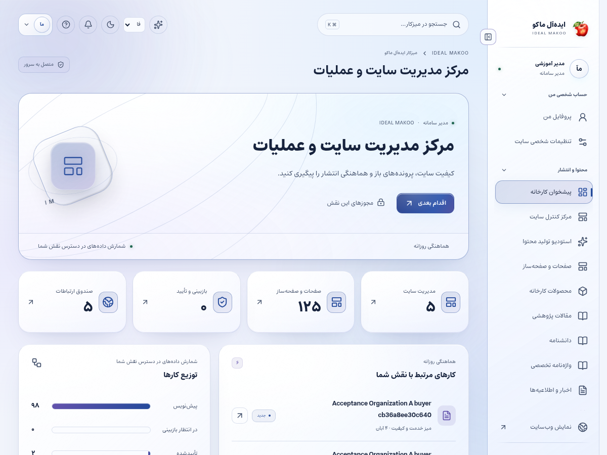
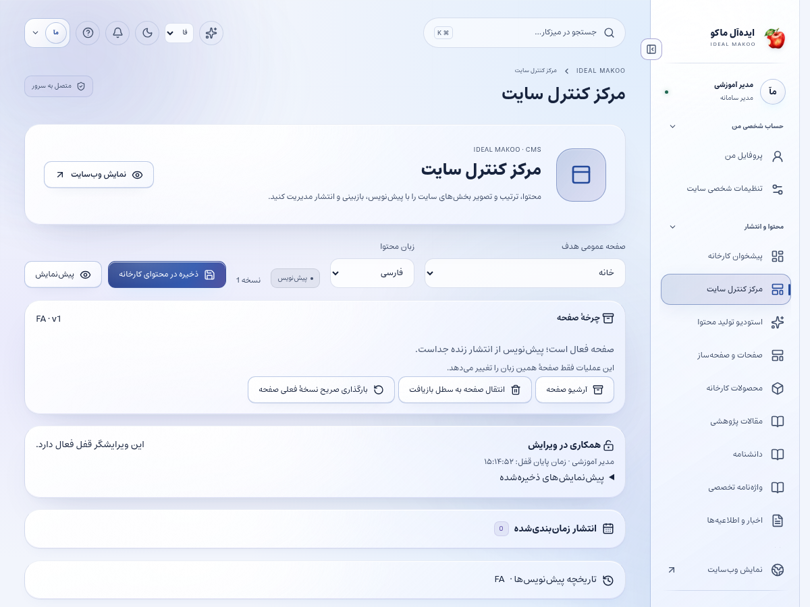
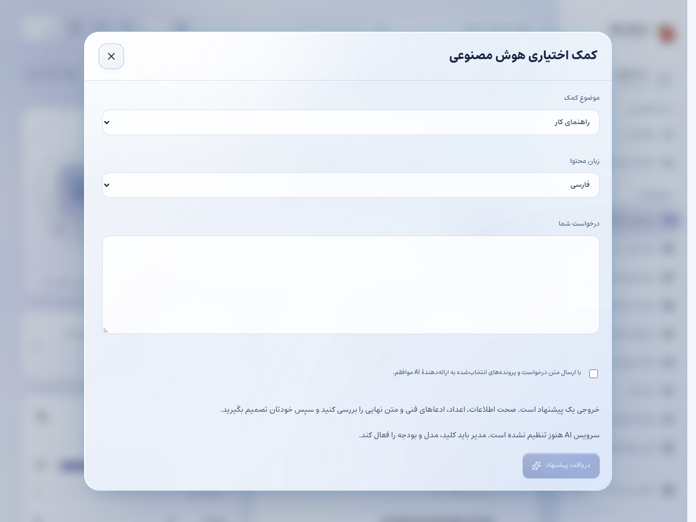

# راهنمای مدیر سایت و عملیات

نسخهٔ ۲٫۲ ایده‌آل ماکو | آموزش کاربر غیرمتخصص | ۲۶ اکتبر ۲۰۲۶

وظیفهٔ شما هماهنگی روزمرهٔ محتوا، کاربران در سقف اختیار، پیام‌ها و کیفیت کار سایت است. هر روز صف‌های باز و خطاهای اثرگذار بر مشتری را بررسی کنید و کار را به مسئول مشخص بسپارید.

## پیش از شروع

برای ورود، از نشانی رسمی سایت و حساب اختصاصی خود استفاده کنید. کارکنان باید علاوه بر رمز، مرحلهٔ MFA را کامل کنند. اگر حساب غیرفعال یا مجوز شما تغییر کرده باشد، ممکن است نیاز به ورود مجدد داشته باشید. یک دکمهٔ پنهان یا خطای دسترسی را با حساب همکار دور نزنید؛ موضوع را به مالک سامانه ارجاع دهید.

زبان رابط با زبان محتوای در حال ویرایش یکسان فرض نمی‌شود. در هر فرم به انتخابگر زبان محتوا توجه کنید. بعضی نقش‌ها فقط یک یا چند زبان مقصد دارند. در متن فارسی و عربی، نشانی اینترنتی و عدد و نام انگلیسی را در پیش‌نمایش کنترل کنید.

برای آشنایی با همان صفحه، علامت سؤال یا راهنمای زمینه‌ای را باز کنید. در آن راهنمای متناسب با نقش و صفحه قرار دارد. این کتابچه گردش کامل یک کار را توضیح می‌دهد و راهنمای زمینه‌ای برای یادآوری حین انجام کار مناسب است.

## صفحه‌های موردنیاز

| صفحه | مسیر |
| --- | --- |
| پیشخوان | `/fa/admin/` |
| کنترل سایت | `/fa/admin/content/` |
| کاربران | `/fa/admin/staff/` |
| بازبینی | `/fa/admin/reviews/` |
| ارتباطات | `/fa/admin/communications/` |
| ورودی CRM | `/fa/admin/crm/inbox/` |

مسیرهای جدول نسبت به دامنهٔ نصب شما هستند. برای زبان دیگر، بخش fa تغییر می‌کند. فقط صفحه‌ها و دکمه‌های مجاز حساب فعلی قابل استفاده‌اند.

شکل ۱ ـ پیشخوان همین نسخه با حساب آموزشی. اعداد این تصویر، آمار کسب‌وکار واقعی نیستند.

## گردش اصلی کار

### رساندن یک اصلاح محتوایی به انتشار و پیگیری نتیجه

1. با حساب اختصاصی مدیر وارد شوید و مرحلهٔ MFA را انجام دهید. زبان رابط را انتخاب کنید؛ زبان محتوای قابل ویرایش را در خود ویرایشگر جدا بررسی کنید.

2. پیشخوان را باز کنید و تعداد درخواست‌ها، صف بازبینی و خطاهای ارسال را ببینید. ابتدا موضوعی را که بر مشتری منتظر اثر دارد پیگیری کنید.

3. در کنترل سایت یا صفحات، صفحهٔ موردنظر را با نام و زبان پیدا کنید. قبل از ویرایش، نسخهٔ فعلی عمومی را در برگهٔ جدا باز کنید.

4. ویرایشگر را باز کنید و اگر قفل ویرایش متعلق به همکار است، هماهنگ کنید. بازخوانی اجباری بدون نگهداری تغییرات محلی ممکن است کار خودتان را از دست بدهد.

5. در کنترل سایت، عنوان و خلاصه و محتوای بلوک و تصویر و دسته/برچسب را اصلاح کنید. فیلد اختصاصی عنوان و توضیح SEO خبر یا پژوهش در ویرایشگر همان بخش قرار دارد؛ برای سیاست کلی SEO به تنظیمات مجاز مدیر بروید. لینک‌ها و ادعای محصول را با منبع تطبیق دهید.

6. پیش‌نویس را ذخیره کنید. تا دریافت پاسخ موفق، صفحه یا زبان را عوض نکنید. بعد از خطا متن را نگه دارید و علت را بررسی کنید.

7. برای بازبینی مستقل ارسال کنید. اگر خودتان نویسندهٔ نسخه بوده‌اید، تأیید مستقل باید توسط همکار مجاز دیگر انجام شود.

8. پس از تأیید، ناشر یا فرد دارای مجوز انتشار نسخهٔ همان زبان را منتشر می‌کند. ذخیرهٔ پیش‌نویس با انتشار فرق دارد.

9. صفحهٔ عمومی را تازه کنید و عنوان، تصویر، لینک و جهت متن را در اندازهٔ موبایل و دسکتاپ بررسی کنید.

10. اگر انتشار اعلان دارد، در ارتباطات وضعیت صف و پاسخ provider را بررسی کنید. شکست یک کانال را با موفقیت کانال دیگر اشتباه نگیرید.

11. نظرهای pending و گزارش‌های کاربران را در بخش بررسی دیدگاه‌ها و گزارش‌ها باز کنید. متن را با محتوای مادر مقایسه و تصمیم روشن ثبت کنید.

12. موضوع را در کار روزانه با مسئول و نتیجه ببندید؛ پرونده‌ای که صرفاً دیده شده ولی پاسخ یا تصمیم ندارد، تمام‌شده نیست.

شکل ۲ ـ بخش اصلی کار این نقش. نام حساب‌ها آموزشی است؛ اطلاعات مشتری یا رمز در تصویر درج نشده است.

## مدیریت کاربران

در کاربران می‌توانید حساب‌های مجاز را ایجاد یا اصلاح کنید. تغییر سطح مالک، مجوزهای حساس یا حساب خودتان ممکن است محدود باشد؛ این محدودیت را با استفاده از حساب دیگری دور نزنید و به مالک ارجاع دهید.

## قالب اعلان

در مرکز ارتباطات، زبان و قالب را انتخاب و متن را ویرایش کنید. متغیرهایی مانند لینک و شمارهٔ پیگیری باید حفظ شوند. قالب پیش از فعال‌شدن از فرایند بازبینی و انتشار می‌گذرد؛ پیام آزمایشی برای مقصد واقعی نیازمند تصمیم صریح سازمان است.

## رسیدگی به خطا

از پیام خطا، شناسهٔ درخواست و زمان رخداد استفاده کنید. تصویر حاوی کلید یا اطلاعات شخصی مشتری را در گروه عمومی منتشر نکنید. در خطای نسخهٔ هم‌زمان، تغییر خود را نگه دارید و نسخهٔ سرور را دوباره بگیرید.

## شناخت و تکمیل حساب مشتری پیامکی

در فهرست کاربران، ستون ایمیل / تلفن ورود برای حساب بدون ایمیل، شمارهٔ تأییدشده را نشان می‌دهد. شماره را برای جستجو وارد کنید و پیش از اصلاح، هویت حساب را با شمارهٔ تأییدشدهٔ فقط‌خواندنی تطبیق دهید. تلفن تماسِ قابل ویرایش در پروفایل، شمارهٔ ورود را تغییر نمی‌دهد. برای اصلاح اطلاعات دیگر لازم نیست ایمیل ساختگی وارد کنید. اگر مشتری ایمیل واقعی می‌خواهد، در فیلد ایمیل ثبت و ذخیره کنید؛ این کار نشست قبلی را پایان می‌دهد و ایمیل هنوز نیازمند تأیید است. مشتری پس از ورود مجدد می‌تواند پیوند تأیید و در صورت نیاز بازیابی رمز را استفاده کند. پیش از تبدیل حساب پیامکی مشتری به نقش کارمند، ایمیل واقعی لازم است و کارکنان باید رمز و MFA داشته باشند.

## تصویر دستیار اختیاری

این تصویر با حساب آموزشی مدیر تهیه شده است؛ موضوع‌های قابل انتخاب برای هر نقش متفاوت‌اند. هیچ فرمان تولید یا ارسال در تهیهٔ تصویر اجرا نشده است.

## ذخیره و وضعیت کار

در کارهای محتوایی ابتدا پیش‌نویس را ذخیره کنید، منتظر پاسخ موفق بمانید و بعد صفحه یا زبان را تغییر دهید. بعضی ویرایشگرها قفل همکاری دارند تا دو نفر هم‌زمان کار یکدیگر را بازنویسی نکنند. اگر پیام تغییر نسخه یا قفل مشاهده شد، متن خود را نگه دارید، با همکار هماهنگ کنید و نسخهٔ تازه را آگاهانه بارگذاری کنید.

وضعیت‌های رایج را جدا بدانید: draft یعنی کار ذخیره‌شده ولی آمادهٔ نمایش عمومی نیست؛ review یعنی در انتظار بررسی؛ approved یعنی نسخهٔ مشخص تأیید شده؛ scheduled یعنی در صف زمان‌بندی؛ published یعنی نسخهٔ همان زبان منتشر شده؛ archived یا withdrawn یعنی از مسیر عادی انتشار کنار رفته است. تغییر متن پس از تأیید ممکن است به بازبینی تازه نیاز داشته باشد.

## اعلان و پیگیری

اعلان داخلی را از زنگ پنل باز کنید و با لینک همان اعلان به پرونده بروید. برای هشدار ایمیل، پیامک یا تلگرام، سرویس باید توسط مالک تنظیم و کانال شخصی شما تأیید شده باشد. از حساب شخصی ← اعلان‌ها (/fa/account/notifications/) به تنظیمات کانال و رضایت موضوع‌ها بروید؛ این مسیر برای حساب کارکنان هم قابل استفاده است. شمارهٔ ذخیره‌شده در پروفایل به‌تنهایی مجوز ارسال به آن شماره نیست. اگر به پرونده‌ای دسترسی ندارید، انتظار هشدار محتوای خصوصی همان پرونده را نداشته باشید.

پیام کوتاه بیرونی فقط خلاصه و لینک امن را حمل می‌کند؛ تصمیم و پاسخ کامل در پنل ثبت می‌شود. وضعیت صف، شکست، لغو و پذیرش provider را جدا بخوانید. قبل از تکرار ارسال، علت وضعیت قبلی را بررسی کنید تا مخاطب پیام تکراری نگیرد.

## گزارش و مصرف سرویس

در پایین پیشخوان و در گزارش‌های مجاز، کارت «گزارش سایت و مصرف سرویس‌ها» را پیدا کنید. از دکمه‌های «بازدید و تعامل» و «مصرف API و هزینه» استفاده کنید. بازهٔ ۷، ۳۰ یا ۹۰ روز و زبان را مشخص کنید. بازدیدهای این نسخه به مرورگر، محتوا و بازهٔ ۳۰ دقیقه محدود می‌شوند و شمارش قطعی افراد یکتا نیستند. تعداد نظر تأییدشده از صف بررسی جداست.

گزارش مصرف برای مدیر ارشد، مدیر و تحلیلگر در محدودهٔ سازمانی و برای سایر کارکنان در محدودهٔ شخصی مجاز نشان داده می‌شود. هزینهٔ نامعلوم صفر نیست. پیامک با ریال و AI با دلار ممکن است گزارش شود؛ آن‌ها را بدون نرخ تبدیل و سیاست مالی با هم جمع نکنید. حالت accepted یعنی سرویس درخواست را پذیرفته است و خوانده‌شدن پیام توسط مخاطب را اثبات نمی‌کند.

## دستیار اختیاری هوش مصنوعی

دکمهٔ «کمک اختیاری هوش مصنوعی» در نوار بالای پنل است و فقط موضوع‌های مجاز نقش را نشان می‌دهد. موضوع و زبان مجاز را انتخاب کنید، درخواست روشن بنویسید و گزینهٔ رضایت ارسال متن و پرونده‌های انتخابی به ارائه‌دهنده را بخوانید و علامت بزنید؛ سپس «دریافت پیشنهاد» را بزنید. بدون تنظیم کلید/مدل سرویس توسط مالک، تولید غیرفعال است. برای محتوا، SEO، محصول یا راهنمای کار، متن مرجع را خودتان در درخواست بنویسید؛ صرف بازبودن یک صفحه باعث خواندن خودکار آن نمی‌شود. در موضوع مشتری، حداکثر پنج پروندهٔ مجاز را صریح انتخاب کنید تا سرور فقط همان دادهٔ مجاز را بخواند. موضوع تحلیل، آمار ۳۰ روز اخیر زبان انتخاب‌شده را اضافه می‌کند و به فیلتر فعلی جدول وابسته نیست. تولید، با فرمان شما مصرف ایجاد می‌کند. خروجی را بازخوانی کنید؛ پیشنهاد خودکار ذخیره، منتشر، تأیید یا برای مشتری ارسال نمی‌شود. توقف درخواست ممکن است مصرفی را که قبلاً نزد ارائه‌دهنده انجام شده برنگرداند.

نمونهٔ درخواست مناسب:

برای این خبر یک عنوان دقیق، خلاصهٔ کوتاه و توضیح SEO پیشنهاد بده. هیچ گواهی، آمار یا ادعای تأییدنشده اضافه نکن.

## خطاهای رایج و اقدام درست

| نشانه | اقدام |
| --- | --- |
| ورود دوباره خواسته می‌شود | نشست منقضی، حساب غیرفعال یا اختیار تغییر کرده است. متن ذخیره‌نشده را نگه دارید، با حساب خود وارد شوید و در صورت تکرار به مدیر اطلاع دهید. |
| این کار مجاز نیست یا زبان قابل انتخاب نیست | نام نقش، زبان و محدودهٔ پرونده را بررسی کنید. از مالک اصلاح اختیار لازم را بخواهید؛ نقش بالاتر را صرفاً برای دورزدن خطا درخواست نکنید. |
| نسخه تغییر کرده یا ویرایشگر قفل است | همکار دیگری داده را تغییر داده یا قفل معتبر دارد. پیش‌نویس خود را نگه دارید، هماهنگ کنید و نسخهٔ سرور را دوباره بارگذاری کنید. |
| تعداد درخواست زیاد است | محدودیت زمانی برای جلوگیری از سوءاستفاده فعال شده است. زمان اعلام‌شده را صبر کنید و درخواست را پیاپی تکرار نکنید. |
| سرویس تنظیم نشده یا پیام ارسال نشد | کلید، قالب، کانال تأییدشده و سلامت worker باید توسط نقش مجاز بررسی شوند. وضعیت ناموفق را موفق فرض نکنید و کلید را داخل متن خطا نفرستید. |
| محتوا در جست‌وجو پیدا نمی‌شود | نوع، دسته و زبان را بررسی کنید. draft، ترجمهٔ منتشرنشده، محتوای پس‌گرفته‌شده یا سند خصوصی در جست‌وجوی عمومی نمی‌آید. |

## تمرین پایان آموزش

۱. مسیر «رساندن یک اصلاح محتوایی به انتشار و پیگیری نتیجه» را با دادهٔ آموزشی و بدون ارسال ناخواسته به افراد واقعی مرور کنید.

۲. نشان دهید نتیجهٔ کار کجا روی سرور ثبت می‌شود و چه تفاوتی با متن ذخیره‌نشده در مرورگر دارد.

۳. یک خطای دسترسی یا وضعیت انتظار را توضیح دهید و مسیر ارجاع درست را انتخاب کنید.

۴. گزارش یا صفحهٔ نتیجه را دوباره باز کنید و مطمئن شوید اطلاعات درست، زبان درست و وضعیت درست دیده می‌شود.

## تحویل کار به نقش بعدی

نویسنده برای اصلاح متن، بازبین برای دقت علمی، ناشر برای انتشار و مالک برای افزایش اختیار یا تنظیم سرویس.

## حدود اختیار

نقش مدیر اجازهٔ تغییر اختیارات مالک یا دسترسی خودکار به هر فایل خصوصی و هر پرونده را ایجاد نمی‌کند.

## چک‌لیست پایان روز

- کارهای ذخیره‌نشده را تعیین تکلیف کنید و پاسخ موفق سرور را ببینید.
- درخواست یا وظیفهٔ باز را بدون مسئول و اقدام بعدی رها نکنید.
- پیام خطا یا ارسال ناموفق را با اطلاعات لازم و بدون رمز/کلید گزارش کنید.
- روی دستگاه مشترک از حساب خارج شوید.
- برای کار بعدی از راهنمای همان نقش و بخش کمک بگیرید.

## راهنماهای مرتبط

- [سند تفصیلی توسعه](../EXPANSION-SPEC-2.2.fa.md)
- [برنامهٔ اجرا](../IMPLEMENTATION-PLAN-2.2.fa.md)
- [شروع نصب و استفاده](../START-HERE-2.2.0.fa.md)
- [سرویس‌ها و DNS و SEO](../INSTALL-SERVICES-SEO-2.2.fa.md)
- [گزارش آزمون این نسخه](../VERIFICATION-2.2.0.fa.md)
