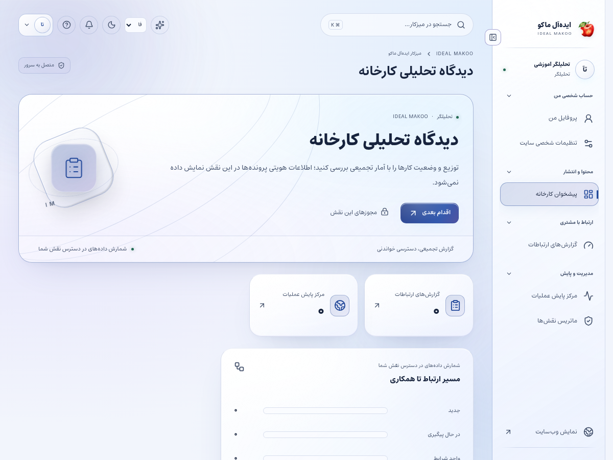
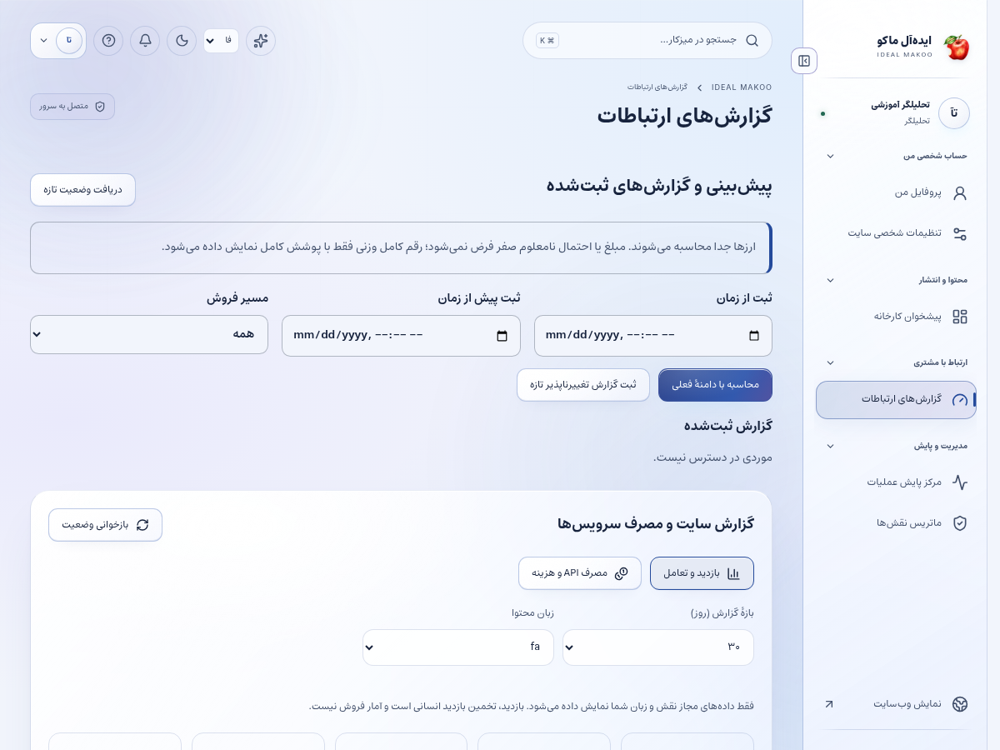
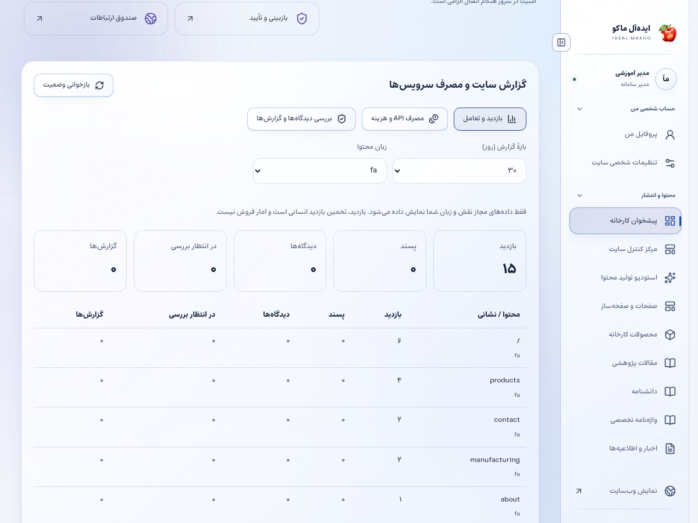

# راهنمای تحلیلگر و مسئول گزارش

نسخهٔ ۲٫۲ ایده‌آل ماکو | آموزش کاربر غیرمتخصص | ۲۶ اکتبر ۲۰۲۶

دادهٔ قابل دسترس را به گزارش قابل فهم برای تصمیم‌گیری تبدیل می‌کنید. هر شاخص باید با بازه، زبان، تعریف و محدودیت اندازه‌گیری خوانده شود.

## پیش از شروع

برای ورود، از نشانی رسمی سایت و حساب اختصاصی خود استفاده کنید. کارکنان باید علاوه بر رمز، مرحلهٔ MFA را کامل کنند. اگر حساب غیرفعال یا مجوز شما تغییر کرده باشد، ممکن است نیاز به ورود مجدد داشته باشید. یک دکمهٔ پنهان یا خطای دسترسی را با حساب همکار دور نزنید؛ موضوع را به مالک سامانه ارجاع دهید.

زبان رابط با زبان محتوای در حال ویرایش یکسان فرض نمی‌شود. در هر فرم به انتخابگر زبان محتوا توجه کنید. بعضی نقش‌ها فقط یک یا چند زبان مقصد دارند. در متن فارسی و عربی، نشانی اینترنتی و عدد و نام انگلیسی را در پیش‌نمایش کنترل کنید.

برای آشنایی با همان صفحه، علامت سؤال یا راهنمای زمینه‌ای را باز کنید. در آن راهنمای متناسب با نقش و صفحه قرار دارد. این کتابچه گردش کامل یک کار را توضیح می‌دهد و راهنمای زمینه‌ای برای یادآوری حین انجام کار مناسب است.

## صفحه‌های موردنیاز

| صفحه | مسیر |
| --- | --- |
| پیشخوان | `/fa/admin/` |
| گزارش‌های CRM | `/fa/admin/crm/reports/` |
| مانیتورینگ مجاز | `/fa/admin/monitoring/` |
| پروفایل | `/fa/admin/profile/` |

مسیرهای جدول نسبت به دامنهٔ نصب شما هستند. برای زبان دیگر، بخش fa تغییر می‌کند. فقط صفحه‌ها و دکمه‌های مجاز حساب فعلی قابل استفاده‌اند.

شکل ۱ ـ پیشخوان همین نسخه با حساب آموزشی. اعداد این تصویر، آمار کسب‌وکار واقعی نیستند.

## گردش اصلی کار

### تهیهٔ گزارش هفتگی عملکرد محتوا و مصرف سرویس

1. پیشخوان یا گزارش‌ها را باز کنید. ابتدا بازهٔ زمانی را روی ۷، ۳۰ یا ۹۰ روزِ موردنظر قرار دهید.

2. زبان گزارش محتوا را از زبان‌های مجاز انتخاب کنید. مقایسهٔ دو گزارش با زبان یا بازهٔ متفاوت می‌تواند گمراه‌کننده باشد.

3. بازدید، لایک، نظر تأییدشده، نظر منتظر و گزارش را جدا بخوانید. تعداد بازدید این نسخه برابر تعداد قطعی انسان‌های یکتا نیست.

4. روند روزانه و محتوای پرتوجه را ببینید. افزایش بازدید بدون درخواست مشتری الزاماً موفقیت تجاری نیست.

5. فهرست صفحه‌ها را با آدرس و زبان بررسی کنید. برای شناخت موضوع، صفحهٔ عمومی را باز کنید؛ به شناسهٔ فنی اکتفا نکنید.

6. بخش مصرف سرویس را باز کنید. گروه AI و کانال‌های پیامک/ایمیل/تلگرام را جدا بررسی کنید.

7. تعداد درخواست، مدل، token یا قطعات SMS و وضعیت را بخوانید. مبلغ نامعلوم را صفر در نظر نگیرید.

8. هزینهٔ IRR و USD را جدا گزارش کنید. مبلغ رزروشده یا تخمینی را با فاکتور قطعی جمع نزنید.

9. در مانیتورینگ مجاز، در دسترس بودن و عملکرد صفحات را ببینید. جزئیات امنیتی و زیرساختی که مجوز ندارید بخشی از گزارش این نقش نیست.

10. در دستیار اختیاری، موضوع تحلیل و زبان مجاز را انتخاب کنید. دادهٔ خودکار این موضوع همیشه ۳۰ روز اخیر همان زبان است؛ فیلتر ۷ یا ۹۰ روزِ جدول، بازهٔ خودکار دستیار را تغییر نمی‌دهد. برای تحلیل دیگری، اعداد مجاز و بازه را در درخواست روشن بنویسید.

11. گزارش را با سه بخش بنویسید: مشاهدهٔ قابل اندازه‌گیری، تفسیر محتاطانه و اقدام پیشنهادی با مسئول.

12. برای تصمیم بعدی، زمان بازبینی و معیار موفقیت تعیین کنید. همان بازه و تعریف شاخص را در مقایسهٔ دورهٔ بعد حفظ کنید.

شکل ۲ ـ بخش اصلی کار این نقش. نام حساب‌ها آموزشی است؛ اطلاعات مشتری یا رمز در تصویر درج نشده است.

## معنای بازدید

بازدید به بازهٔ ۳۰ دقیقه برای مرورگر و محتوا محدود می‌شود و از شناسهٔ مشتق‌شده استفاده می‌کند. چند دستگاه یک نفر یا مسدودسازی مرورگر می‌تواند شمارش را تغییر دهد. شاخص برای تحلیل روند است، نه صورت‌حساب قطعی تبلیغات.

## معنای هزینه

accepted یا complete نوع وضعیت عملیات است. دادهٔ هزینه ممکن است واقعی، تخمینی یا نامعلوم باشد. برای مالی، پاسخ provider و تعرفه و واحد پول را با گزارش حساب سازمان تطبیق دهید.

## حریم خصوصی گزارش

گزارش aggregate مجوز دیدن متن خصوصی و شمارهٔ مشتری نمی‌دهد. هنگام خروجی‌گرفتن، فقط دادهٔ مجاز و لازم برای تصمیم را در گزارش قرار دهید.

## تصویر گزارش بازدید و تعامل

این کارت در پایین پیشخوان قرار دارد. بازه و زبان را انتخاب کنید و برای هزینه‌ها به دکمهٔ مصرف API و هزینه بروید. اعداد تصویر آموزشی‌اند.

## ذخیره و وضعیت کار

در کارهای محتوایی ابتدا پیش‌نویس را ذخیره کنید، منتظر پاسخ موفق بمانید و بعد صفحه یا زبان را تغییر دهید. بعضی ویرایشگرها قفل همکاری دارند تا دو نفر هم‌زمان کار یکدیگر را بازنویسی نکنند. اگر پیام تغییر نسخه یا قفل مشاهده شد، متن خود را نگه دارید، با همکار هماهنگ کنید و نسخهٔ تازه را آگاهانه بارگذاری کنید.

وضعیت‌های رایج را جدا بدانید: draft یعنی کار ذخیره‌شده ولی آمادهٔ نمایش عمومی نیست؛ review یعنی در انتظار بررسی؛ approved یعنی نسخهٔ مشخص تأیید شده؛ scheduled یعنی در صف زمان‌بندی؛ published یعنی نسخهٔ همان زبان منتشر شده؛ archived یا withdrawn یعنی از مسیر عادی انتشار کنار رفته است. تغییر متن پس از تأیید ممکن است به بازبینی تازه نیاز داشته باشد.

## اعلان و پیگیری

اعلان داخلی را از زنگ پنل باز کنید و با لینک همان اعلان به پرونده بروید. برای هشدار ایمیل، پیامک یا تلگرام، سرویس باید توسط مالک تنظیم و کانال شخصی شما تأیید شده باشد. از حساب شخصی ← اعلان‌ها (/fa/account/notifications/) به تنظیمات کانال و رضایت موضوع‌ها بروید؛ این مسیر برای حساب کارکنان هم قابل استفاده است. شمارهٔ ذخیره‌شده در پروفایل به‌تنهایی مجوز ارسال به آن شماره نیست. اگر به پرونده‌ای دسترسی ندارید، انتظار هشدار محتوای خصوصی همان پرونده را نداشته باشید.

پیام کوتاه بیرونی فقط خلاصه و لینک امن را حمل می‌کند؛ تصمیم و پاسخ کامل در پنل ثبت می‌شود. وضعیت صف، شکست، لغو و پذیرش provider را جدا بخوانید. قبل از تکرار ارسال، علت وضعیت قبلی را بررسی کنید تا مخاطب پیام تکراری نگیرد.

## گزارش و مصرف سرویس

در پایین پیشخوان و در گزارش‌های مجاز، کارت «گزارش سایت و مصرف سرویس‌ها» را پیدا کنید. از دکمه‌های «بازدید و تعامل» و «مصرف API و هزینه» استفاده کنید. بازهٔ ۷، ۳۰ یا ۹۰ روز و زبان را مشخص کنید. بازدیدهای این نسخه به مرورگر، محتوا و بازهٔ ۳۰ دقیقه محدود می‌شوند و شمارش قطعی افراد یکتا نیستند. تعداد نظر تأییدشده از صف بررسی جداست.

گزارش مصرف برای مدیر ارشد، مدیر و تحلیلگر در محدودهٔ سازمانی و برای سایر کارکنان در محدودهٔ شخصی مجاز نشان داده می‌شود. هزینهٔ نامعلوم صفر نیست. پیامک با ریال و AI با دلار ممکن است گزارش شود؛ آن‌ها را بدون نرخ تبدیل و سیاست مالی با هم جمع نکنید. حالت accepted یعنی سرویس درخواست را پذیرفته است و خوانده‌شدن پیام توسط مخاطب را اثبات نمی‌کند.

## دستیار اختیاری هوش مصنوعی

دکمهٔ «کمک اختیاری هوش مصنوعی» در نوار بالای پنل است و فقط موضوع‌های مجاز نقش را نشان می‌دهد. موضوع و زبان مجاز را انتخاب کنید، درخواست روشن بنویسید و گزینهٔ رضایت ارسال متن و پرونده‌های انتخابی به ارائه‌دهنده را بخوانید و علامت بزنید؛ سپس «دریافت پیشنهاد» را بزنید. بدون تنظیم کلید/مدل سرویس توسط مالک، تولید غیرفعال است. برای محتوا، SEO، محصول یا راهنمای کار، متن مرجع را خودتان در درخواست بنویسید؛ صرف بازبودن یک صفحه باعث خواندن خودکار آن نمی‌شود. در موضوع مشتری، حداکثر پنج پروندهٔ مجاز را صریح انتخاب کنید تا سرور فقط همان دادهٔ مجاز را بخواند. موضوع تحلیل، آمار ۳۰ روز اخیر زبان انتخاب‌شده را اضافه می‌کند و به فیلتر فعلی جدول وابسته نیست. تولید، با فرمان شما مصرف ایجاد می‌کند. خروجی را بازخوانی کنید؛ پیشنهاد خودکار ذخیره، منتشر، تأیید یا برای مشتری ارسال نمی‌شود. توقف درخواست ممکن است مصرفی را که قبلاً نزد ارائه‌دهنده انجام شده برنگرداند.

نمونهٔ درخواست مناسب:

براساس آمار ۳۰ روز اخیر زبان انتخاب‌شده، روندها را توصیف کن و فرضیه‌ها را از واقعیت‌های ثبت‌شده جدا کن. سه اقدام قابل سنجش پیشنهاد بده و محدودیت نمونه را بگو.

## خطاهای رایج و اقدام درست

| نشانه | اقدام |
| --- | --- |
| ورود دوباره خواسته می‌شود | نشست منقضی، حساب غیرفعال یا اختیار تغییر کرده است. متن ذخیره‌نشده را نگه دارید، با حساب خود وارد شوید و در صورت تکرار به مدیر اطلاع دهید. |
| این کار مجاز نیست یا زبان قابل انتخاب نیست | نام نقش، زبان و محدودهٔ پرونده را بررسی کنید. از مالک اصلاح اختیار لازم را بخواهید؛ نقش بالاتر را صرفاً برای دورزدن خطا درخواست نکنید. |
| نسخه تغییر کرده یا ویرایشگر قفل است | همکار دیگری داده را تغییر داده یا قفل معتبر دارد. پیش‌نویس خود را نگه دارید، هماهنگ کنید و نسخهٔ سرور را دوباره بارگذاری کنید. |
| تعداد درخواست زیاد است | محدودیت زمانی برای جلوگیری از سوءاستفاده فعال شده است. زمان اعلام‌شده را صبر کنید و درخواست را پیاپی تکرار نکنید. |
| سرویس تنظیم نشده یا پیام ارسال نشد | کلید، قالب، کانال تأییدشده و سلامت worker باید توسط نقش مجاز بررسی شوند. وضعیت ناموفق را موفق فرض نکنید و کلید را داخل متن خطا نفرستید. |
| محتوا در جست‌وجو پیدا نمی‌شود | نوع، دسته و زبان را بررسی کنید. draft، ترجمهٔ منتشرنشده، محتوای پس‌گرفته‌شده یا سند خصوصی در جست‌وجوی عمومی نمی‌آید. |

## تمرین پایان آموزش

۱. مسیر «تهیهٔ گزارش هفتگی عملکرد محتوا و مصرف سرویس» را با دادهٔ آموزشی و بدون ارسال ناخواسته به افراد واقعی مرور کنید.

۲. نشان دهید نتیجهٔ کار کجا روی سرور ثبت می‌شود و چه تفاوتی با متن ذخیره‌نشده در مرورگر دارد.

۳. یک خطای دسترسی یا وضعیت انتظار را توضیح دهید و مسیر ارجاع درست را انتخاب کنید.

۴. گزارش یا صفحهٔ نتیجه را دوباره باز کنید و مطمئن شوید اطلاعات درست، زبان درست و وضعیت درست دیده می‌شود.

## تحویل کار به نقش بعدی

مدیر برای اقدام، نویسنده/ناشر برای بهبود محتوا، تیم فنی برای افت عملکرد و مالک برای بودجه.

## حدود اختیار

تحلیلگر نقش انتشار یا مدیریت کاربران ندارد. دسترسی به aggregate نباید به انتشار اطلاعات شخصی یا ادعای علت قطعی بدون شاهد تبدیل شود.

## چک‌لیست پایان روز

- کارهای ذخیره‌نشده را تعیین تکلیف کنید و پاسخ موفق سرور را ببینید.
- درخواست یا وظیفهٔ باز را بدون مسئول و اقدام بعدی رها نکنید.
- پیام خطا یا ارسال ناموفق را با اطلاعات لازم و بدون رمز/کلید گزارش کنید.
- روی دستگاه مشترک از حساب خارج شوید.
- برای کار بعدی از راهنمای همان نقش و بخش کمک بگیرید.

## راهنماهای مرتبط

- [سند تفصیلی توسعه](../EXPANSION-SPEC-2.2.fa.md)
- [برنامهٔ اجرا](../IMPLEMENTATION-PLAN-2.2.fa.md)
- [شروع نصب و استفاده](../START-HERE-2.2.0.fa.md)
- [سرویس‌ها و DNS و SEO](../INSTALL-SERVICES-SEO-2.2.fa.md)
- [گزارش آزمون این نسخه](../VERIFICATION-2.2.0.fa.md)
