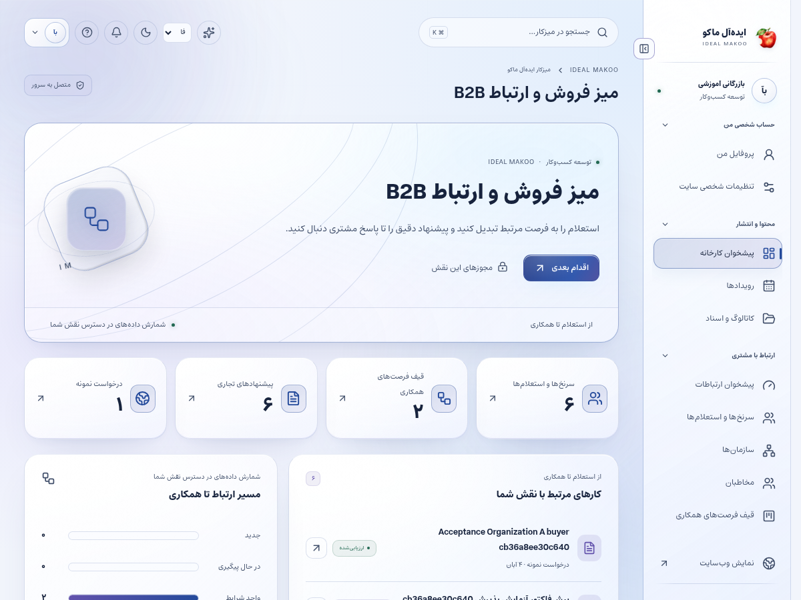
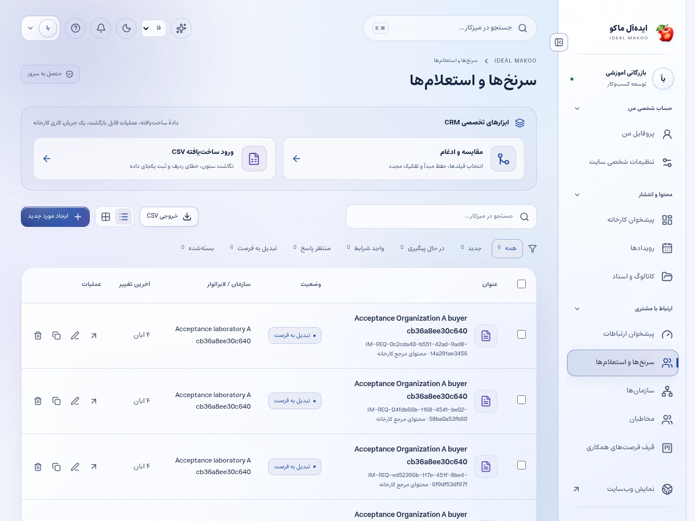

# راهنمای کارشناس بازرگانی و CRM

نسخهٔ ۲٫۲ ایده‌آل ماکو | آموزش کاربر غیرمتخصص | ۲۶ اکتبر ۲۰۲۶

استعلام و فرصت مشتری را از دریافت تا پاسخ و پیشنهاد تجاری پیگیری می‌کنید. کیفیت کار با پاسخ روشن، ثبت مسئول و مرحله و رعایت اختیار مالی سنجیده می‌شود.

## پیش از شروع

برای ورود، از نشانی رسمی سایت و حساب اختصاصی خود استفاده کنید. کارکنان باید علاوه بر رمز، مرحلهٔ MFA را کامل کنند. اگر حساب غیرفعال یا مجوز شما تغییر کرده باشد، ممکن است نیاز به ورود مجدد داشته باشید. یک دکمهٔ پنهان یا خطای دسترسی را با حساب همکار دور نزنید؛ موضوع را به مالک سامانه ارجاع دهید.

زبان رابط با زبان محتوای در حال ویرایش یکسان فرض نمی‌شود. در هر فرم به انتخابگر زبان محتوا توجه کنید. بعضی نقش‌ها فقط یک یا چند زبان مقصد دارند. در متن فارسی و عربی، نشانی اینترنتی و عدد و نام انگلیسی را در پیش‌نمایش کنترل کنید.

برای آشنایی با همان صفحه، علامت سؤال یا راهنمای زمینه‌ای را باز کنید. در آن راهنمای متناسب با نقش و صفحه قرار دارد. این کتابچه گردش کامل یک کار را توضیح می‌دهد و راهنمای زمینه‌ای برای یادآوری حین انجام کار مناسب است.

## صفحه‌های موردنیاز

| صفحه | مسیر |
| --- | --- |
| پیشخوان | `/fa/admin/` |
| CRM | `/fa/admin/crm/` |
| سرنخ‌ها و استعلام | `/fa/admin/crm/leads/` |
| فرصت‌ها | `/fa/admin/crm/opportunities/` |
| پیشنهاد قیمت | `/fa/admin/crm/quotes/` |
| فعالیت‌ها | `/fa/admin/crm/activities/` |
| گزارش | `/fa/admin/crm/reports/` |

مسیرهای جدول نسبت به دامنهٔ نصب شما هستند. برای زبان دیگر، بخش fa تغییر می‌کند. فقط صفحه‌ها و دکمه‌های مجاز حساب فعلی قابل استفاده‌اند.

شکل ۱ ـ پیشخوان همین نسخه با حساب آموزشی. اعداد این تصویر، آمار کسب‌وکار واقعی نیستند.

## گردش اصلی کار

### رسیدگی به یک استعلام تازه

1. پس از ورود و MFA، اعلان داخلی یا بخش سرنخ‌ها/استعلام را باز کنید. هشدار بیرونی فقط راه اطلاع است؛ پروندهٔ اصلی در پنل قرار دارد.

2. شمارهٔ پیگیری، زبان، محصول، تعداد و پیام مشتری را بخوانید. مشتری پیامکی ممکن است ایمیل نداشته باشد و تلفن تأییدشده راه تماس او باشد.

3. محدوده و مالک پرونده را بررسی کنید. اگر پرونده خارج از حوزهٔ شماست، با مدیر برای واگذاری درست هماهنگ کنید.

4. اطلاعات تماس را فقط در صورت داشتن مجوز مربوط مشاهده و استفاده کنید. غیرفعال‌بودن ستون مالی یا تماس با تغییر مرورگر حل نمی‌شود.

5. اگر اطلاعات ناقص است، در همان پرونده سؤال روشن بپرسید. از ساخت پروندهٔ جدید برای ادامهٔ یک گفتگو خودداری کنید.

6. یادداشت داخلی را برای همکاران و پاسخ عمومی را برای مشتری انتخاب کنید. قبل از ذخیره نوع پیام را کنترل کنید.

7. مرحلهٔ پیگیری و فعالیت بعدی و موعد را ثبت کنید. پرونده‌ای که منتظر پاسخ مشتری است باید وضعیت و زمان پیگیری معلوم داشته باشد.

8. برای پیشنهاد قیمت، محصول و مقدار و نسخهٔ قیمت‌نامهٔ مجاز را انتخاب کنید. ارز و تخفیف و مبلغ را با سیاست تجاری کنترل کنید.

9. اگر فرایند تأیید مستقل لازم است، پیشنهاد را برای تأیید ارسال کنید. تغییر مبلغ بعد از تأیید، revision تازه می‌خواهد.

10. نسخهٔ صادرشده را از مسیر پرونده برای مشتری قابل مشاهده کنید. پاسخ مشتری باید به همان نسخهٔ پیشنهاد مربوط باشد.

11. وضعیت اعلان و پاسخ مشتری را پیگیری کنید؛ قبول پیام توسط provider تضمین خوانده‌شدن آن نیست.

12. نتیجهٔ واقعی مذاکره و اقدام بعدی را ثبت کنید. در گزارش، پرونده را با ارزش و احتمال واقعی نگه دارید و دادهٔ ساختگی وارد نکنید.

شکل ۲ ـ بخش اصلی کار این نقش. نام حساب‌ها آموزشی است؛ اطلاعات مشتری یا رمز در تصویر درج نشده است.

## کمک AI در پرونده

در دستیار، پرونده‌های مجاز را صریح انتخاب کنید تا سرور همان دادهٔ مجاز را بخواند. خروجی خلاصه یا پاسخ پیشنهادی است. دستیار قیمت یا تخفیف و تعهد تحویل را به جای شما صادر نمی‌کند.

## تماس تلفنی خارج سایت

تماسی که با تلفن عادی دریافت کرده‌اید را به‌صورت فعالیت در CRM ثبت کنید. سامانه بدون اتصال مرکز تلفن از تماس بیرون سایت باخبر نمی‌شود. فرم درخواست تماس سایت مسیر جداگانهٔ ثبت خودکار دارد.

## کمپین و رضایت

ارسال تبلیغاتی به فهرست مشتریان فقط با رضایت و کانال تأییدشده انجام می‌شود. دریافت یک استعلام به معنی رضایت دائمی برای تبلیغات نیست. لغو عضویت و suppression را رعایت کنید.

## ذخیره و وضعیت کار

در کارهای محتوایی ابتدا پیش‌نویس را ذخیره کنید، منتظر پاسخ موفق بمانید و بعد صفحه یا زبان را تغییر دهید. بعضی ویرایشگرها قفل همکاری دارند تا دو نفر هم‌زمان کار یکدیگر را بازنویسی نکنند. اگر پیام تغییر نسخه یا قفل مشاهده شد، متن خود را نگه دارید، با همکار هماهنگ کنید و نسخهٔ تازه را آگاهانه بارگذاری کنید.

وضعیت‌های رایج را جدا بدانید: draft یعنی کار ذخیره‌شده ولی آمادهٔ نمایش عمومی نیست؛ review یعنی در انتظار بررسی؛ approved یعنی نسخهٔ مشخص تأیید شده؛ scheduled یعنی در صف زمان‌بندی؛ published یعنی نسخهٔ همان زبان منتشر شده؛ archived یا withdrawn یعنی از مسیر عادی انتشار کنار رفته است. تغییر متن پس از تأیید ممکن است به بازبینی تازه نیاز داشته باشد.

## اعلان و پیگیری

اعلان داخلی را از زنگ پنل باز کنید و با لینک همان اعلان به پرونده بروید. برای هشدار ایمیل، پیامک یا تلگرام، سرویس باید توسط مالک تنظیم و کانال شخصی شما تأیید شده باشد. از حساب شخصی ← اعلان‌ها (/fa/account/notifications/) به تنظیمات کانال و رضایت موضوع‌ها بروید؛ این مسیر برای حساب کارکنان هم قابل استفاده است. شمارهٔ ذخیره‌شده در پروفایل به‌تنهایی مجوز ارسال به آن شماره نیست. اگر به پرونده‌ای دسترسی ندارید، انتظار هشدار محتوای خصوصی همان پرونده را نداشته باشید.

پیام کوتاه بیرونی فقط خلاصه و لینک امن را حمل می‌کند؛ تصمیم و پاسخ کامل در پنل ثبت می‌شود. وضعیت صف، شکست، لغو و پذیرش provider را جدا بخوانید. قبل از تکرار ارسال، علت وضعیت قبلی را بررسی کنید تا مخاطب پیام تکراری نگیرد.

## گزارش و مصرف سرویس

در پایین پیشخوان و در گزارش‌های مجاز، کارت «گزارش سایت و مصرف سرویس‌ها» را پیدا کنید. از دکمه‌های «بازدید و تعامل» و «مصرف API و هزینه» استفاده کنید. بازهٔ ۷، ۳۰ یا ۹۰ روز و زبان را مشخص کنید. بازدیدهای این نسخه به مرورگر، محتوا و بازهٔ ۳۰ دقیقه محدود می‌شوند و شمارش قطعی افراد یکتا نیستند. تعداد نظر تأییدشده از صف بررسی جداست.

گزارش مصرف برای مدیر ارشد، مدیر و تحلیلگر در محدودهٔ سازمانی و برای سایر کارکنان در محدودهٔ شخصی مجاز نشان داده می‌شود. هزینهٔ نامعلوم صفر نیست. پیامک با ریال و AI با دلار ممکن است گزارش شود؛ آن‌ها را بدون نرخ تبدیل و سیاست مالی با هم جمع نکنید. حالت accepted یعنی سرویس درخواست را پذیرفته است و خوانده‌شدن پیام توسط مخاطب را اثبات نمی‌کند.

## دستیار اختیاری هوش مصنوعی

دکمهٔ «کمک اختیاری هوش مصنوعی» در نوار بالای پنل است و فقط موضوع‌های مجاز نقش را نشان می‌دهد. موضوع و زبان مجاز را انتخاب کنید، درخواست روشن بنویسید و گزینهٔ رضایت ارسال متن و پرونده‌های انتخابی به ارائه‌دهنده را بخوانید و علامت بزنید؛ سپس «دریافت پیشنهاد» را بزنید. بدون تنظیم کلید/مدل سرویس توسط مالک، تولید غیرفعال است. برای محتوا، SEO، محصول یا راهنمای کار، متن مرجع را خودتان در درخواست بنویسید؛ صرف بازبودن یک صفحه باعث خواندن خودکار آن نمی‌شود. در موضوع مشتری، حداکثر پنج پروندهٔ مجاز را صریح انتخاب کنید تا سرور فقط همان دادهٔ مجاز را بخواند. موضوع تحلیل، آمار ۳۰ روز اخیر زبان انتخاب‌شده را اضافه می‌کند و به فیلتر فعلی جدول وابسته نیست. تولید، با فرمان شما مصرف ایجاد می‌کند. خروجی را بازخوانی کنید؛ پیشنهاد خودکار ذخیره، منتشر، تأیید یا برای مشتری ارسال نمی‌شود. توقف درخواست ممکن است مصرفی را که قبلاً نزد ارائه‌دهنده انجام شده برنگرداند.

نمونهٔ درخواست مناسب:

پروندهٔ انتخاب‌شده را خلاصه کن، اطلاعات ناقص و اقدام بعدی را بگو و یک پاسخ پیشنهادی محترمانه بنویس؛ هیچ قیمت یا وعدهٔ جدید نساز.

## خطاهای رایج و اقدام درست

| نشانه | اقدام |
| --- | --- |
| ورود دوباره خواسته می‌شود | نشست منقضی، حساب غیرفعال یا اختیار تغییر کرده است. متن ذخیره‌نشده را نگه دارید، با حساب خود وارد شوید و در صورت تکرار به مدیر اطلاع دهید. |
| این کار مجاز نیست یا زبان قابل انتخاب نیست | نام نقش، زبان و محدودهٔ پرونده را بررسی کنید. از مالک اصلاح اختیار لازم را بخواهید؛ نقش بالاتر را صرفاً برای دورزدن خطا درخواست نکنید. |
| نسخه تغییر کرده یا ویرایشگر قفل است | همکار دیگری داده را تغییر داده یا قفل معتبر دارد. پیش‌نویس خود را نگه دارید، هماهنگ کنید و نسخهٔ سرور را دوباره بارگذاری کنید. |
| تعداد درخواست زیاد است | محدودیت زمانی برای جلوگیری از سوءاستفاده فعال شده است. زمان اعلام‌شده را صبر کنید و درخواست را پیاپی تکرار نکنید. |
| سرویس تنظیم نشده یا پیام ارسال نشد | کلید، قالب، کانال تأییدشده و سلامت worker باید توسط نقش مجاز بررسی شوند. وضعیت ناموفق را موفق فرض نکنید و کلید را داخل متن خطا نفرستید. |
| محتوا در جست‌وجو پیدا نمی‌شود | نوع، دسته و زبان را بررسی کنید. draft، ترجمهٔ منتشرنشده، محتوای پس‌گرفته‌شده یا سند خصوصی در جست‌وجوی عمومی نمی‌آید. |

## تمرین پایان آموزش

۱. مسیر «رسیدگی به یک استعلام تازه» را با دادهٔ آموزشی و بدون ارسال ناخواسته به افراد واقعی مرور کنید.

۲. نشان دهید نتیجهٔ کار کجا روی سرور ثبت می‌شود و چه تفاوتی با متن ذخیره‌نشده در مرورگر دارد.

۳. یک خطای دسترسی یا وضعیت انتظار را توضیح دهید و مسیر ارجاع درست را انتخاب کنید.

۴. گزارش یا صفحهٔ نتیجه را دوباره باز کنید و مطمئن شوید اطلاعات درست، زبان درست و وضعیت درست دیده می‌شود.

## تحویل کار به نقش بعدی

مدیر محصول برای سؤال فنی، مسئول مالی برای سقف تجاری، پشتیبان برای مشکل خدمت و مدیر برای تخصیص.

## حدود اختیار

سطح نقش بازرگانی به‌تنهایی همهٔ اطلاعات تماس و مالی یا همهٔ پرونده‌ها را باز نمی‌کند. محدوده، تیم و مجوزهای مستقل اعمال می‌شوند.

## چک‌لیست پایان روز

- کارهای ذخیره‌نشده را تعیین تکلیف کنید و پاسخ موفق سرور را ببینید.
- درخواست یا وظیفهٔ باز را بدون مسئول و اقدام بعدی رها نکنید.
- پیام خطا یا ارسال ناموفق را با اطلاعات لازم و بدون رمز/کلید گزارش کنید.
- روی دستگاه مشترک از حساب خارج شوید.
- برای کار بعدی از راهنمای همان نقش و بخش کمک بگیرید.

## راهنماهای مرتبط

- [سند تفصیلی توسعه](../EXPANSION-SPEC-2.2.fa.md)
- [برنامهٔ اجرا](../IMPLEMENTATION-PLAN-2.2.fa.md)
- [شروع نصب و استفاده](../START-HERE-2.2.0.fa.md)
- [سرویس‌ها و DNS و SEO](../INSTALL-SERVICES-SEO-2.2.fa.md)
- [گزارش آزمون این نسخه](../VERIFICATION-2.2.0.fa.md)
