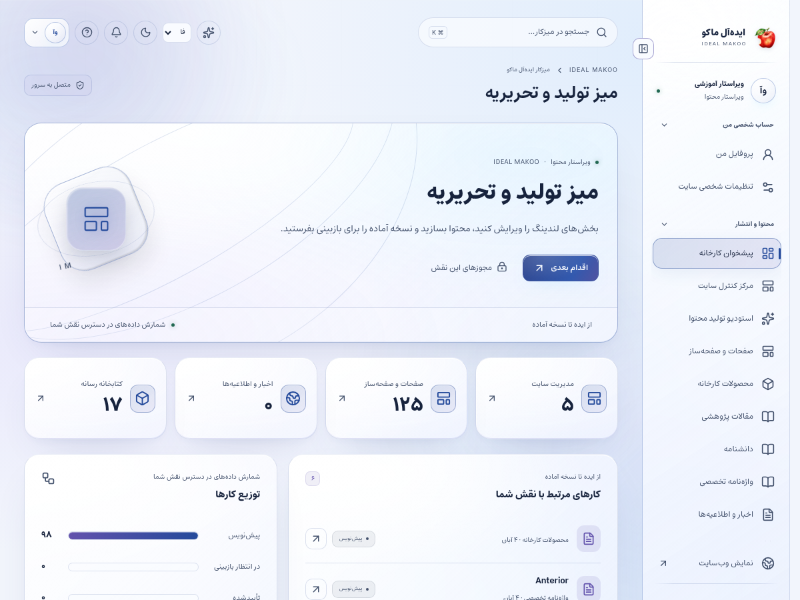
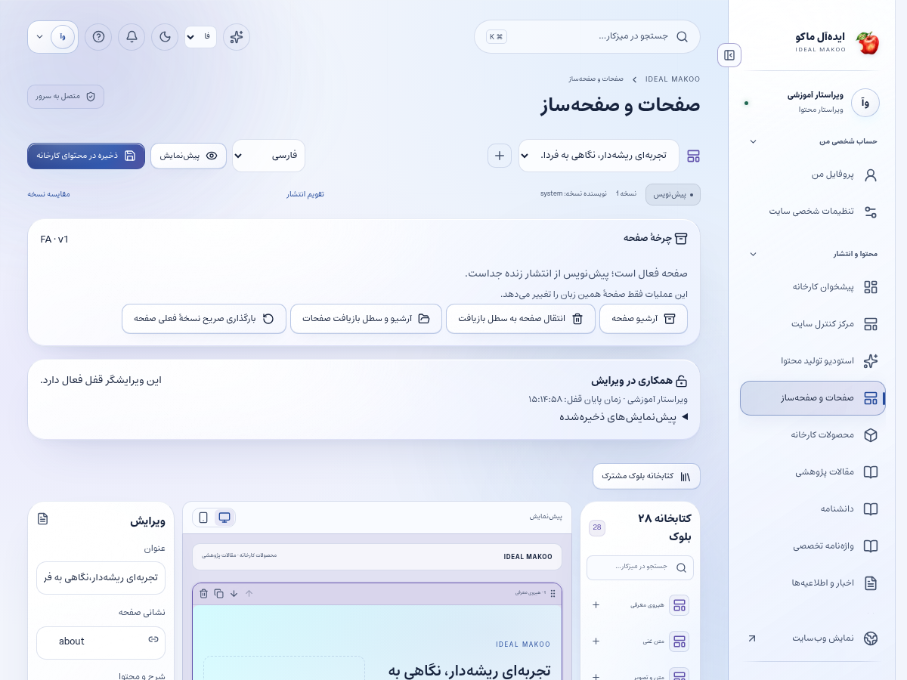

# راهنمای نویسنده و ویراستار محتوا

نسخهٔ ۲٫۲ ایده‌آل ماکو | آموزش کاربر غیرمتخصص | ۲۶ اکتبر ۲۰۲۶

محتوای روشن و مستند می‌سازید، صفحه‌های عمومی را به‌روز می‌کنید و نسخهٔ آماده را برای بازبینی می‌فرستید. مسئولیت شما آماده‌سازی دقیق پیش‌نویس و اصلاح بازخورد است؛ انتشار نهایی به نقش ناشر وابسته است.

## پیش از شروع

برای ورود، از نشانی رسمی سایت و حساب اختصاصی خود استفاده کنید. کارکنان باید علاوه بر رمز، مرحلهٔ MFA را کامل کنند. اگر حساب غیرفعال یا مجوز شما تغییر کرده باشد، ممکن است نیاز به ورود مجدد داشته باشید. یک دکمهٔ پنهان یا خطای دسترسی را با حساب همکار دور نزنید؛ موضوع را به مالک سامانه ارجاع دهید.

زبان رابط با زبان محتوای در حال ویرایش یکسان فرض نمی‌شود. در هر فرم به انتخابگر زبان محتوا توجه کنید. بعضی نقش‌ها فقط یک یا چند زبان مقصد دارند. در متن فارسی و عربی، نشانی اینترنتی و عدد و نام انگلیسی را در پیش‌نمایش کنترل کنید.

برای آشنایی با همان صفحه، علامت سؤال یا راهنمای زمینه‌ای را باز کنید. در آن راهنمای متناسب با نقش و صفحه قرار دارد. این کتابچه گردش کامل یک کار را توضیح می‌دهد و راهنمای زمینه‌ای برای یادآوری حین انجام کار مناسب است.

## صفحه‌های موردنیاز

| صفحه | مسیر |
| --- | --- |
| پیشخوان | `/fa/admin/` |
| صفحات | `/fa/admin/pages/` |
| کنترل سایت و هیرو | `/fa/admin/content/` |
| خبر | `/fa/admin/news/` |
| پژوهش | `/fa/admin/research/` |
| رسانه | `/fa/admin/media/` |
| هوش مصنوعی | `/fa/admin/ai/` |

مسیرهای جدول نسبت به دامنهٔ نصب شما هستند. برای زبان دیگر، بخش fa تغییر می‌کند. فقط صفحه‌ها و دکمه‌های مجاز حساب فعلی قابل استفاده‌اند.

شکل ۱ ـ پیشخوان همین نسخه با حساب آموزشی. اعداد این تصویر، آمار کسب‌وکار واقعی نیستند.

## گردش اصلی کار

### ساخت و آماده‌سازی یک صفحه یا خبر جدید

1. موضوع، مخاطب و منبع اطلاعات را مشخص کنید. پیش از نوشتن، معلوم باشد خواننده پس از مطالعه چه کاری باید انجام دهد.

2. برای صفحهٔ بلوکی، به صفحات بروید و ایجاد را بزنید؛ فرم اولیه عنوان و نشانی slug می‌خواهد. برای خبر، بخش خبر را باز کنید و ایجاد را بزنید؛ این بخش فرم متن مقاله دارد و نشانی رکورد را سامانه می‌سازد.

3. زبان متن را انتخاب کنید و عنوان را بنویسید. در صفحه‌ساز نشانی خوانا و ثابت وارد کنید؛ فیلد نشانی مستقل در فرم عمومی خبر وجود ندارد. تغییر نشانی صفحهٔ منتشرشده نیازمند بررسی لینک‌های قبلی است.

4. دسته و برچسب‌ها را دقیق انتخاب یا وارد کنید. از چند برچسب مشخص مانند نام محصول و موضوع استفاده کنید و برای یک موضوع چند املای متفاوت نسازید.

5. خلاصه‌ای بنویسید که موضوع و فایدهٔ صفحه را توضیح دهد. جملهٔ تبلیغاتی تکراری جای خلاصهٔ واقعی محتوا نیست.

6. در صفحه‌ساز، بلوک لازم مثل متن، تصویر، گالری یا فراخوان را از ستون بلوک‌ها اضافه کنید و بلوک انتخاب‌شده را در ستون ویرایش اصلاح کنید. در خبر، متن اصلی را در ویرایشگر متن کامل بنویسید. بخش خالی یا پنهان را در پیش‌نمایش بررسی کنید.

7. تصویر را از رسانهٔ مجاز انتخاب کنید و عنوان بلوک تصویر را توصیفی بنویسید. اگر فرم رسانه فیلد توضیح جایگزین دارد، آن را هم تکمیل کنید. فایل منتظر اسکن یا فاقد مجوز انتشار را عمومی نکنید.

8. در ویرایشگر خبر یا پژوهش، عنوان و توضیح SEO را در بخش مربوط تکمیل کنید. در صفحه‌ساز، عنوان و خلاصهٔ صفحه مبنای نمایش‌اند و تنظیم عمومی SEO با مدیر است. عنوان باید موضوع همان صفحه را بیان کند؛ کلمهٔ کلیدی را غیرطبیعی تکرار نکنید.

9. اگر از AI کمک می‌گیرید، درخواست روشن بدهید و متن پیشنهادی را با منبع تطبیق دهید. خروجی را فقط پس از بازخوانی به پیش‌نویس منتقل کنید.

10. ذخیره کنید و پاسخ موفق را ببینید. پیش‌نمایش موبایل، لینک دکمه‌ها و چیدمان راست‌به‌چپ را بررسی کنید.

11. وضعیت را برای بازبینی ارسال کنید. به بازبین بگویید کدام منبع و کدام تغییر مهم است. محتوای ارسال‌شده هنوز لزوماً عمومی نیست.

12. بازخورد بازبین را اصلاح و نسخهٔ جدید ذخیره کنید. پس از تغییر متن، تأیید نسخهٔ قبلی به‌طور خودکار تأیید همهٔ تغییرهای جدید نیست.

شکل ۲ ـ بخش اصلی کار این نقش. نام حساب‌ها آموزشی است؛ اطلاعات مشتری یا رمز در تصویر درج نشده است.

## ویرایش هیرو

در کنترل سایت، خانه و زبان را انتخاب کنید. عنوان، توضیح و دکمه‌های بخش نخست قابل اصلاح‌اند. حالت صحنه گرافیک سه‌بعدی را حفظ می‌کند و حالت تصویر رسانهٔ انتخابی را نشان می‌دهد. قبل از جابه‌جایی بخش‌ها، ترتیب فعلی را در پیش‌نمایش ببینید.

## ترجمه و تکرار محتوا

یک صفحهٔ فارسی به معنی نسخهٔ کامل چهار زبان دیگر نیست. متن مقصد باید ترجمه و بازبینی شود. انتشار هر زبان مستقل است؛ بهتر است منبع اعداد، نام برند و اصطلاحات فنی را همراه پیش‌نویس ثبت کنید.

## تصحیح بعد از انتشار

نسخهٔ عمومی را مستقیم با متن نیمه‌کاره عوض نکنید. اصلاح را در پیش‌نویس انجام دهید، برای بازبینی بفرستید و پس از انتشار صفحه و لینک‌هایش را کنترل کنید.

## ذخیره و وضعیت کار

در کارهای محتوایی ابتدا پیش‌نویس را ذخیره کنید، منتظر پاسخ موفق بمانید و بعد صفحه یا زبان را تغییر دهید. بعضی ویرایشگرها قفل همکاری دارند تا دو نفر هم‌زمان کار یکدیگر را بازنویسی نکنند. اگر پیام تغییر نسخه یا قفل مشاهده شد، متن خود را نگه دارید، با همکار هماهنگ کنید و نسخهٔ تازه را آگاهانه بارگذاری کنید.

وضعیت‌های رایج را جدا بدانید: draft یعنی کار ذخیره‌شده ولی آمادهٔ نمایش عمومی نیست؛ review یعنی در انتظار بررسی؛ approved یعنی نسخهٔ مشخص تأیید شده؛ scheduled یعنی در صف زمان‌بندی؛ published یعنی نسخهٔ همان زبان منتشر شده؛ archived یا withdrawn یعنی از مسیر عادی انتشار کنار رفته است. تغییر متن پس از تأیید ممکن است به بازبینی تازه نیاز داشته باشد.

## اعلان و پیگیری

اعلان داخلی را از زنگ پنل باز کنید و با لینک همان اعلان به پرونده بروید. برای هشدار ایمیل، پیامک یا تلگرام، سرویس باید توسط مالک تنظیم و کانال شخصی شما تأیید شده باشد. از حساب شخصی ← اعلان‌ها (/fa/account/notifications/) به تنظیمات کانال و رضایت موضوع‌ها بروید؛ این مسیر برای حساب کارکنان هم قابل استفاده است. شمارهٔ ذخیره‌شده در پروفایل به‌تنهایی مجوز ارسال به آن شماره نیست. اگر به پرونده‌ای دسترسی ندارید، انتظار هشدار محتوای خصوصی همان پرونده را نداشته باشید.

پیام کوتاه بیرونی فقط خلاصه و لینک امن را حمل می‌کند؛ تصمیم و پاسخ کامل در پنل ثبت می‌شود. وضعیت صف، شکست، لغو و پذیرش provider را جدا بخوانید. قبل از تکرار ارسال، علت وضعیت قبلی را بررسی کنید تا مخاطب پیام تکراری نگیرد.

## گزارش و مصرف سرویس

در پایین پیشخوان و در گزارش‌های مجاز، کارت «گزارش سایت و مصرف سرویس‌ها» را پیدا کنید. از دکمه‌های «بازدید و تعامل» و «مصرف API و هزینه» استفاده کنید. بازهٔ ۷، ۳۰ یا ۹۰ روز و زبان را مشخص کنید. بازدیدهای این نسخه به مرورگر، محتوا و بازهٔ ۳۰ دقیقه محدود می‌شوند و شمارش قطعی افراد یکتا نیستند. تعداد نظر تأییدشده از صف بررسی جداست.

گزارش مصرف برای مدیر ارشد، مدیر و تحلیلگر در محدودهٔ سازمانی و برای سایر کارکنان در محدودهٔ شخصی مجاز نشان داده می‌شود. هزینهٔ نامعلوم صفر نیست. پیامک با ریال و AI با دلار ممکن است گزارش شود؛ آن‌ها را بدون نرخ تبدیل و سیاست مالی با هم جمع نکنید. حالت accepted یعنی سرویس درخواست را پذیرفته است و خوانده‌شدن پیام توسط مخاطب را اثبات نمی‌کند.

## دستیار اختیاری هوش مصنوعی

دکمهٔ «کمک اختیاری هوش مصنوعی» در نوار بالای پنل است و فقط موضوع‌های مجاز نقش را نشان می‌دهد. موضوع و زبان مجاز را انتخاب کنید، درخواست روشن بنویسید و گزینهٔ رضایت ارسال متن و پرونده‌های انتخابی به ارائه‌دهنده را بخوانید و علامت بزنید؛ سپس «دریافت پیشنهاد» را بزنید. بدون تنظیم کلید/مدل سرویس توسط مالک، تولید غیرفعال است. برای محتوا، SEO، محصول یا راهنمای کار، متن مرجع را خودتان در درخواست بنویسید؛ صرف بازبودن یک صفحه باعث خواندن خودکار آن نمی‌شود. در موضوع مشتری، حداکثر پنج پروندهٔ مجاز را صریح انتخاب کنید تا سرور فقط همان دادهٔ مجاز را بخواند. موضوع تحلیل، آمار ۳۰ روز اخیر زبان انتخاب‌شده را اضافه می‌کند و به فیلتر فعلی جدول وابسته نیست. تولید، با فرمان شما مصرف ایجاد می‌کند. خروجی را بازخوانی کنید؛ پیشنهاد خودکار ذخیره، منتشر، تأیید یا برای مشتری ارسال نمی‌شود. توقف درخواست ممکن است مصرفی را که قبلاً نزد ارائه‌دهنده انجام شده برنگرداند.

نمونهٔ درخواست مناسب:

بر اساس متن زیر یک خبر کارخانه با تیتر، لید و سه پاراگراف بنویس؛ نام‌ها و عددها را عین منبع حفظ کن و قسمت‌های نیازمند منبع را مشخص کن.

## خطاهای رایج و اقدام درست

| نشانه | اقدام |
| --- | --- |
| ورود دوباره خواسته می‌شود | نشست منقضی، حساب غیرفعال یا اختیار تغییر کرده است. متن ذخیره‌نشده را نگه دارید، با حساب خود وارد شوید و در صورت تکرار به مدیر اطلاع دهید. |
| این کار مجاز نیست یا زبان قابل انتخاب نیست | نام نقش، زبان و محدودهٔ پرونده را بررسی کنید. از مالک اصلاح اختیار لازم را بخواهید؛ نقش بالاتر را صرفاً برای دورزدن خطا درخواست نکنید. |
| نسخه تغییر کرده یا ویرایشگر قفل است | همکار دیگری داده را تغییر داده یا قفل معتبر دارد. پیش‌نویس خود را نگه دارید، هماهنگ کنید و نسخهٔ سرور را دوباره بارگذاری کنید. |
| تعداد درخواست زیاد است | محدودیت زمانی برای جلوگیری از سوءاستفاده فعال شده است. زمان اعلام‌شده را صبر کنید و درخواست را پیاپی تکرار نکنید. |
| سرویس تنظیم نشده یا پیام ارسال نشد | کلید، قالب، کانال تأییدشده و سلامت worker باید توسط نقش مجاز بررسی شوند. وضعیت ناموفق را موفق فرض نکنید و کلید را داخل متن خطا نفرستید. |
| محتوا در جست‌وجو پیدا نمی‌شود | نوع، دسته و زبان را بررسی کنید. draft، ترجمهٔ منتشرنشده، محتوای پس‌گرفته‌شده یا سند خصوصی در جست‌وجوی عمومی نمی‌آید. |

## تمرین پایان آموزش

۱. مسیر «ساخت و آماده‌سازی یک صفحه یا خبر جدید» را با دادهٔ آموزشی و بدون ارسال ناخواسته به افراد واقعی مرور کنید.

۲. نشان دهید نتیجهٔ کار کجا روی سرور ثبت می‌شود و چه تفاوتی با متن ذخیره‌نشده در مرورگر دارد.

۳. یک خطای دسترسی یا وضعیت انتظار را توضیح دهید و مسیر ارجاع درست را انتخاب کنید.

۴. گزارش یا صفحهٔ نتیجه را دوباره باز کنید و مطمئن شوید اطلاعات درست، زبان درست و وضعیت درست دیده می‌شود.

## تحویل کار به نقش بعدی

بازبین علمی برای کنترل ادعا، مترجم برای زبان مقصد، ناشر برای انتشار و مدیر برای تصمیم محتوایی.

## حدود اختیار

نویسنده نمی‌تواند با ذخیرهٔ یک draft آن را منتشر کند یا نظر عمومی را تأیید کند. تغییر مجوز کاربران و قیمت تجاری اختصاصی در اختیار این نقش نیست.

## چک‌لیست پایان روز

- کارهای ذخیره‌نشده را تعیین تکلیف کنید و پاسخ موفق سرور را ببینید.
- درخواست یا وظیفهٔ باز را بدون مسئول و اقدام بعدی رها نکنید.
- پیام خطا یا ارسال ناموفق را با اطلاعات لازم و بدون رمز/کلید گزارش کنید.
- روی دستگاه مشترک از حساب خارج شوید.
- برای کار بعدی از راهنمای همان نقش و بخش کمک بگیرید.

## راهنماهای مرتبط

- [سند تفصیلی توسعه](../EXPANSION-SPEC-2.2.fa.md)
- [برنامهٔ اجرا](../IMPLEMENTATION-PLAN-2.2.fa.md)
- [شروع نصب و استفاده](../START-HERE-2.2.0.fa.md)
- [سرویس‌ها و DNS و SEO](../INSTALL-SERVICES-SEO-2.2.fa.md)
- [گزارش آزمون این نسخه](../VERIFICATION-2.2.0.fa.md)
