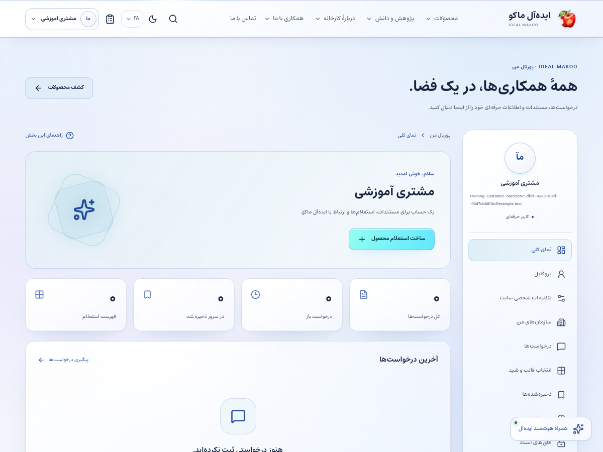
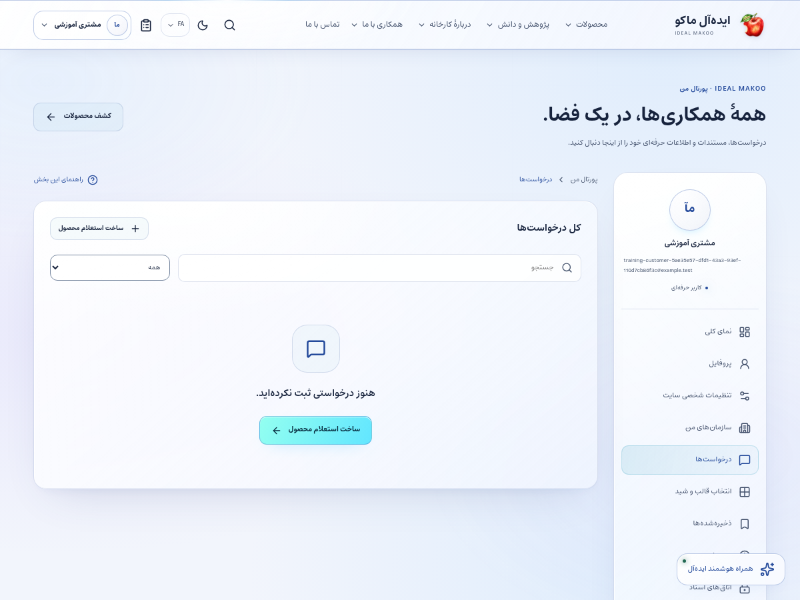
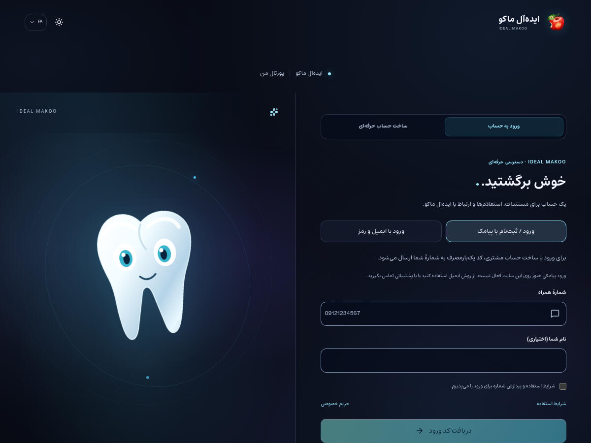
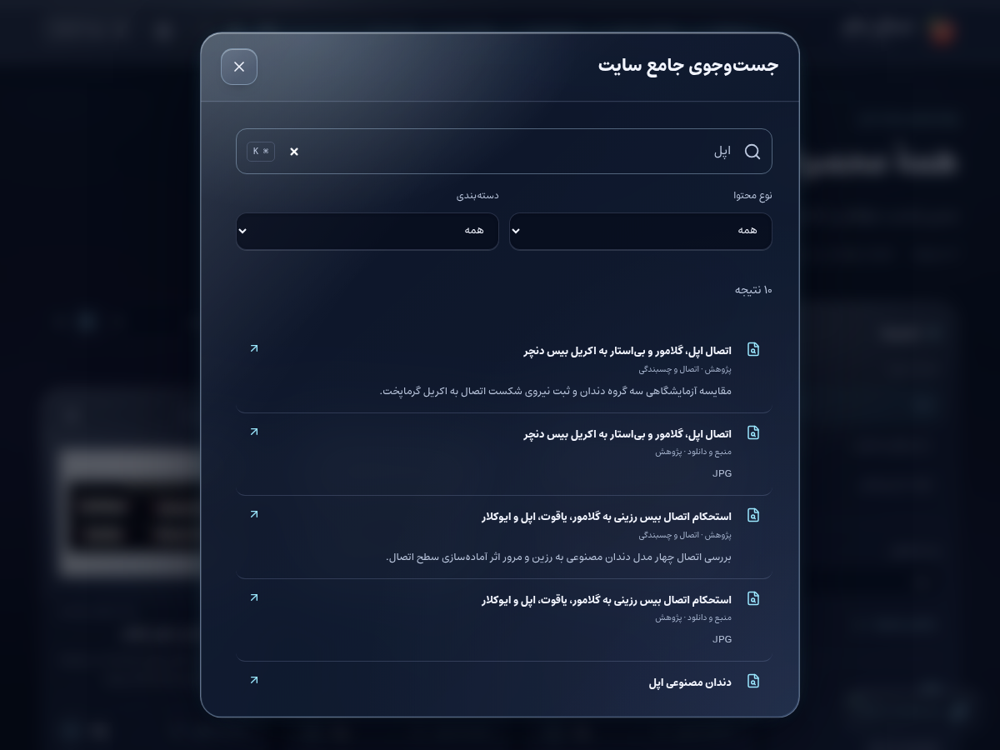

# راهنمای مشتری و کاربر سایت

نسخهٔ ۲٫۲ ایده‌آل ماکو | آموزش کاربر غیرمتخصص | ۲۶ اکتبر ۲۰۲۶

می‌توانید با شمارهٔ همراه وارد شوید، محصول و محتوای موردنظر را پیدا کنید، استعلام بدهید و پاسخ را در حساب خود پیگیری کنید. پیام‌ها و پرونده‌های خصوصی شما فقط در محدودهٔ حساب و اشتراک معتبر نمایش داده می‌شوند.

## پیش از شروع

برای ورود پیامکی باید به شمارهٔ همراه خود دسترسی داشته باشید. کلید سرویس یا حساب مدیر لازم ندارید. رمز یک‌بارمصرف فقط برای ورود خود شماست. اگر قبلاً حساب ایمیلی دارید، بدون تأیید هویت نباید فرض کنید شمارهٔ جدید به همان حساب متصل می‌شود.

## صفحه‌های موردنیاز

| صفحه | مسیر |
| --- | --- |
| ورود | `/fa/auth/login/` |
| حساب من | `/fa/account/` |
| درخواست‌های من | `/fa/account/requests/` |
| پروفایل | `/fa/account/profile/` |
| اعلان‌ها | `/fa/account/notifications/` |
| فهرست علاقه‌مندی | `/fa/account/saved/` |

مسیرهای جدول نسبت به دامنهٔ نصب شما هستند. برای زبان دیگر، بخش fa تغییر می‌کند. فقط صفحه‌ها و دکمه‌های مجاز حساب فعلی قابل استفاده‌اند.

شکل ۱ ـ پیشخوان همین نسخه با حساب آموزشی. اعداد این تصویر، آمار کسب‌وکار واقعی نیستند.

## گردش اصلی کار

### ورود پیامکی و ثبت استعلام محصول

1. در سایت زبان خود را انتخاب کنید و ورود را بزنید. در صفحهٔ ورود، گزینهٔ «ورود / ثبت‌نام با پیامک» را انتخاب کنید. ورود پیامکی این نسخه مخصوص شمارهٔ همراه ایران است؛ روش ایمیل جداگانه در همین صفحه وجود دارد.

2. شمارهٔ همراه خود را وارد کنید؛ برای مثال شمارهٔ واقعی خودتان را به شکل 09… یا +989… بنویسید. نام اختیاری را همین‌جا می‌توانید تکمیل کنید. سامانه رقم فارسی و عربی را هم به قالب استاندارد تبدیل می‌کند.

3. رضایت مربوط به ورود و ایجاد حساب را بخوانید و علامت بزنید؛ سپس دریافت کد را بزنید. اگر سرویس تنظیم نشده باشد، دکمه غیرفعال و علت مشخص است. در محدودیت موقت، تا پایان زمان انتظار دوباره درخواست نزنید.

4. کد پیامک را در زمان مجاز وارد کنید. کد را برای هیچ فرد دیگری ارسال نکنید. پس از انقضا یا مصرف، کد قدیمی دوباره معتبر نیست.

5. پس از تأیید کد، حساب موجود باز می‌شود یا حساب مشتری تازه ساخته می‌شود. اگر نام را ننوشته‌اید، نام عمومی موقت نمایش داده می‌شود و از پروفایل قابل اصلاح است. ایمیل برای این ورود اجباری نیست؛ افزودن ایمیلِ ورود در حال حاضر از مسیر مدیر حساب انجام می‌شود.

6. در دسکتاپ علامت ذره‌بین بالای سایت یا Ctrl/⌘+K را بزنید؛ در موبایل ابتدا منو و سپس جستجو را باز کنید. نام محصول، موضوع یا کد را بنویسید، نوع محتوا و دسته را انتخاب کنید و نتیجهٔ مربوط را باز کنید.

7. مشخصات و منبع را بخوانید و محصول را به فهرست استعلام اضافه کنید. افزودن به فهرست هنوز ارسال درخواست نیست.

8. فهرست استعلام را باز کنید و تعداد، نیاز و توضیح را وارد کنید. روش تماس و رضایت لازم برای رسیدگی را بررسی کنید.

9. ابتدا «بعدی» را بزنید و پیش‌نمایش نام، تلفن، کالا و مقدار و متن را بخوانید؛ در صورت نیاز «ویرایش» را بزنید. سپس ارسال نهایی را یک بار انجام دهید و شمارهٔ پیگیری را نگه دارید. در خطای ارتباط، وضعیت درخواست را بررسی کنید.

10. در حساب، درخواست‌های من را باز کنید و پرونده را با شمارهٔ پیگیری پیدا کنید. وضعیت و پاسخ عمومی کارشناس را در همان پرونده ببینید.

11. اگر توضیح بیشتری لازم است در همان گفتگو پاسخ دهید. اعضای سازمان فقط با دعوت و اشتراک معتبر ممکن است به پرونده دسترسی داشته باشند.

12. بعد از خواندن محتوا می‌توانید لایک کنید، نظر بفرستید یا گزارش مشکل بدهید. نظر شما پیش از تأیید مسئول سایت عمومی نمی‌شود.

شکل ۲ ـ بخش اصلی کار این نقش. نام حساب‌ها آموزشی است؛ اطلاعات مشتری یا رمز در تصویر درج نشده است.

## نظر و گزارش

نظر باید به محتوای صفحه مربوط باشد و اطلاعات حساس خود یا دیگران را در آن ننویسید. این نسخه نظرهای تخت دارد. گزارش تخلف خصوصی برای مسئول بررسی ثبت می‌شود و متن گزارش به عنوان نظر عمومی نمایش داده نمی‌شود.

## ایمیل و سرویس‌های خاص

برای حساب فقط پیامکی، بخش امنیت شمارهٔ تأییدشده را نشان می‌دهد و دکمهٔ تأیید ایمیل یا فرم نیازمند رمز قبلی نمایش داده نمی‌شود. ایمیل تماسِ پروفایل، ایمیل ورود نیست. اگر کاری مانند دعوت سازمانی یا رزرو رویداد ایمیل تأییدشده می‌خواهد، از مدیر بخواهید ایمیل واقعی را به حساب متصل کند؛ سپس از امنیت، ایمیل را تأیید و با بازیابی رمز عبور، رمز را تعیین کنید.

## انتخاب اعلان‌های دلخواه

در حساب ← اعلان‌ها، کانال ایمیل، پیامک یا تلگرام را از مسیر مربوط متصل و تأیید کنید و موضوع‌های موردنظر را روشن کنید. موضوع اخبار و محتوای سایت انتخاب جداگانه دارد و در شروع خاموش است. ورود OTP رضایت خودکار برای پیام تبلیغاتی یا همهٔ اعلان‌ها ایجاد نمی‌کند. برای قطع، همان موضوع یا کانال را خاموش کنید.

## علاقه‌مندی و امنیت

محصول را ذخیره کنید تا بعداً دوباره پیدا شود. لینک اشتراک ممکن است محدوده و انقضا داشته باشد. روی دستگاه مشترک پس از کار خارج شوید و کد ورود یا لینک خصوصی پرونده را در گروه عمومی نفرستید.

## ورود و جستجو در تصویر

دریافت کد فقط پس از پیکربندی سرویس توسط مالک فعال می‌شود. این تصویر وضعیت واقعی محیط آموزشی را نشان می‌دهد و هیچ پیامکی برای تهیهٔ آن ارسال نشده است.

در جستجوی جامع، نتیجهٔ منتشرشده با نوع و دسته و لینک واقعی نمایش داده می‌شود. روی عنوان نتیجه بزنید تا صفحهٔ مربوط باز شود.

## دستیار عمومی اختیاری

دستیار عمومی، اگر مالک آن را فعال کرده باشد، فقط دربارهٔ اطلاعات عمومی سایت کمک می‌کند؛ برای تصمیم خرید مشخصات و پاسخ رسمی کارخانه را ملاک قرار دهید.

## خطاهای رایج و اقدام درست

| نشانه | اقدام |
| --- | --- |
| ورود دوباره خواسته می‌شود | نشست منقضی، حساب غیرفعال یا اختیار تغییر کرده است. متن ذخیره‌نشده را نگه دارید، با حساب خود وارد شوید و در صورت تکرار به مدیر اطلاع دهید. |
| این کار مجاز نیست یا زبان قابل انتخاب نیست | نام نقش، زبان و محدودهٔ پرونده را بررسی کنید. از مالک اصلاح اختیار لازم را بخواهید؛ نقش بالاتر را صرفاً برای دورزدن خطا درخواست نکنید. |
| نسخه تغییر کرده یا ویرایشگر قفل است | همکار دیگری داده را تغییر داده یا قفل معتبر دارد. پیش‌نویس خود را نگه دارید، هماهنگ کنید و نسخهٔ سرور را دوباره بارگذاری کنید. |
| تعداد درخواست زیاد است | محدودیت زمانی برای جلوگیری از سوءاستفاده فعال شده است. زمان اعلام‌شده را صبر کنید و درخواست را پیاپی تکرار نکنید. |
| سرویس تنظیم نشده یا پیام ارسال نشد | کلید، قالب، کانال تأییدشده و سلامت worker باید توسط نقش مجاز بررسی شوند. وضعیت ناموفق را موفق فرض نکنید و کلید را داخل متن خطا نفرستید. |
| محتوا در جست‌وجو پیدا نمی‌شود | نوع، دسته و زبان را بررسی کنید. draft، ترجمهٔ منتشرنشده، محتوای پس‌گرفته‌شده یا سند خصوصی در جست‌وجوی عمومی نمی‌آید. |

## تمرین پایان آموزش

۱. مسیر «ورود پیامکی و ثبت استعلام محصول» را با دادهٔ آموزشی و بدون ارسال ناخواسته به افراد واقعی مرور کنید.

۲. نشان دهید نتیجهٔ کار کجا روی سرور ثبت می‌شود و چه تفاوتی با متن ذخیره‌نشده در مرورگر دارد.

۳. یک خطای دسترسی یا وضعیت انتظار را توضیح دهید و مسیر ارجاع درست را انتخاب کنید.

۴. گزارش یا صفحهٔ نتیجه را دوباره باز کنید و مطمئن شوید اطلاعات درست، زبان درست و وضعیت درست دیده می‌شود.

## تحویل کار به نقش بعدی

کارشناس بازرگانی برای استعلام، پشتیبانی برای مشکل حساب/خدمت و مسئول سایت برای گزارش محتوای نامناسب.

## حدود اختیار

مشتری نمی‌تواند نظر خود را تأیید یا محتوای سایت را منتشر کند. ثبت استعلام به معنی خرید قطعی، پرداخت آنلاین یا تضمین موجودی نیست.

## چک‌لیست پایان روز

- کارهای ذخیره‌نشده را تعیین تکلیف کنید و پاسخ موفق سرور را ببینید.
- درخواست یا وظیفهٔ باز را بدون مسئول و اقدام بعدی رها نکنید.
- پیام خطا یا ارسال ناموفق را با اطلاعات لازم و بدون رمز/کلید گزارش کنید.
- روی دستگاه مشترک از حساب خارج شوید.
- برای کار بعدی از راهنمای همان نقش و بخش کمک بگیرید.

## راهنماهای مرتبط

- [سند تفصیلی توسعه](../EXPANSION-SPEC-2.2.fa.md)
- [برنامهٔ اجرا](../IMPLEMENTATION-PLAN-2.2.fa.md)
- [شروع نصب و استفاده](../START-HERE-2.2.0.fa.md)
- [سرویس‌ها و DNS و SEO](../INSTALL-SERVICES-SEO-2.2.fa.md)
- [گزارش آزمون این نسخه](../VERIFICATION-2.2.0.fa.md)
