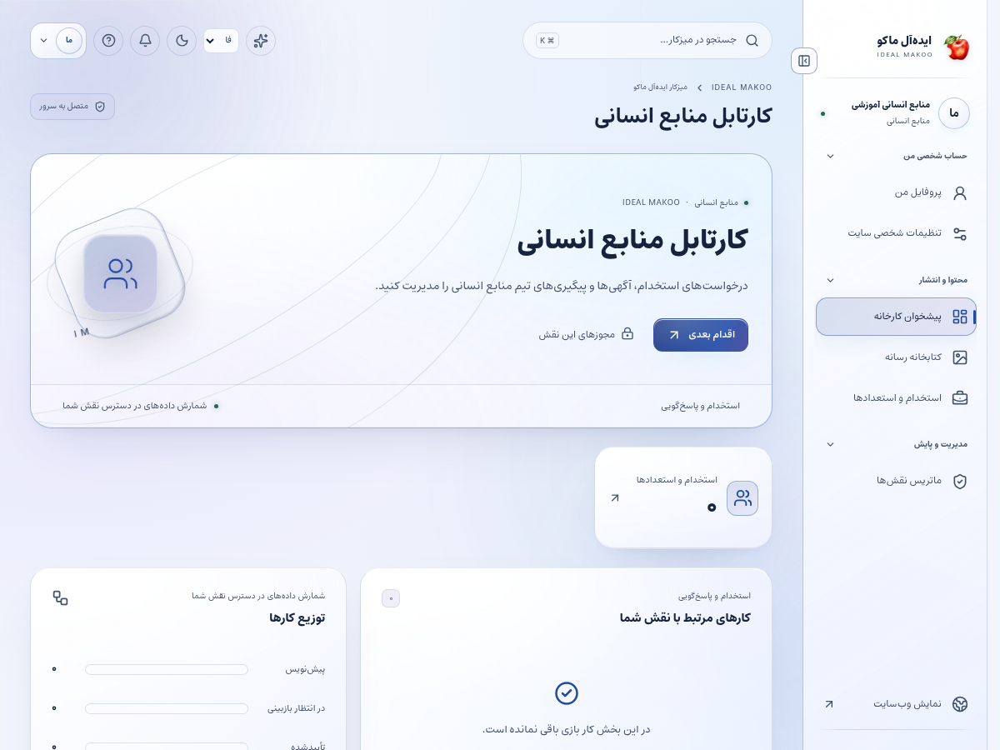
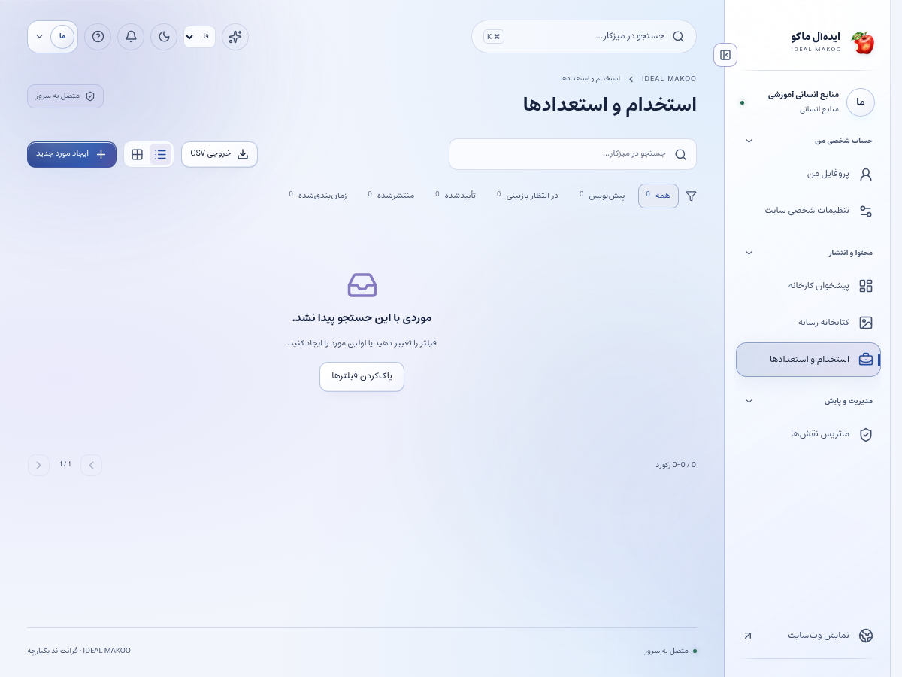

# راهنمای مسئول منابع انسانی

نسخهٔ ۲٫۲ ایده‌آل ماکو | آموزش کاربر غیرمتخصص | ۲۶ اکتبر ۲۰۲۶

فرصت‌های شغلی و درخواست‌های استخدام مجاز را مدیریت می‌کنید. اطلاعات متقاضی خصوصی است و باید فقط در گردش کاری استخدام استفاده شود.

## پیش از شروع

برای ورود، از نشانی رسمی سایت و حساب اختصاصی خود استفاده کنید. کارکنان باید علاوه بر رمز، مرحلهٔ MFA را کامل کنند. اگر حساب غیرفعال یا مجوز شما تغییر کرده باشد، ممکن است نیاز به ورود مجدد داشته باشید. یک دکمهٔ پنهان یا خطای دسترسی را با حساب همکار دور نزنید؛ موضوع را به مالک سامانه ارجاع دهید.

زبان رابط با زبان محتوای در حال ویرایش یکسان فرض نمی‌شود. در هر فرم به انتخابگر زبان محتوا توجه کنید. بعضی نقش‌ها فقط یک یا چند زبان مقصد دارند. در متن فارسی و عربی، نشانی اینترنتی و عدد و نام انگلیسی را در پیش‌نمایش کنترل کنید.

برای آشنایی با همان صفحه، علامت سؤال یا راهنمای زمینه‌ای را باز کنید. در آن راهنمای متناسب با نقش و صفحه قرار دارد. این کتابچه گردش کامل یک کار را توضیح می‌دهد و راهنمای زمینه‌ای برای یادآوری حین انجام کار مناسب است.

## صفحه‌های موردنیاز

| صفحه | مسیر |
| --- | --- |
| پیشخوان | `/fa/admin/` |
| استخدام و فرصت شغلی | `/fa/admin/hr/` |
| رسانهٔ مجاز | `/fa/admin/media/` |
| پروفایل | `/fa/admin/profile/` |
| تنظیمات شخصی | `/fa/admin/preferences/` |

مسیرهای جدول نسبت به دامنهٔ نصب شما هستند. برای زبان دیگر، بخش fa تغییر می‌کند. فقط صفحه‌ها و دکمه‌های مجاز حساب فعلی قابل استفاده‌اند.

شکل ۱ ـ پیشخوان همین نسخه با حساب آموزشی. اعداد این تصویر، آمار کسب‌وکار واقعی نیستند.

## گردش اصلی کار

### ایجاد فرصت شغلی و رسیدگی به یک درخواست

1. به بخش منابع انسانی در /fa/admin/hr/ بروید؛ /fa/admin/careers/ نام دیگر همین بخش است. رکورد دستیِ فرصت شغلی را از پروندهٔ متقاضی که شمارهٔ درخواست دارد جدا بدانید. پیش از ایجاد آگهی، تکراری‌نبودن آن را بررسی کنید.

2. در ایجاد آگهی، عنوان، خلاصه و متن کامل مسئولیت را بنویسید. محل و نوع همکاری را در متن یا فیلد مربوطِ دادهٔ ساختاریافتهٔ شغل، در صورت نمایش، مشخص کنید. شرایط باید با نیاز واقعی کارخانه هماهنگ باشد.

3. مهارت‌های ضروری و امتیازی را جدا کنید. اطلاعات تماس یا دادهٔ شخصی یک متقاضی نباید داخل متن عمومی آگهی قرار بگیرد.

4. زبان متن، دسته و برچسب و آخرین زمان معتبر بودن فرصت را بررسی کنید. آگهی منقضی نباید به‌عنوان فرصت باز معرفی شود.

5. اگر دادهٔ ساختاریافتهٔ شغل را تکمیل می‌کنید، تاریخ و سازمان و محل را از اطلاعات واقعی وارد کنید.

6. پیش‌نویس را ذخیره و برای بازبینی/انتشار به نقش مربوط ارسال کنید. ایجاد آگهی در پنل به معنی عمومی‌شدن آن نیست.

7. بعد از انتشار، صفحهٔ شغل و فرم درخواست را در سایت باز کنید و متن و لینک را کنترل کنید.

8. درخواست‌های استخدام مجاز را با وضعیت و زمان مشاهده کنید. هر پرونده را به‌صورت جداگانه بررسی کنید.

9. رزومه و پیوست را فقط از مسیر مجاز باز کنید. فایل منتظر بررسی امنیتی را با انتقال به پوشهٔ عمومی منتشر نکنید.

10. یادداشت داخلی و پاسخ قابل مشاهده برای متقاضی را از هم جدا نگه دارید. قبل از ارسال، مخاطب و متن را دوباره بخوانید.

11. وضعیت و مسئول پیگیری را به‌روز کنید تا پرونده بدون صاحب باقی نماند. ثبت یادداشت به‌تنهایی به معنی اطلاع‌رسانی بیرونی نیست.

12. پس از بسته‌شدن فرصت، وضعیت محتوا و فرایند انتشار را اصلاح کنید و نگهداری اطلاعات متقاضی را مطابق سیاست سازمان پیگیری کنید.

شکل ۲ ـ بخش اصلی کار این نقش. نام حساب‌ها آموزشی است؛ اطلاعات مشتری یا رمز در تصویر درج نشده است.

## آگهی عمومی و پروندهٔ متقاضی

رکوردی که از فرم استخدام آمده و شمارهٔ درخواست دارد خصوصی است. با پاک‌کردن شمارهٔ درخواست نمی‌توان آن را به آگهی عمومی تبدیل کرد. برای فرصت شغلی یک رکورد دستی مستقل بسازید و تنها متن مربوط به موقعیت شغلی را برای انتشار بفرستید.

## حریم خصوصی متقاضی

رزومه، شماره و سابقهٔ فرد را به کانال عمومی یا خبر سایت منتقل نکنید. صرف دسترسی شما به پرونده، اجازهٔ انتشار اطلاعات شخصی نیست.

## اعلان پرونده

برای دریافت هشدار، کانال ارتباطی خود را تأیید کنید و مجوز مرتبط با درخواست را داشته باشید. اگر ایمیل/SMS نمی‌رسد ابتدا اعلان داخلی و وضعیت صف را بررسی کنید.

## دستیار اختیاری

AI می‌تواند متن آگهی، چک‌لیست مصاحبه یا پاسخ پیشنهادی بسازد. تصمیم استخدام، بررسی سوابق و ارسال پیام به متقاضی با انسان است؛ دادهٔ حساس را بدون ضرورت در prompt ننویسید.

## ذخیره و وضعیت کار

در کارهای محتوایی ابتدا پیش‌نویس را ذخیره کنید، منتظر پاسخ موفق بمانید و بعد صفحه یا زبان را تغییر دهید. بعضی ویرایشگرها قفل همکاری دارند تا دو نفر هم‌زمان کار یکدیگر را بازنویسی نکنند. اگر پیام تغییر نسخه یا قفل مشاهده شد، متن خود را نگه دارید، با همکار هماهنگ کنید و نسخهٔ تازه را آگاهانه بارگذاری کنید.

وضعیت‌های رایج را جدا بدانید: draft یعنی کار ذخیره‌شده ولی آمادهٔ نمایش عمومی نیست؛ review یعنی در انتظار بررسی؛ approved یعنی نسخهٔ مشخص تأیید شده؛ scheduled یعنی در صف زمان‌بندی؛ published یعنی نسخهٔ همان زبان منتشر شده؛ archived یا withdrawn یعنی از مسیر عادی انتشار کنار رفته است. تغییر متن پس از تأیید ممکن است به بازبینی تازه نیاز داشته باشد.

## اعلان و پیگیری

اعلان داخلی را از زنگ پنل باز کنید و با لینک همان اعلان به پرونده بروید. برای هشدار ایمیل، پیامک یا تلگرام، سرویس باید توسط مالک تنظیم و کانال شخصی شما تأیید شده باشد. از حساب شخصی ← اعلان‌ها (/fa/account/notifications/) به تنظیمات کانال و رضایت موضوع‌ها بروید؛ این مسیر برای حساب کارکنان هم قابل استفاده است. شمارهٔ ذخیره‌شده در پروفایل به‌تنهایی مجوز ارسال به آن شماره نیست. اگر به پرونده‌ای دسترسی ندارید، انتظار هشدار محتوای خصوصی همان پرونده را نداشته باشید.

پیام کوتاه بیرونی فقط خلاصه و لینک امن را حمل می‌کند؛ تصمیم و پاسخ کامل در پنل ثبت می‌شود. وضعیت صف، شکست، لغو و پذیرش provider را جدا بخوانید. قبل از تکرار ارسال، علت وضعیت قبلی را بررسی کنید تا مخاطب پیام تکراری نگیرد.

## گزارش و مصرف سرویس

در پایین پیشخوان و در گزارش‌های مجاز، کارت «گزارش سایت و مصرف سرویس‌ها» را پیدا کنید. از دکمه‌های «بازدید و تعامل» و «مصرف API و هزینه» استفاده کنید. بازهٔ ۷، ۳۰ یا ۹۰ روز و زبان را مشخص کنید. بازدیدهای این نسخه به مرورگر، محتوا و بازهٔ ۳۰ دقیقه محدود می‌شوند و شمارش قطعی افراد یکتا نیستند. تعداد نظر تأییدشده از صف بررسی جداست.

گزارش مصرف برای مدیر ارشد، مدیر و تحلیلگر در محدودهٔ سازمانی و برای سایر کارکنان در محدودهٔ شخصی مجاز نشان داده می‌شود. هزینهٔ نامعلوم صفر نیست. پیامک با ریال و AI با دلار ممکن است گزارش شود؛ آن‌ها را بدون نرخ تبدیل و سیاست مالی با هم جمع نکنید. حالت accepted یعنی سرویس درخواست را پذیرفته است و خوانده‌شدن پیام توسط مخاطب را اثبات نمی‌کند.

## دستیار اختیاری هوش مصنوعی

دکمهٔ «کمک اختیاری هوش مصنوعی» در نوار بالای پنل است و فقط موضوع‌های مجاز نقش را نشان می‌دهد. موضوع و زبان مجاز را انتخاب کنید، درخواست روشن بنویسید و گزینهٔ رضایت ارسال متن و پرونده‌های انتخابی به ارائه‌دهنده را بخوانید و علامت بزنید؛ سپس «دریافت پیشنهاد» را بزنید. بدون تنظیم کلید/مدل سرویس توسط مالک، تولید غیرفعال است. برای محتوا، SEO، محصول یا راهنمای کار، متن مرجع را خودتان در درخواست بنویسید؛ صرف بازبودن یک صفحه باعث خواندن خودکار آن نمی‌شود. در موضوع مشتری، حداکثر پنج پروندهٔ مجاز را صریح انتخاب کنید تا سرور فقط همان دادهٔ مجاز را بخواند. موضوع تحلیل، آمار ۳۰ روز اخیر زبان انتخاب‌شده را اضافه می‌کند و به فیلتر فعلی جدول وابسته نیست. تولید، با فرمان شما مصرف ایجاد می‌کند. خروجی را بازخوانی کنید؛ پیشنهاد خودکار ذخیره، منتشر، تأیید یا برای مشتری ارسال نمی‌شود. توقف درخواست ممکن است مصرفی را که قبلاً نزد ارائه‌دهنده انجام شده برنگرداند.

نمونهٔ درخواست مناسب:

برای این شرح نیاز، آگهی شغلی روشن با مسئولیت‌ها، شرایط ضروری و مراحل درخواست پیشنهاد بده؛ حقوق یا شرایطی که مشخص نشده اختراع نکن.

## خطاهای رایج و اقدام درست

| نشانه | اقدام |
| --- | --- |
| ورود دوباره خواسته می‌شود | نشست منقضی، حساب غیرفعال یا اختیار تغییر کرده است. متن ذخیره‌نشده را نگه دارید، با حساب خود وارد شوید و در صورت تکرار به مدیر اطلاع دهید. |
| این کار مجاز نیست یا زبان قابل انتخاب نیست | نام نقش، زبان و محدودهٔ پرونده را بررسی کنید. از مالک اصلاح اختیار لازم را بخواهید؛ نقش بالاتر را صرفاً برای دورزدن خطا درخواست نکنید. |
| نسخه تغییر کرده یا ویرایشگر قفل است | همکار دیگری داده را تغییر داده یا قفل معتبر دارد. پیش‌نویس خود را نگه دارید، هماهنگ کنید و نسخهٔ سرور را دوباره بارگذاری کنید. |
| تعداد درخواست زیاد است | محدودیت زمانی برای جلوگیری از سوءاستفاده فعال شده است. زمان اعلام‌شده را صبر کنید و درخواست را پیاپی تکرار نکنید. |
| سرویس تنظیم نشده یا پیام ارسال نشد | کلید، قالب، کانال تأییدشده و سلامت worker باید توسط نقش مجاز بررسی شوند. وضعیت ناموفق را موفق فرض نکنید و کلید را داخل متن خطا نفرستید. |
| محتوا در جست‌وجو پیدا نمی‌شود | نوع، دسته و زبان را بررسی کنید. draft، ترجمهٔ منتشرنشده، محتوای پس‌گرفته‌شده یا سند خصوصی در جست‌وجوی عمومی نمی‌آید. |

## تمرین پایان آموزش

۱. مسیر «ایجاد فرصت شغلی و رسیدگی به یک درخواست» را با دادهٔ آموزشی و بدون ارسال ناخواسته به افراد واقعی مرور کنید.

۲. نشان دهید نتیجهٔ کار کجا روی سرور ثبت می‌شود و چه تفاوتی با متن ذخیره‌نشده در مرورگر دارد.

۳. یک خطای دسترسی یا وضعیت انتظار را توضیح دهید و مسیر ارجاع درست را انتخاب کنید.

۴. گزارش یا صفحهٔ نتیجه را دوباره باز کنید و مطمئن شوید اطلاعات درست، زبان درست و وضعیت درست دیده می‌شود.

## تحویل کار به نقش بعدی

مدیر واحد برای شرایط شغل، ناشر برای انتشار، مالک برای تغییر مجوز و مسئول مربوط برای پروندهٔ خارج از حوزه.

## حدود اختیار

این نقش به همهٔ پرونده‌های فروش یا تنظیمات مالی و فنی سایت دسترسی ندارد. کمک AI به معنی تصمیم خودکار دربارهٔ متقاضی نیست.

## چک‌لیست پایان روز

- کارهای ذخیره‌نشده را تعیین تکلیف کنید و پاسخ موفق سرور را ببینید.
- درخواست یا وظیفهٔ باز را بدون مسئول و اقدام بعدی رها نکنید.
- پیام خطا یا ارسال ناموفق را با اطلاعات لازم و بدون رمز/کلید گزارش کنید.
- روی دستگاه مشترک از حساب خارج شوید.
- برای کار بعدی از راهنمای همان نقش و بخش کمک بگیرید.

## راهنماهای مرتبط

- [سند تفصیلی توسعه](../EXPANSION-SPEC-2.2.fa.md)
- [برنامهٔ اجرا](../IMPLEMENTATION-PLAN-2.2.fa.md)
- [شروع نصب و استفاده](../START-HERE-2.2.0.fa.md)
- [سرویس‌ها و DNS و SEO](../INSTALL-SERVICES-SEO-2.2.fa.md)
- [گزارش آزمون این نسخه](../VERIFICATION-2.2.0.fa.md)
