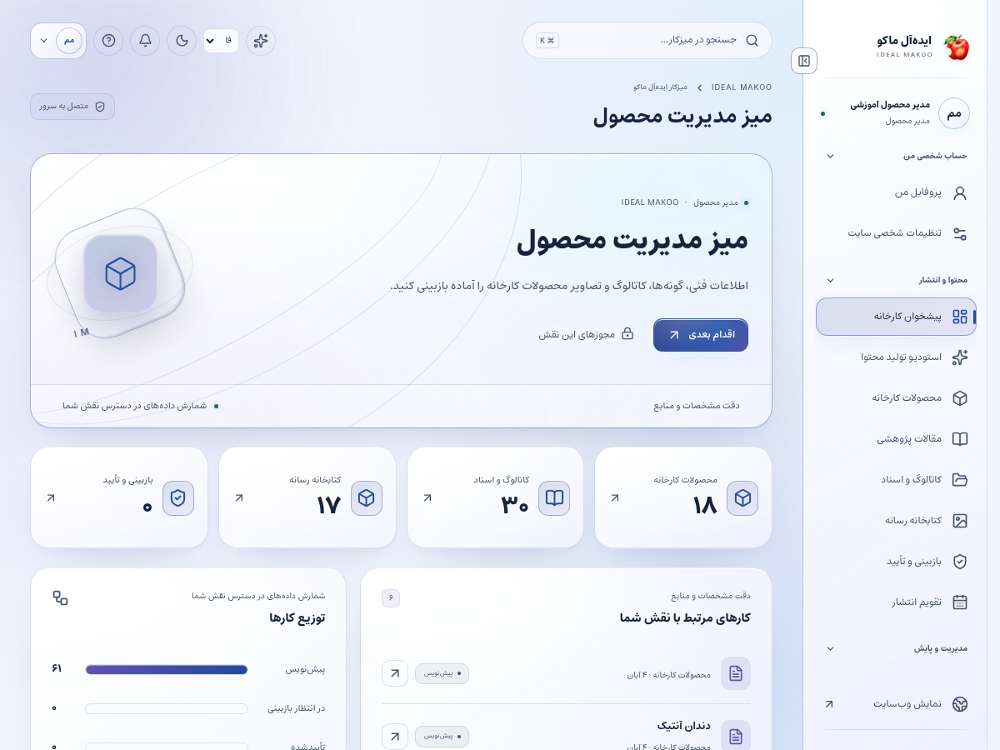
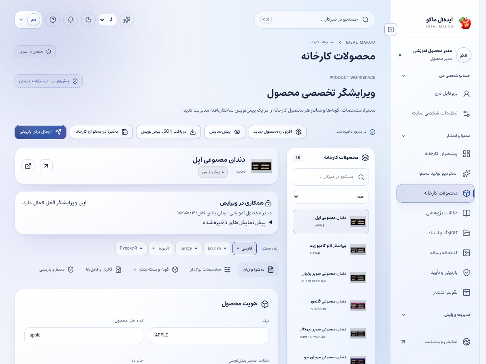

# راهنمای مدیر محصول و کاتالوگ

نسخهٔ ۲٫۲ ایده‌آل ماکو | آموزش کاربر غیرمتخصص | ۲۶ اکتبر ۲۰۲۶

اطلاعات محصول، خانواده، ماده، ویژگی، مشخصات و فایل‌های مرتبط را منظم و مستند نگه می‌دارید. هر تغییر باید به منبع معتبر متصل باشد تا مشتری و کارشناس فروش اطلاعات هماهنگ ببینند.

## پیش از شروع

برای ورود، از نشانی رسمی سایت و حساب اختصاصی خود استفاده کنید. کارکنان باید علاوه بر رمز، مرحلهٔ MFA را کامل کنند. اگر حساب غیرفعال یا مجوز شما تغییر کرده باشد، ممکن است نیاز به ورود مجدد داشته باشید. یک دکمهٔ پنهان یا خطای دسترسی را با حساب همکار دور نزنید؛ موضوع را به مالک سامانه ارجاع دهید.

زبان رابط با زبان محتوای در حال ویرایش یکسان فرض نمی‌شود. در هر فرم به انتخابگر زبان محتوا توجه کنید. بعضی نقش‌ها فقط یک یا چند زبان مقصد دارند. در متن فارسی و عربی، نشانی اینترنتی و عدد و نام انگلیسی را در پیش‌نمایش کنترل کنید.

برای آشنایی با همان صفحه، علامت سؤال یا راهنمای زمینه‌ای را باز کنید. در آن راهنمای متناسب با نقش و صفحه قرار دارد. این کتابچه گردش کامل یک کار را توضیح می‌دهد و راهنمای زمینه‌ای برای یادآوری حین انجام کار مناسب است.

## صفحه‌های موردنیاز

| صفحه | مسیر |
| --- | --- |
| پیشخوان | `/fa/admin/` |
| محصولات | `/fa/admin/products/` |
| منابع و کاتالوگ | `/fa/admin/resources/` |
| رسانه | `/fa/admin/media/` |
| بازبینی | `/fa/admin/reviews/` |
| هوش مصنوعی | `/fa/admin/ai/` |

مسیرهای جدول نسبت به دامنهٔ نصب شما هستند. برای زبان دیگر، بخش fa تغییر می‌کند. فقط صفحه‌ها و دکمه‌های مجاز حساب فعلی قابل استفاده‌اند.

شکل ۱ ـ پیشخوان همین نسخه با حساب آموزشی. اعداد این تصویر، آمار کسب‌وکار واقعی نیستند.

## گردش اصلی کار

### افزودن یا اصلاح مشخصات یک محصول

1. در محصولات، نام یا برند محصول را جست‌وجو کنید. اگر محصول موجود است همان رکورد را باز کنید تا کاتالوگ تکراری ساخته نشود.

2. برای محصول جدید، نام، نشانی و برند و خانوادهٔ اصلی را وارد کنید. خانوادهٔ دندان و مواد را مطابق ماهیت واقعی محصول انتخاب کنید.

3. زبان متن را انتخاب و نام و توضیح کوتاه محصول را تکمیل کنید. نام تجاری را با املای منبع نگه دارید.

4. ماده و کاربرد معرفی‌شده را ثبت کنید. «موجودی انبار»، «قیمت قطعی» یا «مجوز پزشکی» را بدون منبع و اختیار مربوط ادعا نکنید.

5. مشخصات را به صورت عنوان و مقدار وارد کنید. واحد اندازه‌گیری، شمارهٔ قالب، شید و کد فنی نباید در ترجمه تغییر کنند.

6. ویژگی‌ها را کوتاه و قابل بررسی بنویسید. تفاوت ویژگی محصول با برداشت تبلیغاتی را روشن نگه دارید.

7. تصویر اصلی و گالری را از دارایی مجاز انتخاب کنید. تصویر محصول دیگر یا فایل قدیمی را فقط برای پرکردن صفحه استفاده نکنید.

8. کاتالوگ یا راهنمای فنی را به منبع درست وصل کنید. اگر سند تحت کنترل نسخه است، نسخهٔ تأییدشده و منتشرشده را انتخاب کنید.

9. برگهٔ مشخصات را باز کنید: برای دندان، طبقهٔ ماده، موقعیت و فک و لایه؛ برای مواد، دسته، روش پخت و شکل عرضه را از گزینه‌های واقعی تکمیل کنید. خانواده و برند نیز در طبقه‌بندی جست‌وجو اثر دارند؛ فیلد آزاد برچسبِ خبر را با مشخصات فنی محصول اشتباه نگیرید.

10. SEO محصول را تکمیل و پیش‌نمایش را بررسی کنید. لینک استعلام باید به همین محصول مربوط شود.

11. پیش‌نویس را ذخیره و برای بازبینی علمی یا فنی ارسال کنید. تغییر مهم در مشخصات باید در توضیح بازبینی ذکر شود.

12. بعد از انتشار نقش ناشر، صفحهٔ عمومی و فهرست استعلام را بررسی کنید. در هر پنج زبان وجود متن مستقل و درستی عددها را کنترل کنید.

شکل ۲ ـ بخش اصلی کار این نقش. نام حساب‌ها آموزشی است؛ اطلاعات مشتری یا رمز در تصویر درج نشده است.

## اصلاح کاتالوگ قدیمی

دادهٔ منبع واردشده قابل ویرایش است اما باید سند پشت هر تغییر حفظ شود. هنگام جایگزینی فایل، نسخهٔ تازه بسازید و از حذف فایلی که در صفحه یا پروندهٔ دیگر استفاده می‌شود خودداری کنید.

## پاسخ به سؤال فروش

اگر مشتری سؤال فنی دارد، مشخصات عمومی معتبر را برای بازرگانی آماده کنید. قیمت اختصاصی و تعهد تحویل باید در گردش تجاری بررسی شوند؛ پنل محصول محل ثبت تعهد بدون مجوز نیست.

## پنج برگهٔ ویرایش محصول

برگهٔ محتوا برای معرفی و SEO، مشخصات برای طبقه‌بندی فنی و مقدار/واحد، تنوع‌ها برای مدل‌های قابل استعلام، رسانه برای تصویر و فایل و منبع برای مرجع و کنترل اعتبار است. خطای قرمز را پیش از ارسال بازبینی رفع کنید؛ وجود فقط یک عنوان، محصول کامل نمی‌سازد.

## کنترل ترجمهٔ محصول

نام برند، کد قالب، تعداد لایه و واحد را با فارسی/منبع تطبیق دهید. ترجمهٔ زیبا ولی تغییر عدد یا کد فنی پذیرفته نیست.

## ذخیره و وضعیت کار

در کارهای محتوایی ابتدا پیش‌نویس را ذخیره کنید، منتظر پاسخ موفق بمانید و بعد صفحه یا زبان را تغییر دهید. بعضی ویرایشگرها قفل همکاری دارند تا دو نفر هم‌زمان کار یکدیگر را بازنویسی نکنند. اگر پیام تغییر نسخه یا قفل مشاهده شد، متن خود را نگه دارید، با همکار هماهنگ کنید و نسخهٔ تازه را آگاهانه بارگذاری کنید.

وضعیت‌های رایج را جدا بدانید: draft یعنی کار ذخیره‌شده ولی آمادهٔ نمایش عمومی نیست؛ review یعنی در انتظار بررسی؛ approved یعنی نسخهٔ مشخص تأیید شده؛ scheduled یعنی در صف زمان‌بندی؛ published یعنی نسخهٔ همان زبان منتشر شده؛ archived یا withdrawn یعنی از مسیر عادی انتشار کنار رفته است. تغییر متن پس از تأیید ممکن است به بازبینی تازه نیاز داشته باشد.

## اعلان و پیگیری

اعلان داخلی را از زنگ پنل باز کنید و با لینک همان اعلان به پرونده بروید. برای هشدار ایمیل، پیامک یا تلگرام، سرویس باید توسط مالک تنظیم و کانال شخصی شما تأیید شده باشد. از حساب شخصی ← اعلان‌ها (/fa/account/notifications/) به تنظیمات کانال و رضایت موضوع‌ها بروید؛ این مسیر برای حساب کارکنان هم قابل استفاده است. شمارهٔ ذخیره‌شده در پروفایل به‌تنهایی مجوز ارسال به آن شماره نیست. اگر به پرونده‌ای دسترسی ندارید، انتظار هشدار محتوای خصوصی همان پرونده را نداشته باشید.

پیام کوتاه بیرونی فقط خلاصه و لینک امن را حمل می‌کند؛ تصمیم و پاسخ کامل در پنل ثبت می‌شود. وضعیت صف، شکست، لغو و پذیرش provider را جدا بخوانید. قبل از تکرار ارسال، علت وضعیت قبلی را بررسی کنید تا مخاطب پیام تکراری نگیرد.

## گزارش و مصرف سرویس

در پایین پیشخوان و در گزارش‌های مجاز، کارت «گزارش سایت و مصرف سرویس‌ها» را پیدا کنید. از دکمه‌های «بازدید و تعامل» و «مصرف API و هزینه» استفاده کنید. بازهٔ ۷، ۳۰ یا ۹۰ روز و زبان را مشخص کنید. بازدیدهای این نسخه به مرورگر، محتوا و بازهٔ ۳۰ دقیقه محدود می‌شوند و شمارش قطعی افراد یکتا نیستند. تعداد نظر تأییدشده از صف بررسی جداست.

گزارش مصرف برای مدیر ارشد، مدیر و تحلیلگر در محدودهٔ سازمانی و برای سایر کارکنان در محدودهٔ شخصی مجاز نشان داده می‌شود. هزینهٔ نامعلوم صفر نیست. پیامک با ریال و AI با دلار ممکن است گزارش شود؛ آن‌ها را بدون نرخ تبدیل و سیاست مالی با هم جمع نکنید. حالت accepted یعنی سرویس درخواست را پذیرفته است و خوانده‌شدن پیام توسط مخاطب را اثبات نمی‌کند.

## دستیار اختیاری هوش مصنوعی

دکمهٔ «کمک اختیاری هوش مصنوعی» در نوار بالای پنل است و فقط موضوع‌های مجاز نقش را نشان می‌دهد. موضوع و زبان مجاز را انتخاب کنید، درخواست روشن بنویسید و گزینهٔ رضایت ارسال متن و پرونده‌های انتخابی به ارائه‌دهنده را بخوانید و علامت بزنید؛ سپس «دریافت پیشنهاد» را بزنید. بدون تنظیم کلید/مدل سرویس توسط مالک، تولید غیرفعال است. برای محتوا، SEO، محصول یا راهنمای کار، متن مرجع را خودتان در درخواست بنویسید؛ صرف بازبودن یک صفحه باعث خواندن خودکار آن نمی‌شود. در موضوع مشتری، حداکثر پنج پروندهٔ مجاز را صریح انتخاب کنید تا سرور فقط همان دادهٔ مجاز را بخواند. موضوع تحلیل، آمار ۳۰ روز اخیر زبان انتخاب‌شده را اضافه می‌کند و به فیلتر فعلی جدول وابسته نیست. تولید، با فرمان شما مصرف ایجاد می‌کند. خروجی را بازخوانی کنید؛ پیشنهاد خودکار ذخیره، منتشر، تأیید یا برای مشتری ارسال نمی‌شود. توقف درخواست ممکن است مصرفی را که قبلاً نزد ارائه‌دهنده انجام شده برنگرداند.

نمونهٔ درخواست مناسب:

این مشخصات محصول را به یک جدول خوانا و توضیح کوتاه تبدیل کن؛ هیچ ویژگی جدید اضافه نکن و فیلدهای مبهم یا بدون واحد را علامت بزن.

## خطاهای رایج و اقدام درست

| نشانه | اقدام |
| --- | --- |
| ورود دوباره خواسته می‌شود | نشست منقضی، حساب غیرفعال یا اختیار تغییر کرده است. متن ذخیره‌نشده را نگه دارید، با حساب خود وارد شوید و در صورت تکرار به مدیر اطلاع دهید. |
| این کار مجاز نیست یا زبان قابل انتخاب نیست | نام نقش، زبان و محدودهٔ پرونده را بررسی کنید. از مالک اصلاح اختیار لازم را بخواهید؛ نقش بالاتر را صرفاً برای دورزدن خطا درخواست نکنید. |
| نسخه تغییر کرده یا ویرایشگر قفل است | همکار دیگری داده را تغییر داده یا قفل معتبر دارد. پیش‌نویس خود را نگه دارید، هماهنگ کنید و نسخهٔ سرور را دوباره بارگذاری کنید. |
| تعداد درخواست زیاد است | محدودیت زمانی برای جلوگیری از سوءاستفاده فعال شده است. زمان اعلام‌شده را صبر کنید و درخواست را پیاپی تکرار نکنید. |
| سرویس تنظیم نشده یا پیام ارسال نشد | کلید، قالب، کانال تأییدشده و سلامت worker باید توسط نقش مجاز بررسی شوند. وضعیت ناموفق را موفق فرض نکنید و کلید را داخل متن خطا نفرستید. |
| محتوا در جست‌وجو پیدا نمی‌شود | نوع، دسته و زبان را بررسی کنید. draft، ترجمهٔ منتشرنشده، محتوای پس‌گرفته‌شده یا سند خصوصی در جست‌وجوی عمومی نمی‌آید. |

## تمرین پایان آموزش

۱. مسیر «افزودن یا اصلاح مشخصات یک محصول» را با دادهٔ آموزشی و بدون ارسال ناخواسته به افراد واقعی مرور کنید.

۲. نشان دهید نتیجهٔ کار کجا روی سرور ثبت می‌شود و چه تفاوتی با متن ذخیره‌نشده در مرورگر دارد.

۳. یک خطای دسترسی یا وضعیت انتظار را توضیح دهید و مسیر ارجاع درست را انتخاب کنید.

۴. گزارش یا صفحهٔ نتیجه را دوباره باز کنید و مطمئن شوید اطلاعات درست، زبان درست و وضعیت درست دیده می‌شود.

## تحویل کار به نقش بعدی

بازبین علمی برای صحت مشخصات، مترجم برای زبان‌ها، ناشر برای انتشار و بازرگانی برای نیاز مشتری.

## حدود اختیار

قیمت یا موجودی زنده صرفاً از روی متن کاتالوگ ایجاد نمی‌شود. محصول جدید تا انتشار مجاز در جست‌وجوی عمومی قابل مشاهده نیست.

## چک‌لیست پایان روز

- کارهای ذخیره‌نشده را تعیین تکلیف کنید و پاسخ موفق سرور را ببینید.
- درخواست یا وظیفهٔ باز را بدون مسئول و اقدام بعدی رها نکنید.
- پیام خطا یا ارسال ناموفق را با اطلاعات لازم و بدون رمز/کلید گزارش کنید.
- روی دستگاه مشترک از حساب خارج شوید.
- برای کار بعدی از راهنمای همان نقش و بخش کمک بگیرید.

## راهنماهای مرتبط

- [سند تفصیلی توسعه](../EXPANSION-SPEC-2.2.fa.md)
- [برنامهٔ اجرا](../IMPLEMENTATION-PLAN-2.2.fa.md)
- [شروع نصب و استفاده](../START-HERE-2.2.0.fa.md)
- [سرویس‌ها و DNS و SEO](../INSTALL-SERVICES-SEO-2.2.fa.md)
- [گزارش آزمون این نسخه](../VERIFICATION-2.2.0.fa.md)
