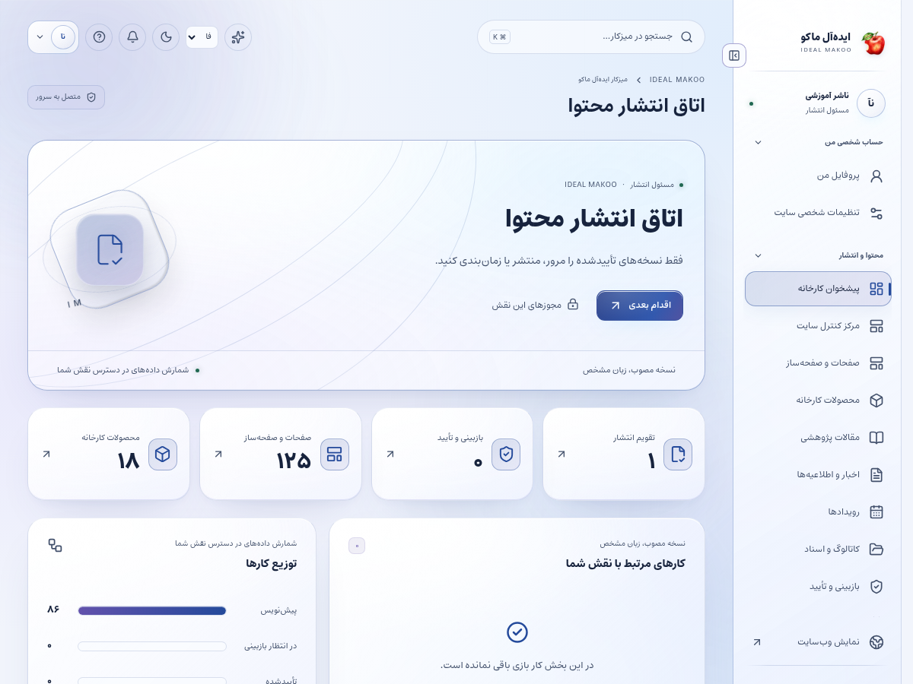
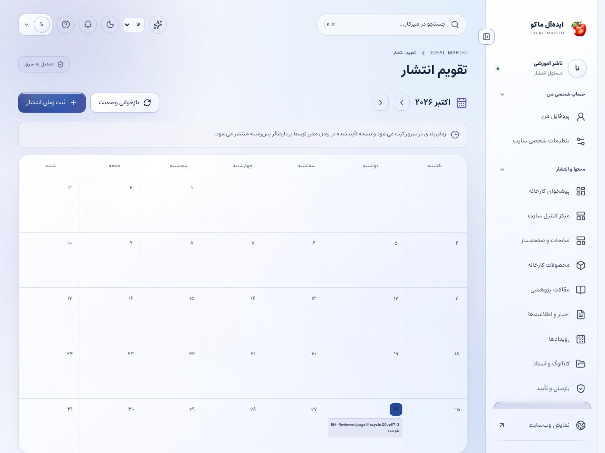
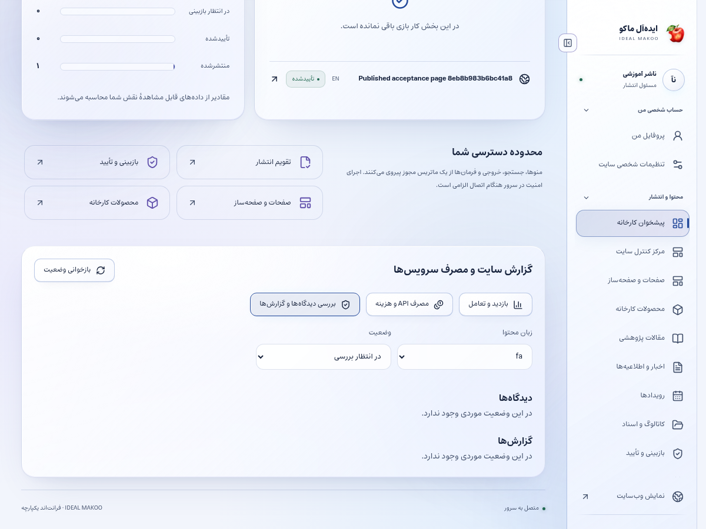

# راهنمای ناشر و مسئول انتشار

نسخهٔ ۲٫۲ ایده‌آل ماکو | آموزش کاربر غیرمتخصص | ۲۶ اکتبر ۲۰۲۶

نسخهٔ بررسی‌شده را در زمان مناسب و زبان درست منتشر می‌کنید و نتیجهٔ عمومی و اعلان‌های آن را کنترل می‌کنید. مسئول بررسی نظرهای کاربران و گزارش‌ها در محدودهٔ زبان مجاز نیز هستید.

## پیش از شروع

برای ورود، از نشانی رسمی سایت و حساب اختصاصی خود استفاده کنید. کارکنان باید علاوه بر رمز، مرحلهٔ MFA را کامل کنند. اگر حساب غیرفعال یا مجوز شما تغییر کرده باشد، ممکن است نیاز به ورود مجدد داشته باشید. یک دکمهٔ پنهان یا خطای دسترسی را با حساب همکار دور نزنید؛ موضوع را به مالک سامانه ارجاع دهید.

زبان رابط با زبان محتوای در حال ویرایش یکسان فرض نمی‌شود. در هر فرم به انتخابگر زبان محتوا توجه کنید. بعضی نقش‌ها فقط یک یا چند زبان مقصد دارند. در متن فارسی و عربی، نشانی اینترنتی و عدد و نام انگلیسی را در پیش‌نمایش کنترل کنید.

برای آشنایی با همان صفحه، علامت سؤال یا راهنمای زمینه‌ای را باز کنید. در آن راهنمای متناسب با نقش و صفحه قرار دارد. این کتابچه گردش کامل یک کار را توضیح می‌دهد و راهنمای زمینه‌ای برای یادآوری حین انجام کار مناسب است.

## صفحه‌های موردنیاز

| صفحه | مسیر |
| --- | --- |
| پیشخوان | `/fa/admin/` |
| انتشارها | `/fa/admin/publications/` |
| بازبینی | `/fa/admin/reviews/` |
| صفحات | `/fa/admin/pages/` |
| محصولات | `/fa/admin/products/` |
| قالب‌های ارتباطی | `/fa/admin/communications/` |

مسیرهای جدول نسبت به دامنهٔ نصب شما هستند. برای زبان دیگر، بخش fa تغییر می‌کند. فقط صفحه‌ها و دکمه‌های مجاز حساب فعلی قابل استفاده‌اند.

شکل ۱ ـ پیشخوان همین نسخه با حساب آموزشی. اعداد این تصویر، آمار کسب‌وکار واقعی نیستند.

## گردش اصلی کار

### انتشار یک نسخهٔ تأییدشده و کنترل اعلان

1. برای انتشار فوری، رکورد تأییدشده را در بخش صفحات، محصولات یا خبر باز کنید. بخش انتشارها یک تقویم زمان‌بندی است؛ در آن «زمان‌بندی» را می‌زنید و زبان و رکوردِ دارای تأیید را انتخاب می‌کنید.

2. تأیید مستقل نسخه را بررسی کنید. اگر متن بعد از تأیید تغییر کرده، همان نسخهٔ تازه باید گردش بازبینی معتبر داشته باشد.

3. پیش‌نمایش را باز کنید و عنوان، خلاصه، تصویر، دسته، لینک و نمایش موبایل را ببینید.

4. عنوان و توضیح SEO، نشانی canonical و زبان محتوا را بررسی کنید. صفحهٔ عادی عمومی نباید سهواً noindex باشد.

5. برای انتشار فوری، فرمان انتشار همان زبان را روی رکورد تأییدشده اجرا کنید. در تقویم زمان‌بندی، تاریخ و ساعت آینده را وارد کنید و نام منطقهٔ زمانی مرورگر را که زیر فرم نمایش داده می‌شود بخوانید؛ ساعت واردشده با همان منطقه تفسیر می‌شود.

6. پاسخ موفق سرور را ببینید و سپس صفحهٔ عمومی را تازه کنید. preview یا draft به‌تنهایی اثبات انتشار نیست.

7. با جست‌وجوی عمومی نام محتوا را پیدا کنید و لینک نتیجه را باز کنید. در صورت تغییر نشانی، لینک‌های قبلی را نیز بررسی کنید.

8. در ارتباطات، رویداد انتشار و وضعیت کانال‌ها را ببینید. در SMS فقط متن و لینک ارسال می‌شود؛ عکس در ایمیل و تلگرامِ پشتیبان قابل استفاده است.

9. خطای provider، لغو به علت تغییر مجوز و نبود گیرنده را از هم جدا کنید. برای رفع خطا، یک پیام را بدون بررسی دوباره ارسال نکنید.

10. در پیشخوان به بخش «بررسی دیدگاه‌ها و گزارش‌ها» بروید، زبان و وضعیت «در انتظار بررسی» را انتخاب کنید. متن هر نظر را با صفحهٔ مربوط بخوانید و تأیید انتشار یا رد دیدگاه را بزنید.

11. گزارش تخلف را بررسی و «رسیدگی شد» یا «رد گزارش» را انتخاب کنید. اگر نظر نامناسب قبلاً منتشر شده، فیلتر وضعیت را روی «دیدگاه‌های منتشرشده» بگذارید، نظر مربوط را پیدا و «رد دیدگاه» را بزنید؛ سپس صفحهٔ عمومی را تازه کنید تا پنهان‌شدن آن را ببینید.

12. در صورت خطای محتوایی جدی، انتشار همان زبان را پس بگیرید و اصلاح را به نویسنده ارجاع دهید. حذف draft دیگر زبان‌ها اقدام لازم برای این کار نیست.

شکل ۲ ـ بخش اصلی کار این نقش. نام حساب‌ها آموزشی است؛ اطلاعات مشتری یا رمز در تصویر درج نشده است.

## مدیریت نظرها

نظر تازه ابتدا pending است. تأیید فقط پس از خواندن متن و بررسی ارتباط با محتوا انجام می‌شود. گزارش کاربر خصوصی است؛ متن گزارش را در نظر عمومی کپی نکنید. این نسخه نظرهای تخت دارد و گفتگوهای تو‌در‌تو ارائه نمی‌کند.

## انتشار قالب پیام

قالب‌ها هم زبان و نسخه و بازبینی دارند. متغیر ضروری یا لینک لغو عضویت را حذف نکنید. پیش‌نمایش قالب را با نمونهٔ بی‌خطر بررسی و سپس فعال کنید.

## زمان‌بندی

قبل از زمان مقرر، تغییر مهم در محتوا یا ازبین‌رفتن مجوز ناشر می‌تواند کار زمان‌بندی را متوقف کند. صف و پیام خطا را ببینید و علت را حل کنید؛ وضعیت scheduled به معنی منتشرشدن نیست.

## تصویر میز نظارت

فیلتر وضعیت، صف انتظار و دیدگاه‌های منتشرشده یا ردشده و نتیجهٔ گزارش‌ها را جدا می‌کند. اگر صف خالی است، عملیات تأیید برای آن صف نمایش داده نمی‌شود.

## ذخیره و وضعیت کار

در کارهای محتوایی ابتدا پیش‌نویس را ذخیره کنید، منتظر پاسخ موفق بمانید و بعد صفحه یا زبان را تغییر دهید. بعضی ویرایشگرها قفل همکاری دارند تا دو نفر هم‌زمان کار یکدیگر را بازنویسی نکنند. اگر پیام تغییر نسخه یا قفل مشاهده شد، متن خود را نگه دارید، با همکار هماهنگ کنید و نسخهٔ تازه را آگاهانه بارگذاری کنید.

وضعیت‌های رایج را جدا بدانید: draft یعنی کار ذخیره‌شده ولی آمادهٔ نمایش عمومی نیست؛ review یعنی در انتظار بررسی؛ approved یعنی نسخهٔ مشخص تأیید شده؛ scheduled یعنی در صف زمان‌بندی؛ published یعنی نسخهٔ همان زبان منتشر شده؛ archived یا withdrawn یعنی از مسیر عادی انتشار کنار رفته است. تغییر متن پس از تأیید ممکن است به بازبینی تازه نیاز داشته باشد.

## اعلان و پیگیری

اعلان داخلی را از زنگ پنل باز کنید و با لینک همان اعلان به پرونده بروید. برای هشدار ایمیل، پیامک یا تلگرام، سرویس باید توسط مالک تنظیم و کانال شخصی شما تأیید شده باشد. از حساب شخصی ← اعلان‌ها (/fa/account/notifications/) به تنظیمات کانال و رضایت موضوع‌ها بروید؛ این مسیر برای حساب کارکنان هم قابل استفاده است. شمارهٔ ذخیره‌شده در پروفایل به‌تنهایی مجوز ارسال به آن شماره نیست. اگر به پرونده‌ای دسترسی ندارید، انتظار هشدار محتوای خصوصی همان پرونده را نداشته باشید.

پیام کوتاه بیرونی فقط خلاصه و لینک امن را حمل می‌کند؛ تصمیم و پاسخ کامل در پنل ثبت می‌شود. وضعیت صف، شکست، لغو و پذیرش provider را جدا بخوانید. قبل از تکرار ارسال، علت وضعیت قبلی را بررسی کنید تا مخاطب پیام تکراری نگیرد.

## گزارش و مصرف سرویس

در پایین پیشخوان و در گزارش‌های مجاز، کارت «گزارش سایت و مصرف سرویس‌ها» را پیدا کنید. از دکمه‌های «بازدید و تعامل» و «مصرف API و هزینه» استفاده کنید. بازهٔ ۷، ۳۰ یا ۹۰ روز و زبان را مشخص کنید. بازدیدهای این نسخه به مرورگر، محتوا و بازهٔ ۳۰ دقیقه محدود می‌شوند و شمارش قطعی افراد یکتا نیستند. تعداد نظر تأییدشده از صف بررسی جداست.

گزارش مصرف برای مدیر ارشد، مدیر و تحلیلگر در محدودهٔ سازمانی و برای سایر کارکنان در محدودهٔ شخصی مجاز نشان داده می‌شود. هزینهٔ نامعلوم صفر نیست. پیامک با ریال و AI با دلار ممکن است گزارش شود؛ آن‌ها را بدون نرخ تبدیل و سیاست مالی با هم جمع نکنید. حالت accepted یعنی سرویس درخواست را پذیرفته است و خوانده‌شدن پیام توسط مخاطب را اثبات نمی‌کند.

## دستیار اختیاری هوش مصنوعی

دکمهٔ «کمک اختیاری هوش مصنوعی» در نوار بالای پنل است و فقط موضوع‌های مجاز نقش را نشان می‌دهد. موضوع و زبان مجاز را انتخاب کنید، درخواست روشن بنویسید و گزینهٔ رضایت ارسال متن و پرونده‌های انتخابی به ارائه‌دهنده را بخوانید و علامت بزنید؛ سپس «دریافت پیشنهاد» را بزنید. بدون تنظیم کلید/مدل سرویس توسط مالک، تولید غیرفعال است. برای محتوا، SEO، محصول یا راهنمای کار، متن مرجع را خودتان در درخواست بنویسید؛ صرف بازبودن یک صفحه باعث خواندن خودکار آن نمی‌شود. در موضوع مشتری، حداکثر پنج پروندهٔ مجاز را صریح انتخاب کنید تا سرور فقط همان دادهٔ مجاز را بخواند. موضوع تحلیل، آمار ۳۰ روز اخیر زبان انتخاب‌شده را اضافه می‌کند و به فیلتر فعلی جدول وابسته نیست. تولید، با فرمان شما مصرف ایجاد می‌کند. خروجی را بازخوانی کنید؛ پیشنهاد خودکار ذخیره، منتشر، تأیید یا برای مشتری ارسال نمی‌شود. توقف درخواست ممکن است مصرفی را که قبلاً نزد ارائه‌دهنده انجام شده برنگرداند.

نمونهٔ درخواست مناسب:

برای این محتوای تأییدشده یک چک‌لیست پیش از انتشار و متن کوتاه معرفی پیشنهاد بده؛ لینک و ادعاهای منبع حفظ شوند.

## خطاهای رایج و اقدام درست

| نشانه | اقدام |
| --- | --- |
| ورود دوباره خواسته می‌شود | نشست منقضی، حساب غیرفعال یا اختیار تغییر کرده است. متن ذخیره‌نشده را نگه دارید، با حساب خود وارد شوید و در صورت تکرار به مدیر اطلاع دهید. |
| این کار مجاز نیست یا زبان قابل انتخاب نیست | نام نقش، زبان و محدودهٔ پرونده را بررسی کنید. از مالک اصلاح اختیار لازم را بخواهید؛ نقش بالاتر را صرفاً برای دورزدن خطا درخواست نکنید. |
| نسخه تغییر کرده یا ویرایشگر قفل است | همکار دیگری داده را تغییر داده یا قفل معتبر دارد. پیش‌نویس خود را نگه دارید، هماهنگ کنید و نسخهٔ سرور را دوباره بارگذاری کنید. |
| تعداد درخواست زیاد است | محدودیت زمانی برای جلوگیری از سوءاستفاده فعال شده است. زمان اعلام‌شده را صبر کنید و درخواست را پیاپی تکرار نکنید. |
| سرویس تنظیم نشده یا پیام ارسال نشد | کلید، قالب، کانال تأییدشده و سلامت worker باید توسط نقش مجاز بررسی شوند. وضعیت ناموفق را موفق فرض نکنید و کلید را داخل متن خطا نفرستید. |
| محتوا در جست‌وجو پیدا نمی‌شود | نوع، دسته و زبان را بررسی کنید. draft، ترجمهٔ منتشرنشده، محتوای پس‌گرفته‌شده یا سند خصوصی در جست‌وجوی عمومی نمی‌آید. |

## تمرین پایان آموزش

۱. مسیر «انتشار یک نسخهٔ تأییدشده و کنترل اعلان» را با دادهٔ آموزشی و بدون ارسال ناخواسته به افراد واقعی مرور کنید.

۲. نشان دهید نتیجهٔ کار کجا روی سرور ثبت می‌شود و چه تفاوتی با متن ذخیره‌نشده در مرورگر دارد.

۳. یک خطای دسترسی یا وضعیت انتظار را توضیح دهید و مسیر ارجاع درست را انتخاب کنید.

۴. گزارش یا صفحهٔ نتیجه را دوباره باز کنید و مطمئن شوید اطلاعات درست، زبان درست و وضعیت درست دیده می‌شود.

## تحویل کار به نقش بعدی

نویسنده برای اصلاح، بازبین برای تأیید نسخه و مدیر/فنی برای اختلال کانال یا زمان‌بندی.

## حدود اختیار

ناشر نمی‌تواند با تأیید نظر، نقش کاربر را تغییر دهد یا محدودیت زبان و بازبینی مستقل را دور بزند. انتشار واقعی اعلان به پیکربندی سرویس و گیرندهٔ مجاز وابسته است.

## چک‌لیست پایان روز

- کارهای ذخیره‌نشده را تعیین تکلیف کنید و پاسخ موفق سرور را ببینید.
- درخواست یا وظیفهٔ باز را بدون مسئول و اقدام بعدی رها نکنید.
- پیام خطا یا ارسال ناموفق را با اطلاعات لازم و بدون رمز/کلید گزارش کنید.
- روی دستگاه مشترک از حساب خارج شوید.
- برای کار بعدی از راهنمای همان نقش و بخش کمک بگیرید.

## راهنماهای مرتبط

- [سند تفصیلی توسعه](../EXPANSION-SPEC-2.2.fa.md)
- [برنامهٔ اجرا](../IMPLEMENTATION-PLAN-2.2.fa.md)
- [شروع نصب و استفاده](../START-HERE-2.2.0.fa.md)
- [سرویس‌ها و DNS و SEO](../INSTALL-SERVICES-SEO-2.2.fa.md)
- [گزارش آزمون این نسخه](../VERIFICATION-2.2.0.fa.md)
