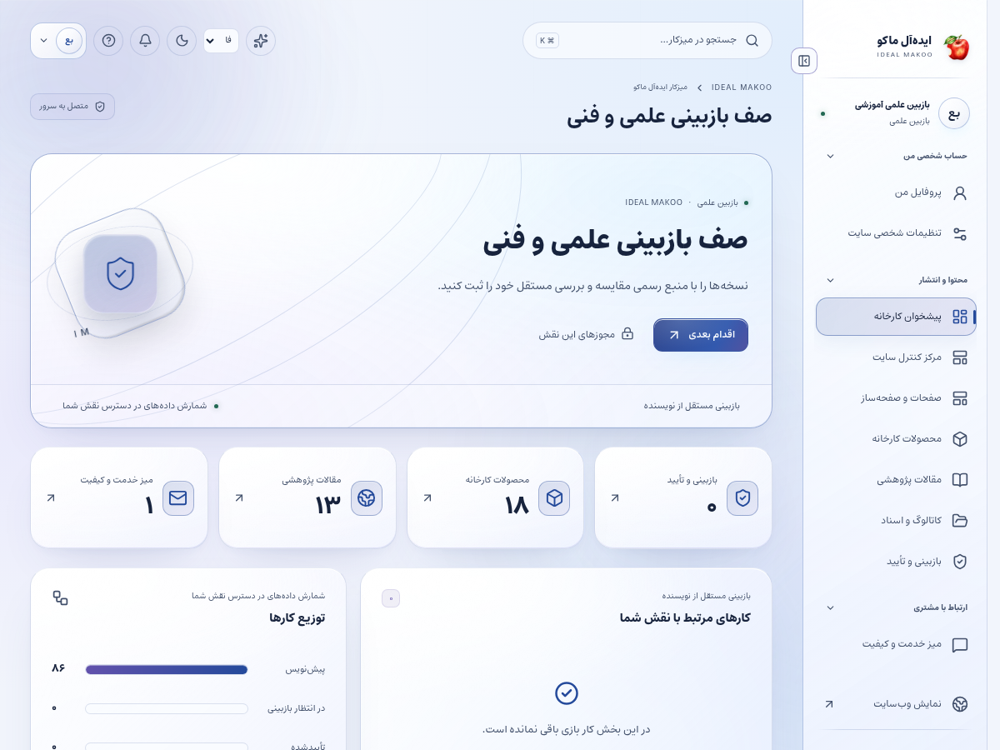
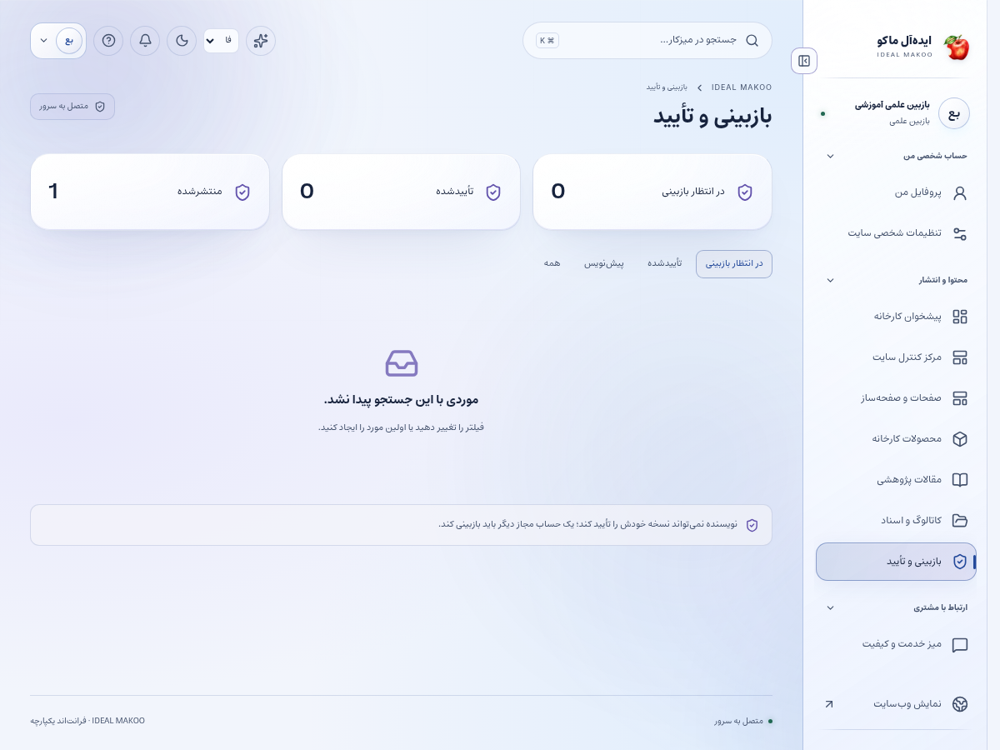

# راهنمای بازبین علمی و فنی

نسخهٔ ۲٫۲ ایده‌آل ماکو | آموزش کاربر غیرمتخصص | ۲۶ اکتبر ۲۰۲۶

نسخهٔ ارسالی را مستقل از نویسنده با منبع مقایسه می‌کنید و نظر قابل اقدام ثبت می‌کنید. تأیید علمی به معنی تضمین همهٔ کاربردهای پزشکی یا مجوز انتشار توسط هر فرد نیست.

## پیش از شروع

برای ورود، از نشانی رسمی سایت و حساب اختصاصی خود استفاده کنید. کارکنان باید علاوه بر رمز، مرحلهٔ MFA را کامل کنند. اگر حساب غیرفعال یا مجوز شما تغییر کرده باشد، ممکن است نیاز به ورود مجدد داشته باشید. یک دکمهٔ پنهان یا خطای دسترسی را با حساب همکار دور نزنید؛ موضوع را به مالک سامانه ارجاع دهید.

زبان رابط با زبان محتوای در حال ویرایش یکسان فرض نمی‌شود. در هر فرم به انتخابگر زبان محتوا توجه کنید. بعضی نقش‌ها فقط یک یا چند زبان مقصد دارند. در متن فارسی و عربی، نشانی اینترنتی و عدد و نام انگلیسی را در پیش‌نمایش کنترل کنید.

برای آشنایی با همان صفحه، علامت سؤال یا راهنمای زمینه‌ای را باز کنید. در آن راهنمای متناسب با نقش و صفحه قرار دارد. این کتابچه گردش کامل یک کار را توضیح می‌دهد و راهنمای زمینه‌ای برای یادآوری حین انجام کار مناسب است.

## صفحه‌های موردنیاز

| صفحه | مسیر |
| --- | --- |
| پیشخوان | `/fa/admin/` |
| بازبینی | `/fa/admin/reviews/` |
| محصولات | `/fa/admin/products/` |
| پژوهش | `/fa/admin/research/` |
| منابع | `/fa/admin/resources/` |
| پرونده‌های کیفیت مجاز | `/fa/admin/tickets/` |

مسیرهای جدول نسبت به دامنهٔ نصب شما هستند. برای زبان دیگر، بخش fa تغییر می‌کند. فقط صفحه‌ها و دکمه‌های مجاز حساب فعلی قابل استفاده‌اند.

شکل ۱ ـ پیشخوان همین نسخه با حساب آموزشی. اعداد این تصویر، آمار کسب‌وکار واقعی نیستند.

## گردش اصلی کار

### بازبینی مستقل یک نسخهٔ محصول یا مقاله

1. صف بازبینی را باز کنید و عنوان، زبان، نویسنده و نسخهٔ درخواست‌شده را ببینید. اگر خودتان نویسندهٔ همان نسخه هستید، بازبینی را به فرد مستقل ارجاع دهید.

2. منبع و فایل‌های مربوط را باز کنید. اگر دسترسی سند محدود است، نبود دسترسی را گزارش کنید و با حدس آن را تأیید نکنید.

3. عنوان و خلاصه را با متن اصلی مقایسه کنید؛ نتیجهٔ پژوهش نباید به وعدهٔ قطعی تجاری یا درمانی تبدیل شده باشد.

4. اعداد، واحدها، ماده، کدهای فنی و نام محصول را سطر به سطر کنترل کنید. به ارقام فارسی و لاتین و اعشار توجه کنید.

5. تصویر و جدول را از نظر تعلق به همان محصول یا مقاله بررسی کنید. یک تصویر زیبا جای مدرک مرتبط نیست.

6. اگر زبان مقصد را بررسی می‌کنید، معنای تخصصی را با منبع تطبیق دهید. فقط بر درستی املای عمومی تکیه نکنید.

7. نقص‌ها را با اشارهٔ روشن به بخش و اصلاح موردنیاز بنویسید. «بد است» یا «اصلاح شود» بدون جزئیات کمک‌کننده نیست.

8. اگر نیاز به اصلاح دارد، اشکالات دقیق را در یادداشت داخلی رکورد ثبت و برای اصلاح به نویسنده ارجاع دهید؛ فرمان تأیید را اجرا نکنید. صف بازبینی برای این نقش دکمهٔ مستقل تغییر متن نویسنده ندارد.

9. اگر صحیح است، نسخهٔ همان زبان را تأیید کنید. تأیید شما به revision بررسی‌شده تعلق دارد.

10. پس از تغییر محتوایی نویسنده، نسخهٔ جدید را دوباره بررسی کنید. نشان تأیید قبلی نباید دلیل نادیده‌گرفتن تغییر تازه شود.

11. برای موضوع کیفیت مشتری، فقط پرونده‌ای را باز کنید که مجوز آن را دارید و نکتهٔ فنی را در یادداشت مجاز بنویسید.

12. نتیجه را به ناشر یا مدیر مربوط منتقل کنید. وضعیت صف را تازه کنید تا ثبت تصمیم روی سرور مشخص باشد.

شکل ۲ ـ بخش اصلی کار این نقش. نام حساب‌ها آموزشی است؛ اطلاعات مشتری یا رمز در تصویر درج نشده است.

## استفاده از AI در بازبینی

دستیار می‌تواند فهرست موارد مبهم یا تفاوت‌های متن را پیشنهاد دهد. مرجع علمی و تصمیم تأیید همچنان با شماست. اگر ابزار منبعی ارائه کرد، خود منبع را بررسی کنید؛ پاسخ AI مدرک مستقل نیست.

## مستندات محدود

دسترسی مدیریتی به همهٔ data roomها داده نمی‌شود. اگر سند برای بررسی لازم است از مالک سند grant معتبر بخواهید. فایل خصوصی را برای دورزدن محدودیت به بخش عمومی منتقل نکنید.

## گزارش خطای محتوا

در خطای عمومی جدی، به ناشر/مدیر اطلاع دهید تا انتشار متوقف یا اصلاح شود. یادداشت داخلی شما به صورت خودکار پیام عمومی به مشتری نیست.

## ذخیره و وضعیت کار

در کارهای محتوایی ابتدا پیش‌نویس را ذخیره کنید، منتظر پاسخ موفق بمانید و بعد صفحه یا زبان را تغییر دهید. بعضی ویرایشگرها قفل همکاری دارند تا دو نفر هم‌زمان کار یکدیگر را بازنویسی نکنند. اگر پیام تغییر نسخه یا قفل مشاهده شد، متن خود را نگه دارید، با همکار هماهنگ کنید و نسخهٔ تازه را آگاهانه بارگذاری کنید.

وضعیت‌های رایج را جدا بدانید: draft یعنی کار ذخیره‌شده ولی آمادهٔ نمایش عمومی نیست؛ review یعنی در انتظار بررسی؛ approved یعنی نسخهٔ مشخص تأیید شده؛ scheduled یعنی در صف زمان‌بندی؛ published یعنی نسخهٔ همان زبان منتشر شده؛ archived یا withdrawn یعنی از مسیر عادی انتشار کنار رفته است. تغییر متن پس از تأیید ممکن است به بازبینی تازه نیاز داشته باشد.

## اعلان و پیگیری

اعلان داخلی را از زنگ پنل باز کنید و با لینک همان اعلان به پرونده بروید. برای هشدار ایمیل، پیامک یا تلگرام، سرویس باید توسط مالک تنظیم و کانال شخصی شما تأیید شده باشد. از حساب شخصی ← اعلان‌ها (/fa/account/notifications/) به تنظیمات کانال و رضایت موضوع‌ها بروید؛ این مسیر برای حساب کارکنان هم قابل استفاده است. شمارهٔ ذخیره‌شده در پروفایل به‌تنهایی مجوز ارسال به آن شماره نیست. اگر به پرونده‌ای دسترسی ندارید، انتظار هشدار محتوای خصوصی همان پرونده را نداشته باشید.

پیام کوتاه بیرونی فقط خلاصه و لینک امن را حمل می‌کند؛ تصمیم و پاسخ کامل در پنل ثبت می‌شود. وضعیت صف، شکست، لغو و پذیرش provider را جدا بخوانید. قبل از تکرار ارسال، علت وضعیت قبلی را بررسی کنید تا مخاطب پیام تکراری نگیرد.

## گزارش و مصرف سرویس

در پایین پیشخوان و در گزارش‌های مجاز، کارت «گزارش سایت و مصرف سرویس‌ها» را پیدا کنید. از دکمه‌های «بازدید و تعامل» و «مصرف API و هزینه» استفاده کنید. بازهٔ ۷، ۳۰ یا ۹۰ روز و زبان را مشخص کنید. بازدیدهای این نسخه به مرورگر، محتوا و بازهٔ ۳۰ دقیقه محدود می‌شوند و شمارش قطعی افراد یکتا نیستند. تعداد نظر تأییدشده از صف بررسی جداست.

گزارش مصرف برای مدیر ارشد، مدیر و تحلیلگر در محدودهٔ سازمانی و برای سایر کارکنان در محدودهٔ شخصی مجاز نشان داده می‌شود. هزینهٔ نامعلوم صفر نیست. پیامک با ریال و AI با دلار ممکن است گزارش شود؛ آن‌ها را بدون نرخ تبدیل و سیاست مالی با هم جمع نکنید. حالت accepted یعنی سرویس درخواست را پذیرفته است و خوانده‌شدن پیام توسط مخاطب را اثبات نمی‌کند.

## دستیار اختیاری هوش مصنوعی

دکمهٔ «کمک اختیاری هوش مصنوعی» در نوار بالای پنل است و فقط موضوع‌های مجاز نقش را نشان می‌دهد. موضوع و زبان مجاز را انتخاب کنید، درخواست روشن بنویسید و گزینهٔ رضایت ارسال متن و پرونده‌های انتخابی به ارائه‌دهنده را بخوانید و علامت بزنید؛ سپس «دریافت پیشنهاد» را بزنید. بدون تنظیم کلید/مدل سرویس توسط مالک، تولید غیرفعال است. برای محتوا، SEO، محصول یا راهنمای کار، متن مرجع را خودتان در درخواست بنویسید؛ صرف بازبودن یک صفحه باعث خواندن خودکار آن نمی‌شود. در موضوع مشتری، حداکثر پنج پروندهٔ مجاز را صریح انتخاب کنید تا سرور فقط همان دادهٔ مجاز را بخواند. موضوع تحلیل، آمار ۳۰ روز اخیر زبان انتخاب‌شده را اضافه می‌کند و به فیلتر فعلی جدول وابسته نیست. تولید، با فرمان شما مصرف ایجاد می‌کند. خروجی را بازخوانی کنید؛ پیشنهاد خودکار ذخیره، منتشر، تأیید یا برای مشتری ارسال نمی‌شود. توقف درخواست ممکن است مصرفی را که قبلاً نزد ارائه‌دهنده انجام شده برنگرداند.

نمونهٔ درخواست مناسب:

این متن را فقط از نظر ادعای بدون منبع، عدد ناسازگار و اصطلاح مبهم بررسی کن. تصمیم تأیید نده و موارد نیازمند بررسی من را فهرست کن.

## خطاهای رایج و اقدام درست

| نشانه | اقدام |
| --- | --- |
| ورود دوباره خواسته می‌شود | نشست منقضی، حساب غیرفعال یا اختیار تغییر کرده است. متن ذخیره‌نشده را نگه دارید، با حساب خود وارد شوید و در صورت تکرار به مدیر اطلاع دهید. |
| این کار مجاز نیست یا زبان قابل انتخاب نیست | نام نقش، زبان و محدودهٔ پرونده را بررسی کنید. از مالک اصلاح اختیار لازم را بخواهید؛ نقش بالاتر را صرفاً برای دورزدن خطا درخواست نکنید. |
| نسخه تغییر کرده یا ویرایشگر قفل است | همکار دیگری داده را تغییر داده یا قفل معتبر دارد. پیش‌نویس خود را نگه دارید، هماهنگ کنید و نسخهٔ سرور را دوباره بارگذاری کنید. |
| تعداد درخواست زیاد است | محدودیت زمانی برای جلوگیری از سوءاستفاده فعال شده است. زمان اعلام‌شده را صبر کنید و درخواست را پیاپی تکرار نکنید. |
| سرویس تنظیم نشده یا پیام ارسال نشد | کلید، قالب، کانال تأییدشده و سلامت worker باید توسط نقش مجاز بررسی شوند. وضعیت ناموفق را موفق فرض نکنید و کلید را داخل متن خطا نفرستید. |
| محتوا در جست‌وجو پیدا نمی‌شود | نوع، دسته و زبان را بررسی کنید. draft، ترجمهٔ منتشرنشده، محتوای پس‌گرفته‌شده یا سند خصوصی در جست‌وجوی عمومی نمی‌آید. |

## تمرین پایان آموزش

۱. مسیر «بازبینی مستقل یک نسخهٔ محصول یا مقاله» را با دادهٔ آموزشی و بدون ارسال ناخواسته به افراد واقعی مرور کنید.

۲. نشان دهید نتیجهٔ کار کجا روی سرور ثبت می‌شود و چه تفاوتی با متن ذخیره‌نشده در مرورگر دارد.

۳. یک خطای دسترسی یا وضعیت انتظار را توضیح دهید و مسیر ارجاع درست را انتخاب کنید.

۴. گزارش یا صفحهٔ نتیجه را دوباره باز کنید و مطمئن شوید اطلاعات درست، زبان درست و وضعیت درست دیده می‌شود.

## تحویل کار به نقش بعدی

نویسنده یا مدیر محصول برای اصلاح، ناشر برای انتشار و مسئول کیفیت برای پروندهٔ مشتری.

## حدود اختیار

تأیید محتوای خود، انتشار بدون مجوز و بازکردن پروندهٔ خارج از محدوده مجاز نیست. دستیار اختیاری جای بررسی مستقل را نمی‌گیرد.

## چک‌لیست پایان روز

- کارهای ذخیره‌نشده را تعیین تکلیف کنید و پاسخ موفق سرور را ببینید.
- درخواست یا وظیفهٔ باز را بدون مسئول و اقدام بعدی رها نکنید.
- پیام خطا یا ارسال ناموفق را با اطلاعات لازم و بدون رمز/کلید گزارش کنید.
- روی دستگاه مشترک از حساب خارج شوید.
- برای کار بعدی از راهنمای همان نقش و بخش کمک بگیرید.

## راهنماهای مرتبط

- [سند تفصیلی توسعه](../EXPANSION-SPEC-2.2.fa.md)
- [برنامهٔ اجرا](../IMPLEMENTATION-PLAN-2.2.fa.md)
- [شروع نصب و استفاده](../START-HERE-2.2.0.fa.md)
- [سرویس‌ها و DNS و SEO](../INSTALL-SERVICES-SEO-2.2.fa.md)
- [گزارش آزمون این نسخه](../VERIFICATION-2.2.0.fa.md)
