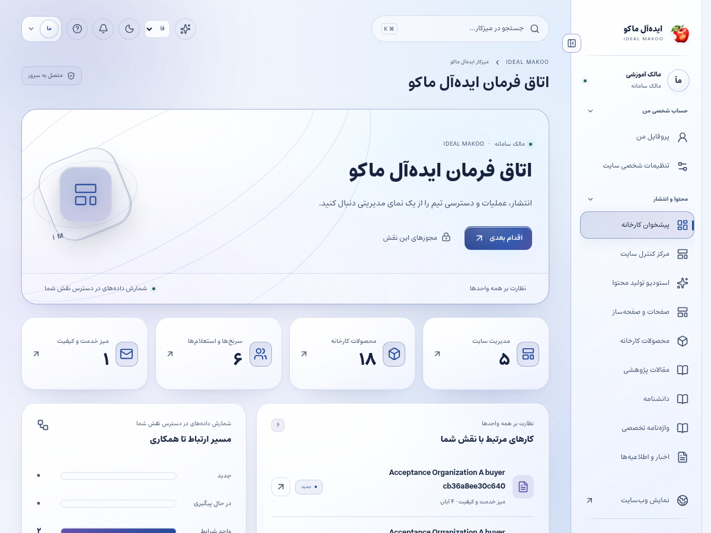
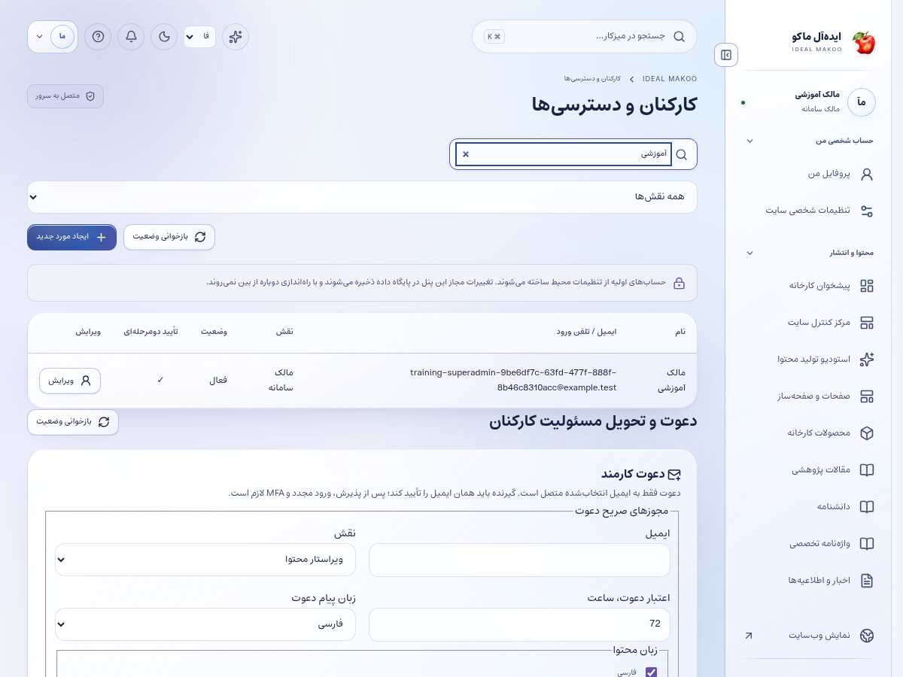

# راهنمای مالک و مدیر ارشد سامانه

نسخهٔ ۲٫۲ ایده‌آل ماکو | آموزش کاربر غیرمتخصص | ۲۶ اکتبر ۲۰۲۶

مسئول تنظیم اختیارها، آمادگی سرویس‌ها، انتشار امن، هزینه و تداوم کار سامانه هستید. ابتدا دسترسی تیم را درست تنظیم کنید؛ سپس کیفیت فرایندها و گزارش خطاها را پیگیری کنید. کلید سرویس‌های بیرونی در فایل خصوصی سرور قرار می‌گیرد و صفحهٔ کاربران محل نگهداری آن نیست.

## پیش از شروع

برای ورود، از نشانی رسمی سایت و حساب اختصاصی خود استفاده کنید. کارکنان باید علاوه بر رمز، مرحلهٔ MFA را کامل کنند. اگر حساب غیرفعال یا مجوز شما تغییر کرده باشد، ممکن است نیاز به ورود مجدد داشته باشید. یک دکمهٔ پنهان یا خطای دسترسی را با حساب همکار دور نزنید؛ موضوع را به مالک سامانه ارجاع دهید.

زبان رابط با زبان محتوای در حال ویرایش یکسان فرض نمی‌شود. در هر فرم به انتخابگر زبان محتوا توجه کنید. بعضی نقش‌ها فقط یک یا چند زبان مقصد دارند. در متن فارسی و عربی، نشانی اینترنتی و عدد و نام انگلیسی را در پیش‌نمایش کنترل کنید.

برای آشنایی با همان صفحه، علامت سؤال یا راهنمای زمینه‌ای را باز کنید. در آن راهنمای متناسب با نقش و صفحه قرار دارد. این کتابچه گردش کامل یک کار را توضیح می‌دهد و راهنمای زمینه‌ای برای یادآوری حین انجام کار مناسب است.

## صفحه‌های موردنیاز

| صفحه | مسیر |
| --- | --- |
| پیشخوان | `/fa/admin/` |
| کاربران | `/fa/admin/staff/` |
| نقش‌ها | `/fa/admin/roles/` |
| تنظیمات سازمان | `/fa/admin/settings/` |
| مانیتورینگ | `/fa/admin/monitoring/` |
| قالب‌ها و تحویل اعلان | `/fa/admin/communications/` |

مسیرهای جدول نسبت به دامنهٔ نصب شما هستند. برای زبان دیگر، بخش fa تغییر می‌کند. فقط صفحه‌ها و دکمه‌های مجاز حساب فعلی قابل استفاده‌اند.

شکل ۱ ـ پیشخوان همین نسخه با حساب آموزشی. اعداد این تصویر، آمار کسب‌وکار واقعی نیستند.

## گردش اصلی کار

### ساخت حساب یک کارشناس بازرگانی و کنترل دسترسی او

1. با حساب مالک وارد شوید و MFA خود را کامل کنید. راهنمای امنیت حساب را بخوانید و کدهای بازیابی را در محل خصوصی نگه دارید.

2. از منوی کاربران، وضعیت مدیریت حساب را ببینید. در حالت hybrid یا panel ساخت حساب از پنل انجام می‌شود؛ در حالت env بعضی تغییرهای حساس فقط با فرمان مالک مجازند.

3. فرمان ایجاد کاربر را باز کنید. نام واقعی همکار، ایمیل درست و یک رمز اولیهٔ اختصاصی وارد کنید. یک حساب مشترک برای چند نفر نسازید.

4. نقش business را برای کارشناس بازرگانی انتخاب کنید. نقش مدیر ارشد را برای رفع یک خطای عادی به کاربر ندهید.

5. زبان‌های موردنیاز همکار را انتخاب کنید. برای نمونه، مسئول بازار داخلی می‌تواند فقط فارسی داشته باشد؛ این انتخاب بر ویرایش و تحلیل زبان‌های دیگر اثر دارد.

6. محدودهٔ CRM را بر اساس کار تعیین کنید: assigned برای پرونده‌های واگذارشده، team برای تیم‌های عضو و all فقط برای فردی که باید همهٔ پرونده‌ها را ببیند.

7. مجوز اطلاعات تماس، دادهٔ مالی، بهای پایه، تخصیص و پذیرش درخواست را جدا بررسی کنید. دسترسی به پرونده و دیدن همهٔ ستون‌های آن دو موضوع متفاوت‌اند.

8. حساب را ذخیره کنید و نتیجهٔ سرور را ببینید. نام کاربر باید در فهرست ظاهر شود. اطلاعات اولیه را از مسیر امن سازمانی در اختیار همان همکار قرار دهید.

9. از همکار بخواهید با حساب خودش وارد شود، MFA را فعال کند و رمز اولیه را عوض کند. رمز حساب او را برای استفادهٔ روزمره نزد خود نگه ندارید.

10. یک استعلام آموزشیِ بدون اطلاعات واقعی ایجاد و به همکار واگذار کنید. او باید پروندهٔ مربوط را ببیند و به پروندهٔ خارج از محدوده دسترسی نداشته باشد.

11. در پیشخوان، مصرف API و صف‌های شکست‌خورده را بررسی کنید. فعال‌شدن پنل به تنهایی نشانهٔ تحویل SMS یا ایمیل نیست؛ رسید provider و آزمون مقصد مجاز را ببینید.

12. برای پایان همکاری، فرایند غیرفعال‌سازی و انتقال پرونده‌ها را اجرا کنید. حذف عجولانهٔ سوابق به جای غیرفعال‌سازی می‌تواند پیگیری سازمان را مختل کند.

شکل ۲ ـ بخش اصلی کار این نقش. نام حساب‌ها آموزشی است؛ اطلاعات مشتری یا رمز در تصویر درج نشده است.

## راه‌اندازی ارتباطات

طبق راهنمای سرویس‌ها، کلید پنل پیامک، قالب OTP، SMTP و bot تلگرام را در تنظیمات خصوصی وارد کنید. عضوکردن bot در کانال و دادن مجوز ارسال لازم است. کارکنان شماره یا چت خود را از تنظیمات ارتباطی تأیید می‌کنند؛ صرف نوشتن شماره در پروفایل به معنی تأیید کانال نیست.

## نگهداری و بازیابی

بکاپ رمزنگاری‌شده را با فرمان مستند بگیرید و در بازهٔ مشخص یک بازیابی آزمایشی انجام دهید. موفقیت دانلود فایل به تنهایی کافی نیست؛ صحت آرشیو و قابلیت بازیابی باید بررسی شود. رمز بکاپ، کلیدهای سرور و ledger حریم خصوصی را در محل مناسب نگه دارید.

## تنظیم ظرفیت

از تنظیمات، سهمیهٔ فایل و سقف بارگذاری هر نوع را متناسب با سرور تعیین کنید. کاهش سهمیه، فایل موجود را حذف نمی‌کند. برای تغییر زیرساخت از راهنمای نصب/ارتقا استفاده کنید؛ پنل جایگزین تنظیم DNS یا فایروال نیست.

## شناخت و تکمیل حساب مشتری پیامکی

در فهرست کاربران، ستون ایمیل / تلفن ورود برای حساب بدون ایمیل، شمارهٔ تأییدشده را نشان می‌دهد. شماره را برای جستجو وارد کنید و پیش از اصلاح، هویت حساب را با شمارهٔ تأییدشدهٔ فقط‌خواندنی تطبیق دهید. تلفن تماسِ قابل ویرایش در پروفایل، شمارهٔ ورود را تغییر نمی‌دهد. برای اصلاح اطلاعات دیگر لازم نیست ایمیل ساختگی وارد کنید. اگر مشتری ایمیل واقعی می‌خواهد، در فیلد ایمیل ثبت و ذخیره کنید؛ این کار نشست قبلی را پایان می‌دهد و ایمیل هنوز نیازمند تأیید است. مشتری پس از ورود مجدد می‌تواند پیوند تأیید و در صورت نیاز بازیابی رمز را استفاده کند. پیش از تبدیل حساب پیامکی مشتری به نقش کارمند، ایمیل واقعی لازم است و کارکنان باید رمز و MFA داشته باشند.

## ذخیره و وضعیت کار

در کارهای محتوایی ابتدا پیش‌نویس را ذخیره کنید، منتظر پاسخ موفق بمانید و بعد صفحه یا زبان را تغییر دهید. بعضی ویرایشگرها قفل همکاری دارند تا دو نفر هم‌زمان کار یکدیگر را بازنویسی نکنند. اگر پیام تغییر نسخه یا قفل مشاهده شد، متن خود را نگه دارید، با همکار هماهنگ کنید و نسخهٔ تازه را آگاهانه بارگذاری کنید.

وضعیت‌های رایج را جدا بدانید: draft یعنی کار ذخیره‌شده ولی آمادهٔ نمایش عمومی نیست؛ review یعنی در انتظار بررسی؛ approved یعنی نسخهٔ مشخص تأیید شده؛ scheduled یعنی در صف زمان‌بندی؛ published یعنی نسخهٔ همان زبان منتشر شده؛ archived یا withdrawn یعنی از مسیر عادی انتشار کنار رفته است. تغییر متن پس از تأیید ممکن است به بازبینی تازه نیاز داشته باشد.

## اعلان و پیگیری

اعلان داخلی را از زنگ پنل باز کنید و با لینک همان اعلان به پرونده بروید. برای هشدار ایمیل، پیامک یا تلگرام، سرویس باید توسط مالک تنظیم و کانال شخصی شما تأیید شده باشد. از حساب شخصی ← اعلان‌ها (/fa/account/notifications/) به تنظیمات کانال و رضایت موضوع‌ها بروید؛ این مسیر برای حساب کارکنان هم قابل استفاده است. شمارهٔ ذخیره‌شده در پروفایل به‌تنهایی مجوز ارسال به آن شماره نیست. اگر به پرونده‌ای دسترسی ندارید، انتظار هشدار محتوای خصوصی همان پرونده را نداشته باشید.

پیام کوتاه بیرونی فقط خلاصه و لینک امن را حمل می‌کند؛ تصمیم و پاسخ کامل در پنل ثبت می‌شود. وضعیت صف، شکست، لغو و پذیرش provider را جدا بخوانید. قبل از تکرار ارسال، علت وضعیت قبلی را بررسی کنید تا مخاطب پیام تکراری نگیرد.

## گزارش و مصرف سرویس

در پایین پیشخوان و در گزارش‌های مجاز، کارت «گزارش سایت و مصرف سرویس‌ها» را پیدا کنید. از دکمه‌های «بازدید و تعامل» و «مصرف API و هزینه» استفاده کنید. بازهٔ ۷، ۳۰ یا ۹۰ روز و زبان را مشخص کنید. بازدیدهای این نسخه به مرورگر، محتوا و بازهٔ ۳۰ دقیقه محدود می‌شوند و شمارش قطعی افراد یکتا نیستند. تعداد نظر تأییدشده از صف بررسی جداست.

گزارش مصرف برای مدیر ارشد، مدیر و تحلیلگر در محدودهٔ سازمانی و برای سایر کارکنان در محدودهٔ شخصی مجاز نشان داده می‌شود. هزینهٔ نامعلوم صفر نیست. پیامک با ریال و AI با دلار ممکن است گزارش شود؛ آن‌ها را بدون نرخ تبدیل و سیاست مالی با هم جمع نکنید. حالت accepted یعنی سرویس درخواست را پذیرفته است و خوانده‌شدن پیام توسط مخاطب را اثبات نمی‌کند.

## دستیار اختیاری هوش مصنوعی

دکمهٔ «کمک اختیاری هوش مصنوعی» در نوار بالای پنل است و فقط موضوع‌های مجاز نقش را نشان می‌دهد. موضوع و زبان مجاز را انتخاب کنید، درخواست روشن بنویسید و گزینهٔ رضایت ارسال متن و پرونده‌های انتخابی به ارائه‌دهنده را بخوانید و علامت بزنید؛ سپس «دریافت پیشنهاد» را بزنید. بدون تنظیم کلید/مدل سرویس توسط مالک، تولید غیرفعال است. برای محتوا، SEO، محصول یا راهنمای کار، متن مرجع را خودتان در درخواست بنویسید؛ صرف بازبودن یک صفحه باعث خواندن خودکار آن نمی‌شود. در موضوع مشتری، حداکثر پنج پروندهٔ مجاز را صریح انتخاب کنید تا سرور فقط همان دادهٔ مجاز را بخواند. موضوع تحلیل، آمار ۳۰ روز اخیر زبان انتخاب‌شده را اضافه می‌کند و به فیلتر فعلی جدول وابسته نیست. تولید، با فرمان شما مصرف ایجاد می‌کند. خروجی را بازخوانی کنید؛ پیشنهاد خودکار ذخیره، منتشر، تأیید یا برای مشتری ارسال نمی‌شود. توقف درخواست ممکن است مصرفی را که قبلاً نزد ارائه‌دهنده انجام شده برنگرداند.

نمونهٔ درخواست مناسب:

گزارش ۳۰ روز اخیر تعامل محتوا را خلاصه کن؛ سه مورد نیازمند بررسی انسانی پیشنهاد بده و هرجا داده کافی نیست صریح بگو.

## خطاهای رایج و اقدام درست

| نشانه | اقدام |
| --- | --- |
| ورود دوباره خواسته می‌شود | نشست منقضی، حساب غیرفعال یا اختیار تغییر کرده است. متن ذخیره‌نشده را نگه دارید، با حساب خود وارد شوید و در صورت تکرار به مدیر اطلاع دهید. |
| این کار مجاز نیست یا زبان قابل انتخاب نیست | نام نقش، زبان و محدودهٔ پرونده را بررسی کنید. از مالک اصلاح اختیار لازم را بخواهید؛ نقش بالاتر را صرفاً برای دورزدن خطا درخواست نکنید. |
| نسخه تغییر کرده یا ویرایشگر قفل است | همکار دیگری داده را تغییر داده یا قفل معتبر دارد. پیش‌نویس خود را نگه دارید، هماهنگ کنید و نسخهٔ سرور را دوباره بارگذاری کنید. |
| تعداد درخواست زیاد است | محدودیت زمانی برای جلوگیری از سوءاستفاده فعال شده است. زمان اعلام‌شده را صبر کنید و درخواست را پیاپی تکرار نکنید. |
| سرویس تنظیم نشده یا پیام ارسال نشد | کلید، قالب، کانال تأییدشده و سلامت worker باید توسط نقش مجاز بررسی شوند. وضعیت ناموفق را موفق فرض نکنید و کلید را داخل متن خطا نفرستید. |
| محتوا در جست‌وجو پیدا نمی‌شود | نوع، دسته و زبان را بررسی کنید. draft، ترجمهٔ منتشرنشده، محتوای پس‌گرفته‌شده یا سند خصوصی در جست‌وجوی عمومی نمی‌آید. |

## تمرین پایان آموزش

۱. مسیر «ساخت حساب یک کارشناس بازرگانی و کنترل دسترسی او» را با دادهٔ آموزشی و بدون ارسال ناخواسته به افراد واقعی مرور کنید.

۲. نشان دهید نتیجهٔ کار کجا روی سرور ثبت می‌شود و چه تفاوتی با متن ذخیره‌نشده در مرورگر دارد.

۳. یک خطای دسترسی یا وضعیت انتظار را توضیح دهید و مسیر ارجاع درست را انتخاب کنید.

۴. گزارش یا صفحهٔ نتیجه را دوباره باز کنید و مطمئن شوید اطلاعات درست، زبان درست و وضعیت درست دیده می‌شود.

## تحویل کار به نقش بعدی

تیم فنی برای DNS و پورت و زیرساخت، مدیر برای کار روزمره، ناشر برای انتشار و بازرگانی برای رسیدگی به تقاضا.

## حدود اختیار

ساخت نقش نامحدود یا اجرای کد و افزونهٔ دلخواه از پنل ارائه نمی‌شود. نقش‌های تعریف‌شده، زبان و محدوده و مجوزهای CRM قابل تخصیص‌اند.

## چک‌لیست پایان روز

- کارهای ذخیره‌نشده را تعیین تکلیف کنید و پاسخ موفق سرور را ببینید.
- درخواست یا وظیفهٔ باز را بدون مسئول و اقدام بعدی رها نکنید.
- پیام خطا یا ارسال ناموفق را با اطلاعات لازم و بدون رمز/کلید گزارش کنید.
- روی دستگاه مشترک از حساب خارج شوید.
- برای کار بعدی از راهنمای همان نقش و بخش کمک بگیرید.

## راهنماهای مرتبط

- [سند تفصیلی توسعه](../EXPANSION-SPEC-2.2.fa.md)
- [برنامهٔ اجرا](../IMPLEMENTATION-PLAN-2.2.fa.md)
- [شروع نصب و استفاده](../START-HERE-2.2.0.fa.md)
- [سرویس‌ها و DNS و SEO](../INSTALL-SERVICES-SEO-2.2.fa.md)
- [گزارش آزمون این نسخه](../VERIFICATION-2.2.0.fa.md)
