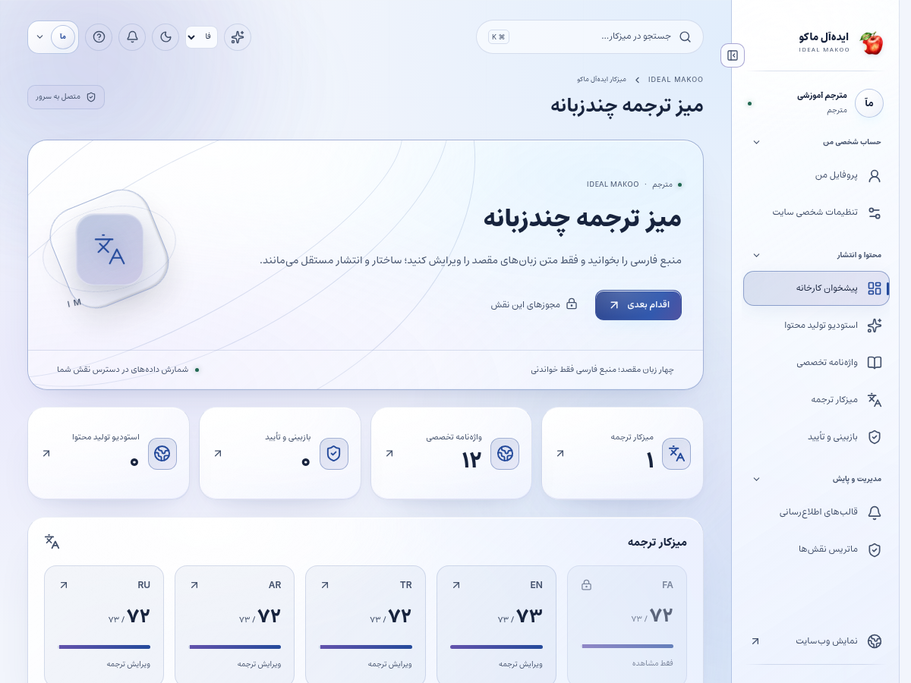
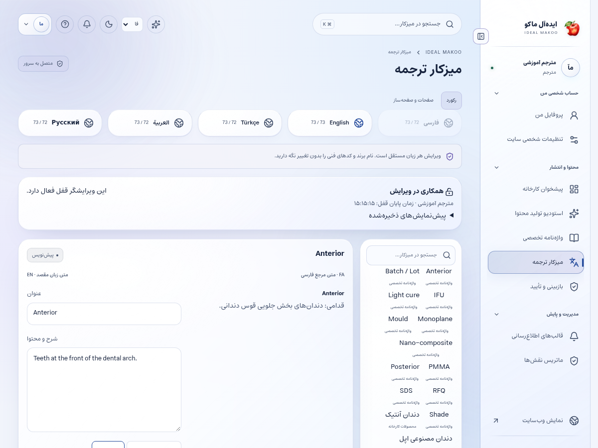

# راهنمای مترجم و مسئول زبان مقصد

نسخهٔ ۲٫۲ ایده‌آل ماکو | آموزش کاربر غیرمتخصص | ۲۶ اکتبر ۲۰۲۶

متن زبان‌های مقصد مجاز را با حفظ معنای منبع، کد، عدد، لینک و ساختار ترجمه می‌کنید. فارسی منبع خواندنی است و انتشار هر زبان گردش مستقل دارد.

## پیش از شروع

برای ورود، از نشانی رسمی سایت و حساب اختصاصی خود استفاده کنید. کارکنان باید علاوه بر رمز، مرحلهٔ MFA را کامل کنند. اگر حساب غیرفعال یا مجوز شما تغییر کرده باشد، ممکن است نیاز به ورود مجدد داشته باشید. یک دکمهٔ پنهان یا خطای دسترسی را با حساب همکار دور نزنید؛ موضوع را به مالک سامانه ارجاع دهید.

زبان رابط با زبان محتوای در حال ویرایش یکسان فرض نمی‌شود. در هر فرم به انتخابگر زبان محتوا توجه کنید. بعضی نقش‌ها فقط یک یا چند زبان مقصد دارند. در متن فارسی و عربی، نشانی اینترنتی و عدد و نام انگلیسی را در پیش‌نمایش کنترل کنید.

برای آشنایی با همان صفحه، علامت سؤال یا راهنمای زمینه‌ای را باز کنید. در آن راهنمای متناسب با نقش و صفحه قرار دارد. این کتابچه گردش کامل یک کار را توضیح می‌دهد و راهنمای زمینه‌ای برای یادآوری حین انجام کار مناسب است.

## صفحه‌های موردنیاز

| صفحه | مسیر |
| --- | --- |
| پیشخوان | `/fa/admin/` |
| ترجمه‌ها | `/fa/admin/translations/` |
| واژه‌نامه | `/fa/admin/glossary/` |
| بازبینی | `/fa/admin/reviews/` |
| قالب پیام | `/fa/admin/communications/` |
| هوش مصنوعی | `/fa/admin/ai/` |

مسیرهای جدول نسبت به دامنهٔ نصب شما هستند. برای زبان دیگر، بخش fa تغییر می‌کند. فقط صفحه‌ها و دکمه‌های مجاز حساب فعلی قابل استفاده‌اند.

شکل ۱ ـ پیشخوان همین نسخه با حساب آموزشی. اعداد این تصویر، آمار کسب‌وکار واقعی نیستند.

## گردش اصلی کار

### ترجمهٔ یک محصول یا صفحه و تحویل برای بازبینی

1. به میز ترجمه بروید. زبان مقصدی را انتخاب کنید که در حساب شما مجاز است؛ زبان رابط فارسی الزاماً زبان محتوای در حال ویرایش نیست.

2. محتوای موردنظر را پیدا کنید و نسخهٔ منبع و وضعیت ترجمه را ببینید. اگر منبع تغییر کرده، ترجمهٔ قبلی را بدون مقایسه تأیید نکنید.

3. عنوان و خلاصه را ترجمه کنید. عنوان باید برای مخاطب همان زبان طبیعی باشد و نام محصول را تغییر ندهد.

4. متن بلوک‌ها و برچسب دکمه‌ها را کامل کنید. بخشی که خالی مانده است با ترجمهٔ یک عنوان کامل نمی‌شود.

5. نام برند، کد قالب، عدد، واحد، لینک، ایمیل و قطعه‌کد را با منبع تطبیق دهید. ترتیب راست‌به‌چپ یا چپ‌به‌راست را جدا بررسی کنید.

6. از واژه‌نامهٔ مشترک برای اصطلاحات استفاده کنید. برای یک ماده یا قطعه در چند صفحه ترجمه‌های متناقض نسازید.

7. اگر ابزار ترجمهٔ AI داخل ویرایشگر فعال است، پیشنهاد همان منبع را بگیرید؛ این ابزار نسخهٔ منبع را بررسی می‌کند و قبل از اعمال باید تفاوت‌ها را بخوانید. دستیار عمومیِ نوار بالا جداست و متن مرجع را باید در درخواست آن بنویسید.

8. پیشنهاد منقضی یا مربوط به نسخهٔ قدیمی را دوباره تولید کنید. برای عبور از خطای نسخه، متن را کورکورانه روی اطلاعات تازه ننویسید.

9. ذخیره کنید و پاسخ موفق سرور را ببینید. سپس پیش‌نمایش همان زبان را باز کنید و شکست خط و چیدمان را کنترل کنید.

10. برای بازبینی ارسال کنید. به بازبین بگویید کدام اصطلاح یا عبارت نیاز به تأیید تخصصی دارد.

11. اگر قالب پیام را ترجمه می‌کنید، متغیرهای لینک و شمارهٔ پیگیری را حذف نکنید و طول پیام SMS را بررسی کنید.

12. بعد از انتشار نقش ناشر، لینک زبان مقصد را بررسی کنید. وجود زبان در کلید تغییر زبان به معنی انتشار همهٔ محتواهای آن زبان نیست.

شکل ۲ ـ بخش اصلی کار این نقش. نام حساب‌ها آموزشی است؛ اطلاعات مشتری یا رمز در تصویر درج نشده است.

## دسته‌بندی ترجمهٔ صفحه

در نمای صفحاتِ میز ترجمه، دسته‌بندی و برچسب‌های همان زبان مقصد قابل تکمیل‌اند. برای زیرگروه از / و برای جداکردن برچسب‌ها از ویرگول استفاده کنید؛ سقف دسته ۱۲۰ نویسه و برچسب‌ها ۲۰ موردِ حداکثر ۸۰ نویسه است. طبقه‌بندی تازه هم همراه همان نسخه بازبینی و منتشر می‌شود.

## منبع تازه و ترجمهٔ قدیمی

وضعیت تغییر منبع را دنبال کنید. ابتدا تغییر معنی‌دار را بخوانید، سپس بخش‌های متأثر را اصلاح کنید. تأیید خواندن منبع و ذخیرهٔ ترجمه جای انتشار را نمی‌گیرند.

## متن مختلط

در متن فارسی/عربی، URL، مدل محصول و اعداد انگلیسی باید قابل خواندن بمانند. در انگلیسی/ترکی/روسی نیز نشانی فارسی را حذف نکنید؛ نمایش را در پیش‌نمایش واقعی بررسی کنید.

## محدودیت زبان

اگر زبان موردنیاز در انتخابگر نیست، مالک باید مجوز را اصلاح کند. عوض‌کردن URL یا ارسال مستقیم درخواست، اختیار زبان جدید ایجاد نمی‌کند.

## ذخیره و وضعیت کار

در کارهای محتوایی ابتدا پیش‌نویس را ذخیره کنید، منتظر پاسخ موفق بمانید و بعد صفحه یا زبان را تغییر دهید. بعضی ویرایشگرها قفل همکاری دارند تا دو نفر هم‌زمان کار یکدیگر را بازنویسی نکنند. اگر پیام تغییر نسخه یا قفل مشاهده شد، متن خود را نگه دارید، با همکار هماهنگ کنید و نسخهٔ تازه را آگاهانه بارگذاری کنید.

وضعیت‌های رایج را جدا بدانید: draft یعنی کار ذخیره‌شده ولی آمادهٔ نمایش عمومی نیست؛ review یعنی در انتظار بررسی؛ approved یعنی نسخهٔ مشخص تأیید شده؛ scheduled یعنی در صف زمان‌بندی؛ published یعنی نسخهٔ همان زبان منتشر شده؛ archived یا withdrawn یعنی از مسیر عادی انتشار کنار رفته است. تغییر متن پس از تأیید ممکن است به بازبینی تازه نیاز داشته باشد.

## اعلان و پیگیری

اعلان داخلی را از زنگ پنل باز کنید و با لینک همان اعلان به پرونده بروید. برای هشدار ایمیل، پیامک یا تلگرام، سرویس باید توسط مالک تنظیم و کانال شخصی شما تأیید شده باشد. از حساب شخصی ← اعلان‌ها (/fa/account/notifications/) به تنظیمات کانال و رضایت موضوع‌ها بروید؛ این مسیر برای حساب کارکنان هم قابل استفاده است. شمارهٔ ذخیره‌شده در پروفایل به‌تنهایی مجوز ارسال به آن شماره نیست. اگر به پرونده‌ای دسترسی ندارید، انتظار هشدار محتوای خصوصی همان پرونده را نداشته باشید.

پیام کوتاه بیرونی فقط خلاصه و لینک امن را حمل می‌کند؛ تصمیم و پاسخ کامل در پنل ثبت می‌شود. وضعیت صف، شکست، لغو و پذیرش provider را جدا بخوانید. قبل از تکرار ارسال، علت وضعیت قبلی را بررسی کنید تا مخاطب پیام تکراری نگیرد.

## گزارش و مصرف سرویس

در پایین پیشخوان و در گزارش‌های مجاز، کارت «گزارش سایت و مصرف سرویس‌ها» را پیدا کنید. از دکمه‌های «بازدید و تعامل» و «مصرف API و هزینه» استفاده کنید. بازهٔ ۷، ۳۰ یا ۹۰ روز و زبان را مشخص کنید. بازدیدهای این نسخه به مرورگر، محتوا و بازهٔ ۳۰ دقیقه محدود می‌شوند و شمارش قطعی افراد یکتا نیستند. تعداد نظر تأییدشده از صف بررسی جداست.

گزارش مصرف برای مدیر ارشد، مدیر و تحلیلگر در محدودهٔ سازمانی و برای سایر کارکنان در محدودهٔ شخصی مجاز نشان داده می‌شود. هزینهٔ نامعلوم صفر نیست. پیامک با ریال و AI با دلار ممکن است گزارش شود؛ آن‌ها را بدون نرخ تبدیل و سیاست مالی با هم جمع نکنید. حالت accepted یعنی سرویس درخواست را پذیرفته است و خوانده‌شدن پیام توسط مخاطب را اثبات نمی‌کند.

## دستیار اختیاری هوش مصنوعی

دکمهٔ «کمک اختیاری هوش مصنوعی» در نوار بالای پنل است و فقط موضوع‌های مجاز نقش را نشان می‌دهد. موضوع و زبان مجاز را انتخاب کنید، درخواست روشن بنویسید و گزینهٔ رضایت ارسال متن و پرونده‌های انتخابی به ارائه‌دهنده را بخوانید و علامت بزنید؛ سپس «دریافت پیشنهاد» را بزنید. بدون تنظیم کلید/مدل سرویس توسط مالک، تولید غیرفعال است. برای محتوا، SEO، محصول یا راهنمای کار، متن مرجع را خودتان در درخواست بنویسید؛ صرف بازبودن یک صفحه باعث خواندن خودکار آن نمی‌شود. در موضوع مشتری، حداکثر پنج پروندهٔ مجاز را صریح انتخاب کنید تا سرور فقط همان دادهٔ مجاز را بخواند. موضوع تحلیل، آمار ۳۰ روز اخیر زبان انتخاب‌شده را اضافه می‌کند و به فیلتر فعلی جدول وابسته نیست. تولید، با فرمان شما مصرف ایجاد می‌کند. خروجی را بازخوانی کنید؛ پیشنهاد خودکار ذخیره، منتشر، تأیید یا برای مشتری ارسال نمی‌شود. توقف درخواست ممکن است مصرفی را که قبلاً نزد ارائه‌دهنده انجام شده برنگرداند.

نمونهٔ درخواست مناسب:

این متن را به زبان مقصد انتخاب‌شده ترجمه کن؛ کدها، اعداد، واحدها، لینک‌ها و نام برند عین منبع بمانند و عبارت نامطمئن را مشخص کن.

## خطاهای رایج و اقدام درست

| نشانه | اقدام |
| --- | --- |
| ورود دوباره خواسته می‌شود | نشست منقضی، حساب غیرفعال یا اختیار تغییر کرده است. متن ذخیره‌نشده را نگه دارید، با حساب خود وارد شوید و در صورت تکرار به مدیر اطلاع دهید. |
| این کار مجاز نیست یا زبان قابل انتخاب نیست | نام نقش، زبان و محدودهٔ پرونده را بررسی کنید. از مالک اصلاح اختیار لازم را بخواهید؛ نقش بالاتر را صرفاً برای دورزدن خطا درخواست نکنید. |
| نسخه تغییر کرده یا ویرایشگر قفل است | همکار دیگری داده را تغییر داده یا قفل معتبر دارد. پیش‌نویس خود را نگه دارید، هماهنگ کنید و نسخهٔ سرور را دوباره بارگذاری کنید. |
| تعداد درخواست زیاد است | محدودیت زمانی برای جلوگیری از سوءاستفاده فعال شده است. زمان اعلام‌شده را صبر کنید و درخواست را پیاپی تکرار نکنید. |
| سرویس تنظیم نشده یا پیام ارسال نشد | کلید، قالب، کانال تأییدشده و سلامت worker باید توسط نقش مجاز بررسی شوند. وضعیت ناموفق را موفق فرض نکنید و کلید را داخل متن خطا نفرستید. |
| محتوا در جست‌وجو پیدا نمی‌شود | نوع، دسته و زبان را بررسی کنید. draft، ترجمهٔ منتشرنشده، محتوای پس‌گرفته‌شده یا سند خصوصی در جست‌وجوی عمومی نمی‌آید. |

## تمرین پایان آموزش

۱. مسیر «ترجمهٔ یک محصول یا صفحه و تحویل برای بازبینی» را با دادهٔ آموزشی و بدون ارسال ناخواسته به افراد واقعی مرور کنید.

۲. نشان دهید نتیجهٔ کار کجا روی سرور ثبت می‌شود و چه تفاوتی با متن ذخیره‌نشده در مرورگر دارد.

۳. یک خطای دسترسی یا وضعیت انتظار را توضیح دهید و مسیر ارجاع درست را انتخاب کنید.

۴. گزارش یا صفحهٔ نتیجه را دوباره باز کنید و مطمئن شوید اطلاعات درست، زبان درست و وضعیت درست دیده می‌شود.

## تحویل کار به نقش بعدی

نویسنده برای رفع ابهام منبع، بازبین برای صحت تخصصی و ناشر برای انتشار زبان مقصد.

## حدود اختیار

مترجم منبع فارسی را تغییر نمی‌دهد، نقش جدید نمی‌سازد و ترجمه را بدون اختیار ناشر عمومی نمی‌کند.

## چک‌لیست پایان روز

- کارهای ذخیره‌نشده را تعیین تکلیف کنید و پاسخ موفق سرور را ببینید.
- درخواست یا وظیفهٔ باز را بدون مسئول و اقدام بعدی رها نکنید.
- پیام خطا یا ارسال ناموفق را با اطلاعات لازم و بدون رمز/کلید گزارش کنید.
- روی دستگاه مشترک از حساب خارج شوید.
- برای کار بعدی از راهنمای همان نقش و بخش کمک بگیرید.

## راهنماهای مرتبط

- [سند تفصیلی توسعه](../EXPANSION-SPEC-2.2.fa.md)
- [برنامهٔ اجرا](../IMPLEMENTATION-PLAN-2.2.fa.md)
- [شروع نصب و استفاده](../START-HERE-2.2.0.fa.md)
- [سرویس‌ها و DNS و SEO](../INSTALL-SERVICES-SEO-2.2.fa.md)
- [گزارش آزمون این نسخه](../VERIFICATION-2.2.0.fa.md)
